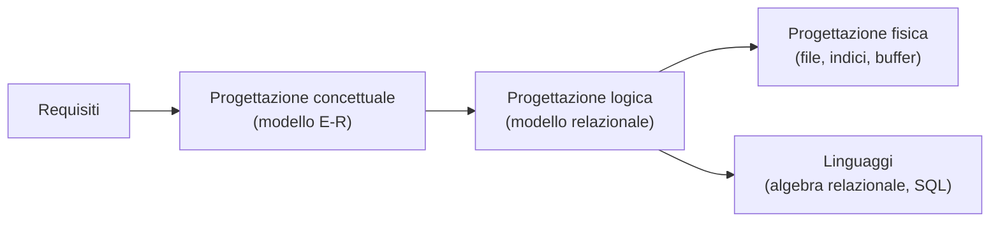

# Basi di dati — Indice degli appunti (slides 2k27)

Appunti ricavati dalle slides della cartella `sliedes2k27` (a.a. 2026/27), organizzati per argomento seguendo il percorso della progettazione e dell'uso di una base di dati.

## 1. Modello relazionale
- [[Modello relazionale]] — modelli logici, relazioni, tabelle, NULL, vincoli di integrità, superchiavi/chiavi/chiave primaria, chiavi esterne, azioni compensative
- [[Feedback 2 - Modello relazionale e vincoli]] — ripasso: cos'è il modello relazionale, vincoli intra/inter-relazionali, K / SK / FK / PK, `CHECK`

## 2. Algebra relazionale
- [[Algebra relazionale]] — DDL/DML, selezione, proiezione, ridenominazione, operatori insiemistici, join (naturale, esterno, theta), prodotto cartesiano, esempi, doppia negazione, equivalenza, NULL, viste

## 3. SQL
- [[SQL - Definizione dei dati (DDL)]] — storia, `CREATE TABLE`, vincoli, politiche di reazione (`cascade`, `set null`…), modifiche agli schemi, indici
- [[SQL - Interrogazioni e aggiornamenti (DML)]] — `SELECT`, `LIKE`, NULL, `distinct`, join espliciti ed esterni, `union`/`except`/`intersect`, query nidificate, `EXISTS`, query correlate, aggregati, `GROUP BY`/`HAVING`, `INSERT`/`DELETE`/`UPDATE`

## 4. Progettazione concettuale
- [[Modello Entity-Relationship]] — sistema informativo, ciclo di vita, metodologia, modelli dei dati, entità, attributi, cardinalità, identificatori, associazioni (binarie, ricorsive, n-arie), entità deboli
- [[Modello ER esteso]] — IS-A, generalizzazioni/specializzazioni, esercizio, schema aziendale, dizionario dei dati, vincoli non esprimibili

## 5. Organizzazione fisica (Prof. Pellegrini)
- [[Organizzazione fisica dei dati]] — architettura DBMS, memoria, pagine e record, heap/ordinati/hash file, modello di costo, indici, B⁺-tree
- [[Buffer Manager]] — buffer pool, fix/unfix/use/force/flush, politiche di rimpiazzo (LRU, clock, MRU), steal/force

## 6. Progetto
- [[Esercitazione finale - Report di progetto (esempio voli)]] — esempio completo di report: analisi dei requisiti, E-R, progettazione logica (volumi, operazioni, costi), progettazione fisica (tabelle, indici, trigger, stored procedure)

---

> [!tip] Come usare questi appunti in Obsidian
> - Le formule sono in LaTeX (`$…$`), i diagrammi in **Mermaid**: entrambi sono resi nativamente da Obsidian (modalità lettura/anteprima).
> - Usa la vista **Grafo** per vedere i collegamenti tra gli argomenti e il pannello **Struttura** (outline) per navigare dentro ogni nota.
> - I tag (`#basi-di-dati`, `#sql`, …) sono nel frontmatter di ogni nota.
