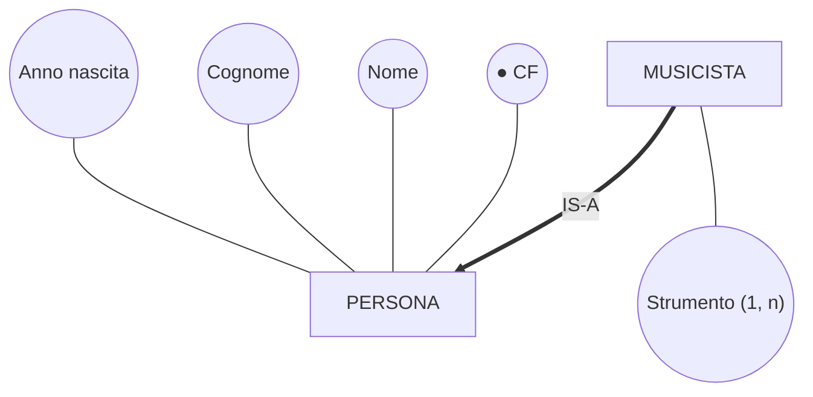
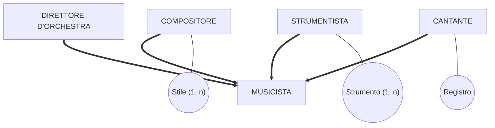
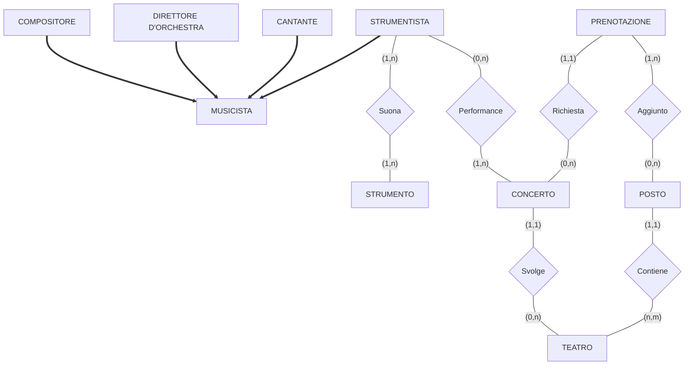
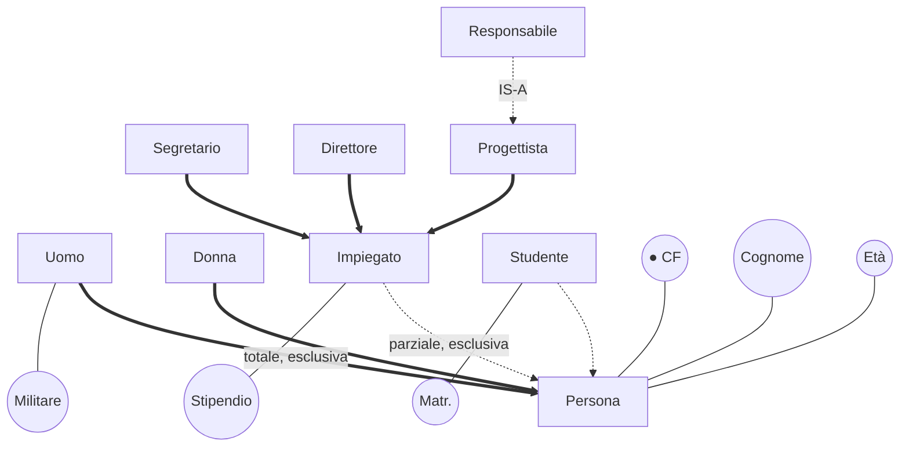
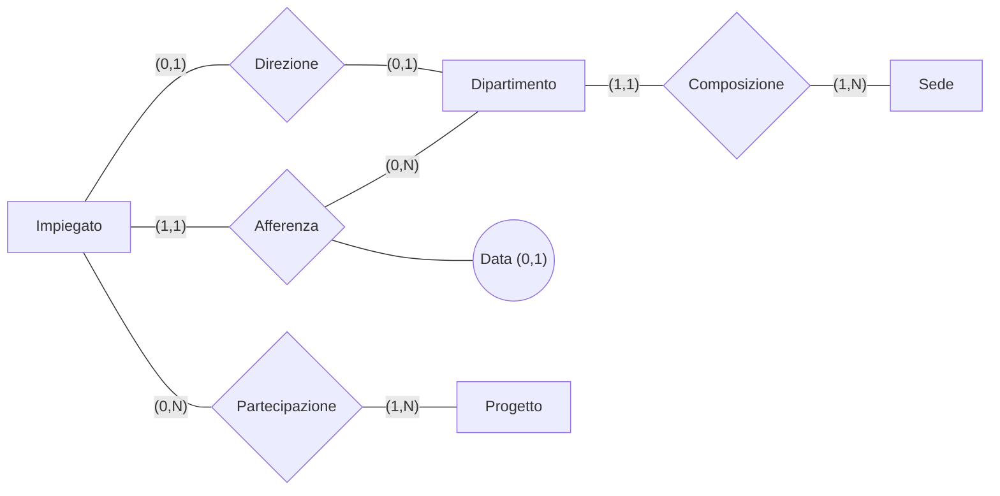
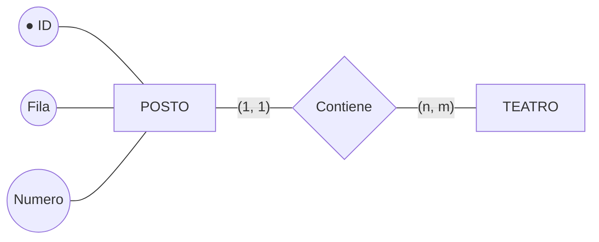

# Modello E-R esteso

> [!info] Fonte
> Slides *"Progettazione di basi di dati: metodologie e modelli per il progetto — modello E-R esteso"* — Prof. Vittoria de Nitto Personè (a.a. 2026/27).
> Prerequisito: [[Modello Entity-Relationship]]. Continua in: [[Progettazione concettuale - Metodologia e strategie]] · [[Progettazione logica - Ristrutturazione dello schema E-R]]. Collegamenti: [[00 Indice|Indice]]

---

## 1. Relazione IS-A tra entità

- **PERSONA**: **entità super-insieme** / **entità padre**
- **MUSICISTA**: **entità sotto-insieme** / **entità figlia**
- **Principio di ereditarietà**: l'entità figlia **eredita** tutti gli attributi (e l'identificatore e le associazioni) dell'entità padre; ha in più i propri (Strumento).

### Vista estensionale
Ogni occorrenza di MUSICISTA è anche occorrenza di PERSONA (insieme contenuto):
- PERSONA (non musicisti): p2 (CF2, Ciro, Esposito, 1989), p4 (CF4, Giovanni, Ferrari, 1992)
- MUSICISTA ⊆ PERSONA: p1 (CF1, Mario, Rossi, 1976, Pianoforte), p5 (CF5, Alberto, Bianchi, 1984, {Pianoforte, Sax}), p3 (CF3, Alessandro, Verdi, 1954, Chitarra)

### Relazione IS-A a catena
COMPOSITORE IS-A MUSICISTA IS-A PERSONA: le relazioni IS-A possono essere concatenate (COMPOSITORE eredita da MUSICISTA, che eredita da PERSONA).

---

## 2. Generalizzazione e specializzazione
Un'entità padre (**generalizzazione**) con più entità figlie (**specializzazioni**):

MUSICISTA(**CF**, Nome, Cognome, Anno nascita); COMPOSITORE ha Stile (1, n); STRUMENTISTA ha Strumento (1, n); CANTANTE ha Registro.

Proprietà di una generalizzazione:
- **totale**: ogni occorrenza del padre è occorrenza di almeno una figlia;
  **parziale**: possono esistere occorrenze del padre che non appartengono a nessuna figlia;
- **esclusiva**: ogni occorrenza del padre appartiene al più a una figlia;
  **sovrapposta**: un'occorrenza può appartenere a più figlie.

> [!note] Notazione grafica (dalle slides)
> - **freccia piena** (nera) → generalizzazione **totale**;
> - **freccia vuota** (bianca) → generalizzazione **parziale**.

### Schema completo (esempio musicisti)
- MUSICISTA (CF, Nome, Cognome, Anno nascita) con generalizzazione **totale** in COMPOSITORE (Stile (1,n)), DIRETTORE D'ORCHESTRA, STRUMENTISTA, CANTANTE (Registro);
- STRUMENTISTA —(1,n)— **Suona** (Anno inizio) —(1,n)— STRUMENTO(**Nome**, Tipo);
- STRUMENTISTA —(0,n)— **Performance** —(1,n)— CONCERTO(Descrizione; identificatore **Data + TEATRO**);
- PRENOTAZIONE(**Numero**) —(1,1)— **Richiesta** —(0,n)— CONCERTO;
- CONCERTO —(1,1)— **Svolge** —(0,n)— TEATRO(**Nome**, Indirizzo);
- PRENOTAZIONE —(1,n)— **Aggiunto** —(0,n)— POSTO;
- POSTO(**Fila, Numero** + TEATRO) —(1,1)— **Contiene** —(n,m)— TEATRO (entità debole).

---

## 3. Esercizio (generalizzazioni)
> [!example] Testo
> Le persone hanno **CF, cognome ed età**; gli **uomini** anche la **posizione militare**; gli **impiegati** hanno lo **stipendio** e possono essere **segretari, direttori o progettisti** (un progettista può essere anche **responsabile di progetto**); gli **studenti** (che **non possono essere impiegati**) un **numero di matricola**; esistono persone che **non sono né impiegati né studenti** (ma i dettagli non ci interessano).

### Soluzione

- **Persona** (CF ●, Cognome, Età)
  - generalizzazione **totale** (freccia piena) in **Uomo** (Militare) e **Donna**;
  - generalizzazione **parziale** (freccia vuota) in **Impiegato** (Stipendio) e **Studente** (Matr.) — esclusiva, perché gli studenti non possono essere impiegati; parziale, perché esistono persone né impiegati né studenti;
- **Impiegato** → generalizzazione **totale** (freccia piena) in **Segretario**, **Direttore**, **Progettista**;
- **Responsabile** IS-A **Progettista** (sottoinsieme, freccia vuota).

---

## 4. Esempio di schema aziendale

- **Impiegato**: Codice ●, Cognome
- **Dipartimento**: Nome ● + Sede (identificatore esterno, tramite Composizione), Telefono (1,N)
- **Progetto**: Nome ●, Budget
- **Sede**: Città ●, Indirizzo (composto: Via, CAP)
- Direzione: Impiegato (0,1) — Dipartimento (0,1)
- Afferenza: Impiegato (1,1) — Dipartimento (0,N); attributo Data (0,1)
- Partecipazione: Impiegato (0,N) — Progetto (1,N)
- Composizione: Dipartimento (1,1) — Sede (1,N)

### Attenzione
> [!warning] Differenze apparentemente piccole in **cardinalità** e **identificatori** possono **cambiare di molto il significato**…

**Variante 1** (slide 30): Composizione con Dipartimento **(1,N)** e Sede **(1,1)**, e l'identificatore esterno spostato su **Sede** (Città + Dipartimento) → ora è la sede ad appartenere a un unico dipartimento (e ogni dipartimento ha più sedi), invece del contrario.

**Variante 2** (slide 31): Impiegato con anche **Stipendio**; Direzione con Impiegato (0,1) e Dipartimento **(1,1)** (ogni dipartimento **deve** avere un direttore); Afferenza con Impiegato **(0,1)** (un impiegato può non afferire a nessun dipartimento); Composizione Dipartimento (1,1) — Sede (1,N), Dipartimento identificato da Nome + Sede.

---

## 5. Documentazione: dizionario dei dati

### Dizionario dei dati (entità)
| Entità | Descrizione | Attributi | Identificatore |
|---|---|---|---|
| Impiegato | Dipendente dell'azienda | Codice, Cognome, Stipendio | Codice |
| Progetto | Progetti aziendali | Nome, Budget | Nome |
| Dipartimento | Struttura aziendale | Nome, Telefono | Nome, Sede |
| Sede | Sede dell'azienda | Città, Indirizzo | Città |

### Dizionario dei dati (relationship)
| Associazione | Descrizione | Componenti | Attributi |
|---|---|---|---|
| Direzione | Direzione di un dipartimento | Impiegato, Dipartimento | |
| Afferenza | Afferenza a un dipartimento | Impiegato, Dipartimento | Data |
| Partecipazione | Partecipazione a un progetto | Impiegato, Progetto | |
| Composizione | Composizione dell'azienda | Dipartimento, Sede | |

---

## 6. Vincoli non esprimibili
Alcuni vincoli **non possono essere espressi** con i costrutti del modello E-R e vanno documentati a parte:

| Vincoli di integrità sui dati |
|---|
| (1) Il direttore di un dipartimento deve afferire a tale dipartimento |
| (2) Un impiegato non deve avere uno stipendio maggiore del direttore del dipartimento al quale afferisce |
| (3) Un dipartimento con sede a Roma deve essere diretto da un impiegato con più di dieci anni di anzianità |
| (4) Un impiegato che non afferisce a nessun dipartimento non deve partecipare a nessun progetto |

### A proposito di vincoli non esprimibili…
**Entità debole: identificatore esterno** — POSTO (Fila ●, Numero ● + TEATRO) —(1,1)— Contiene —(n,m)— TEATRO (Nome ●, Indirizzo).

**Trasformazione di entità debole in entità forte** — POSTO riceve un nuovo identificatore interno **ID** (codice artificiale); Fila e Numero diventano attributi semplici:

→ ma in questo modo il vincolo "non possono esistere due posti con stessa Fila e Numero nello stesso teatro" **non è più espresso** nello schema e diventa un **vincolo non esprimibile** da documentare.
