# Progettazione di basi di dati: metodologie e modello Entity-Relationship

> [!info] Fonte
> Slides *"Progettazione di basi di dati: metodologie e modelli per il progetto"* — Prof. Vittoria de Nitto Personè (a.a. 2026/27).
> Continua in: [[Modello ER esteso]] · [[Progettazione concettuale - Metodologia e strategie]]. Collegamenti: [[Modello relazionale]] · [[00 Indice|Indice]]

> [!tip] Notazione dei diagrammi in questa nota
> Nei diagrammi Mermaid: **rettangolo** = entità, **rombo** = associazione (relationship), **cerchio** = attributo; `●` = attributo identificatore, `○` = attributo semplice. Le cardinalità sono scritte sulle linee.

---

## 1. Dove siamo

Abbiamo visto:
- **modello relazionale** → le modalità di "descrizione" e manipolazione di una BD **supponendo che esista già**;
- **linguaggi**: algebra relazionale e SQL.

**Ora affrontiamo il problema della progettazione.**

## 2. Sistema informativo nelle organizzazioni
Schema: l'**organizzazione**, immersa nell'**ambiente esterno**, è composta da
- **sistema decisionale** (in alto),
- **sistema informativo** (al centro): riceve **informazioni** e **dati esterni**, fornisce informazioni al sistema decisionale,
- **sistema produttivo** (con i suoi **sottosistemi**): riceve **risorse**, produce **beni o servizi**;
- le **decisioni** scendono dal sistema decisionale verso il sistema produttivo.

Progettare il sistema informativo significa:
- **progettazione dei dati**
- **progettazione delle applicazioni**

## 3. Ciclo di vita dei sistemi informativi
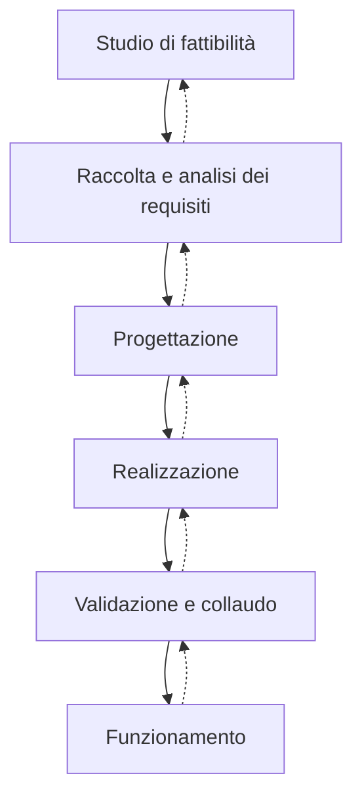
(ciclo "a cascata" con possibilità di ritorno alla fase precedente; la fase evidenziata è la **Progettazione**)

## 4. Metodologia di progetto
Per garantire prodotti di **buona qualità** è opportuno seguire una **metodologia di progetto**, con:
- **articolazione delle attività in fasi**
- **criteri di scelta**
- **modelli di rappresentazione**
- **generalità e facilità d'uso**

### Le fasi della progettazione
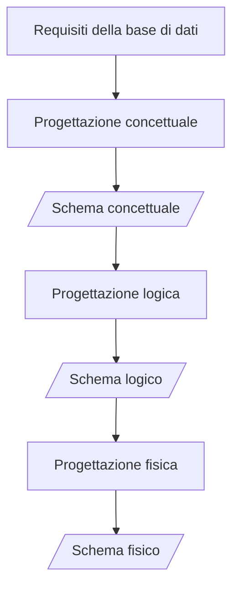
- **"CHE COSA"** → **analisi** (progettazione concettuale)
- **"COME"** → **progettazione** (logica e fisica)

| Fase | Modello |
|---|---|
| Progettazione concettuale | **Entity-Relationship** |
| Progettazione logica | **Modello relazionale** |
| Progettazione fisica | (strutture di memorizzazione, vedi [[Organizzazione fisica dei dati]]) |

---

## 5. Modello dei dati
> [!abstract] Def. Modello dei dati
> **Astrazione dei dati** che permette di definire le proprietà degli oggetti di interesse per la BD e le relazioni fra questi oggetti, dando la possibilità di **nascondere i dettagli dell'implementazione**.

Dipende dal **livello di astrazione** che si vuole descrivere:
- **modello concettuale**
- **modello logico**
- **modello fisico**

- **Componente fondamentale**: **meccanismi di strutturazione** (o **costruttori di tipo**).
- Come nei linguaggi di programmazione esistono meccanismi che permettono di definire nuovi tipi, così **ogni modello dei dati prevede alcuni costruttori**.

| Modello | Caratteristiche | Esempi |
|---|---|---|
| **concettuale** | rappresentare i dati in modo **indipendente da ogni sistema**; descrivere i **concetti del mondo reale**; usato nelle **fasi preliminari** di progettazione | **Entity-Relationship** |
| **logico** | **organizzazione dei dati**; utilizzati dai **programmi**; **indipendenti dalle strutture fisiche** | **relazionale**, reticolare, gerarchico, a oggetti |
| **fisico** | strutture di memorizzazione | — |

---

## 6. Il modello Entity-Relationship (Entità-Relazione)
- È il **più diffuso modello concettuale**.
- Ne esistono **molte versioni**, (più o meno) diverse l'una dall'altra.
- Riferimento: P.P. Chen, *"The entity-relationship model – toward a unified view of data"*, ACM Transactions on Database Systems (TODS) 1, 1 (March 1976), pp. 9-36. http://doi.acm.org/10.1145/320434.320440

### Costrutti principali
| Costrutto | Rappresentazione grafica |
|---|---|
| Entità | rettangolo |
| Associazione (relationship) | rombo |
| Attributo semplice | cerchio vuoto ○ |
| Attributo identificatore | cerchio pieno ● |
| Attributo composto | ovale da cui partono i sotto-attributi |
| Generalizzazione / IS-A | freccia (vedi [[Modello ER esteso]]) |

---

## 7. Entità

### Rappresentazione intensionale (schema)
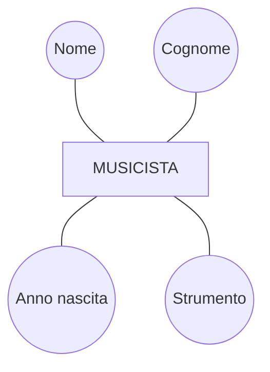
→ lo **schema**: l'entità MUSICISTA con attributi Nome, Cognome, Anno nascita, Strumento.

### Rappresentazione estensionale, insiemistica (istanza)
L'entità è un **insieme di occorrenze** (istanza):
- m1 (Mario, Rossi, 1976, Pianoforte)
- m2 (Alberto, Bianchi, 1984, Sax)
- m3 (Alessandro, Verdi, 1954, Chitarra)

### Entità con attributo composto
`Indirizzo` è un **attributo composto** da `Via`, `Numero`, `Città`.
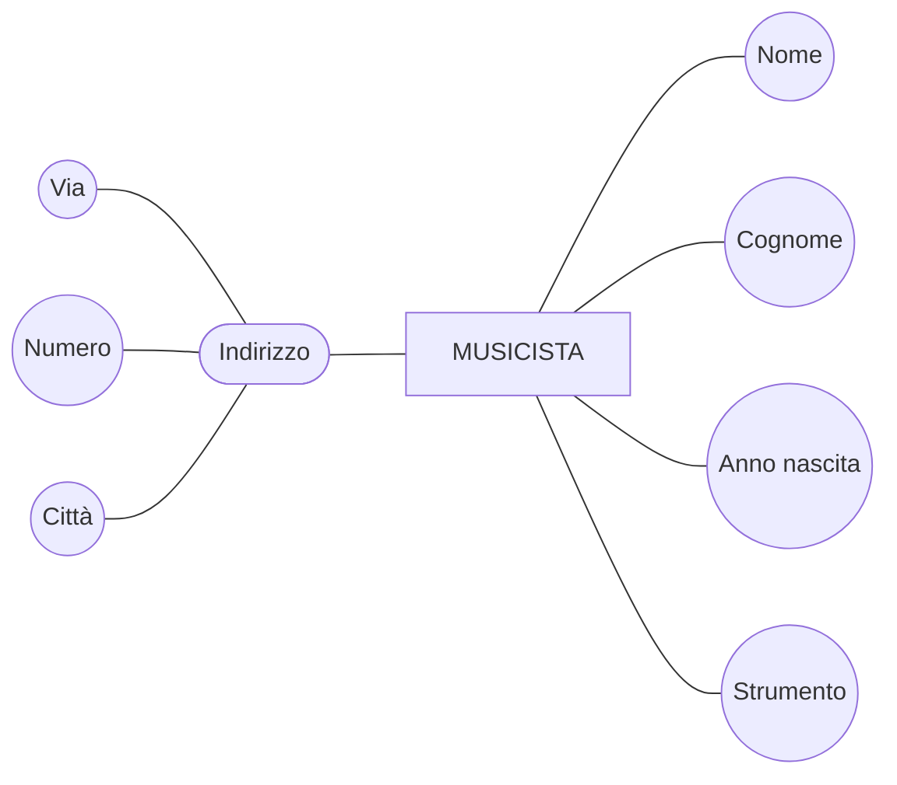

### Cardinalità di attributi
| Attributo | Cardinalità | Significato |
|---|---|---|
| Nome, Cognome, Anno nascita | (1, 1) | **semplici** (obbligatori, monovalore) — è il default |
| Indirizzo | (0, 1) | **opzionale** |
| Strumento | (1, n) | **multivalore** (un musicista può suonare più strumenti) |

Esempio di istanza con questi attributi:
- m1 (Mario, Rossi, 1976, [Via Garibaldi, 12, Padova], {Pianoforte, Chitarra})
- m2 (Alberto, Bianchi, 1984, **null**, Sax)
- m3 (Alessandro, Verdi, 1954, [Via Roma, 1a, Milano], {Chitarra, Basso, Flauto})

---

## 8. Identificatore di un'entità
Problema: aggiungendo m4 (Mario, Gialli, 1980, Sax) e m5 (Giorgio, Bianchi, 1976, Pianoforte), nessun attributo (es. Nome, Cognome) è sufficiente da solo a distinguere le occorrenze.

> [!abstract] Def. Identificatore di un'entità
> "**Strumento**" per l'**identificazione univoca delle occorrenze** di un'entità.
> È costituito da:
> - **attributi dell'entità** → **identificatore interno**
> - **(attributi +) entità esterne attraverso relationship** → **identificatore esterno**

### Chiave: identificatori interni
- MUSICISTA: identificatore **CF** (cerchio pieno ●).
- CORSO DI LAUREA: identificatore composto da **Nome + Università** (linea che unisce i due attributi, terminata da un pallino pieno): nessuno dei due da solo identifica il corso.

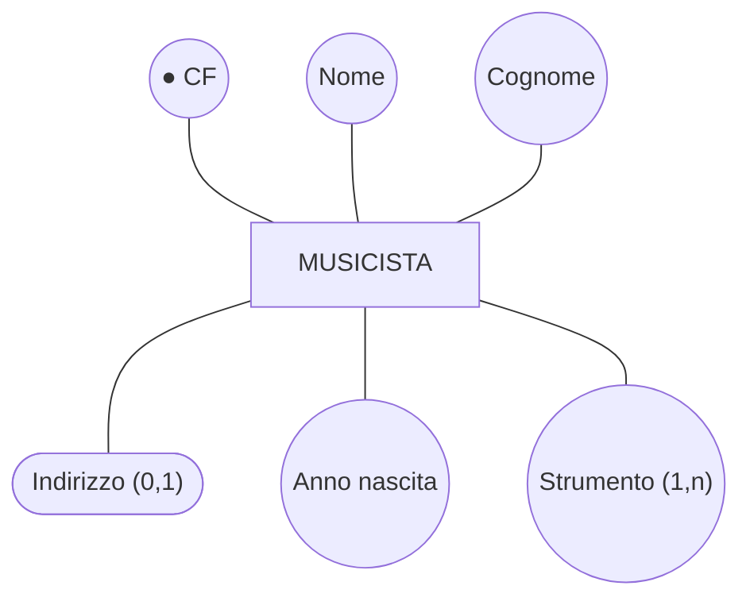

---

## 9. Associazioni (relationship)

### Visione della realtà 1
Lo strumento è un **attributo** multivalore di MUSICISTA, e separatamente esiste un'entità STRUMENTO(**Nome**, Tipo) — le due cose non sono collegate.

### Visione della realtà 2
Lo strumento diventa un'**entità**, collegata a MUSICISTA tramite l'**associazione** *Suona*:
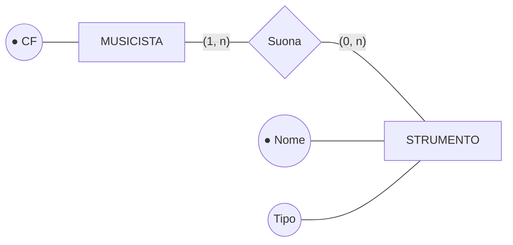

### Cardinalità delle associazioni — vincoli di partecipazione
- MUSICISTA partecipa a *Suona* con **(1, n)** → partecipazione **totale** (ogni musicista suona almeno uno strumento)
- STRUMENTO partecipa con **(0, n)** → partecipazione **parziale** (possono esistere strumenti non suonati da nessuno)

Formato **(min, max)**: min = 0 → partecipazione **opzionale/parziale**; min = 1 → **obbligatoria/totale**; max = 1 o n (N).

### Rappresentazione estensionale
L'associazione è un **insieme di coppie** di occorrenze: ogni occorrenza r1, r2, r3, r4 di *Suona* collega un musicista (m1, m2, m3) a uno strumento (s1, s2, s3, s4). Uno strumento (s2) può non essere collegato a nessuno (partecipazione parziale).

### Relationship "molti a molti"
| Entità A | card. A | Associazione | card. B | Entità B |
|---|---|---|---|---|
| Studente | (0,N) | Esame | (0,N) | Corso |
| Montagna | (0,N) | Scalata | (1,N) | Alpinista |
| Macchinista | (1,N) | Abilitazione | (1,N) | Locomotore |

### Relationship "uno a molti"
| Entità A | card. A | Associazione | card. B | Entità B |
|---|---|---|---|---|
| Persona | (0,1) | Impiego | (0,N) | Azienda |
| Cinema | (1,1) | Ubicazione | (0,N) | Località |
| Comune | (1,1) | Ubicazione | (1,N) | Provincia |

### Relationship "uno a uno"
| Entità A | card. A | Associazione | card. B | Entità B |
|---|---|---|---|---|
| Professore | (0,1) | Titolarità | (0,1) | Cattedra |
| Professore di ruolo | (1,1) | Titolarità | (0,1) | Cattedra |
| Professore di ruolo | (1,1) | Titolarità | (1,1) | Cattedra coperta |

### Attributi delle associazioni
Un'associazione può avere attributi: *Suona* ha l'attributo **Anno inizio** (l'anno in cui *quel* musicista ha iniziato a suonare *quello* strumento: non appartiene né al musicista né allo strumento).
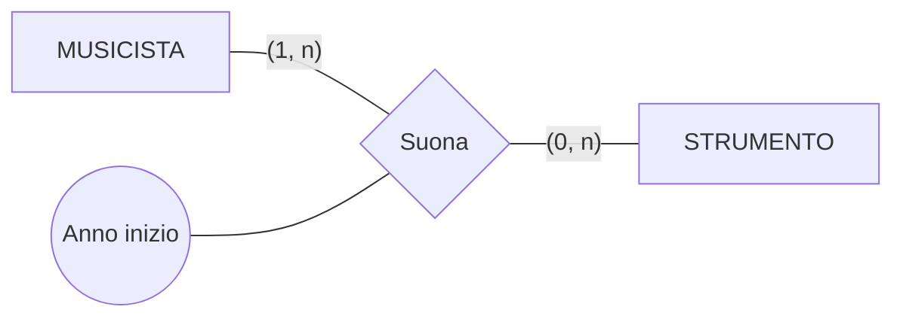

---

## 10. Associazioni ricorsive
Associazione tra un'entità e **sé stessa**.

**Simmetrica** — MUSICISTA *Suona con* MUSICISTA, entrambi i rami (0, n):
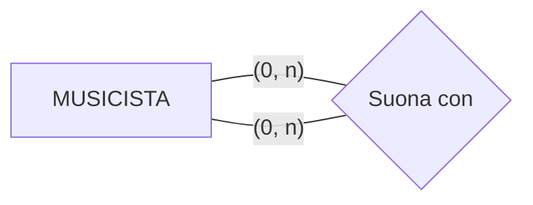

**Non simmetrica** — PERSONA *Genitore* PERSONA, con **ruoli** distinti:
- ruolo **Figli**: (0, n)
- ruolo **Padre/Madre**: (0, 2)
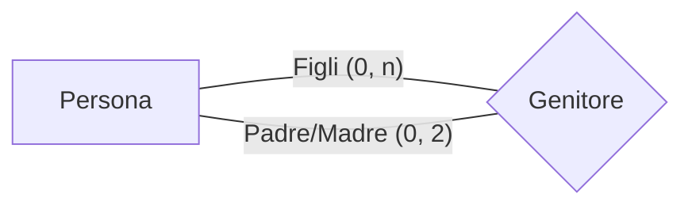

### Estensione di un'associazione ricorsiva non simmetrica
- p1 ha due figli p2 e p3: (p1, p2), (p1, p3)
- p3 è padre di p5: (p3, p5)
- p4 è madre di p5: (p4, p5)
- p2, p5 non hanno figli
- p1 e p4 non hanno genitori

Le occorrenze r1…r4 di *Genitore* sono coppie ordinate (genitore, figlio), in cui ogni elemento ha un **ruolo** (Padre/Madre, Figlio).

---

## 11. Associazioni n-arie

### Associazione ternaria
MUSICISTA —(1, n)— **Registra** —(1, n)— STRUMENTO, e **Registra** —(1, n)— BRANO(**ID**, Titolo).
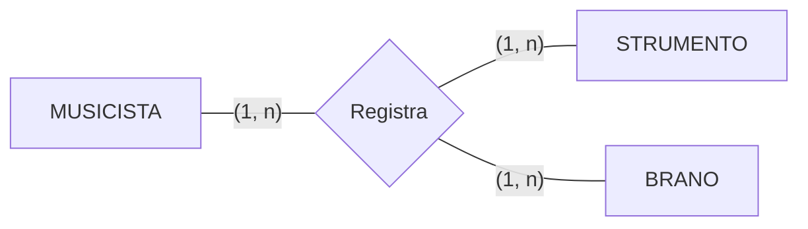
Estensionalmente ogni occorrenza di *Registra* è una **terna** (musicista, strumento, brano).

### Relationship ternaria e binaria
Nello stesso schema possono coesistere *Suona* (binaria, con Anno inizio; MUSICISTA (1, n), STRUMENTO (0, n)) e *Registra* (ternaria; qui con MUSICISTA (0, n), STRUMENTO (0, n), BRANO (1, n)): rappresentano fatti diversi.

### Trasformazione di associazioni: da n-arie a binarie
PROGETTO(**Nome**) —(1, n)— **Lavora** —(1, n)— SEDE(**Città**), e **Lavora** —**(1, 1)**— IMPIEGATO(**Matricola**).

Poiché IMPIEGATO partecipa con **(1, 1)**, la ternaria si può scomporre in binarie. Tre casi:

**CASO 1**: il progetto ha una sola sede e l'impiegato lavora su un solo progetto
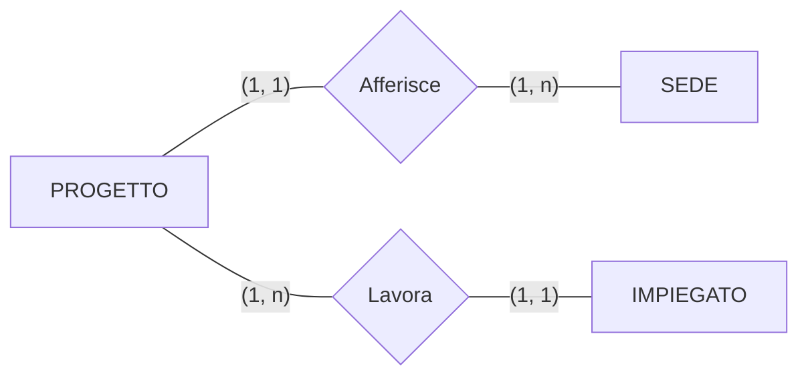

**CASO 2**: la sede ha un solo progetto e l'impiegato lavora su una sola sede
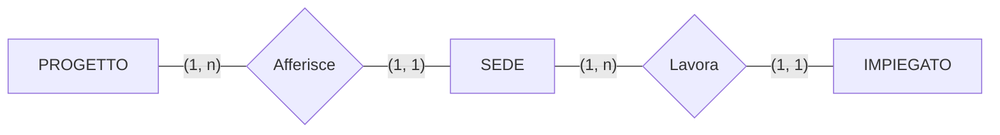

**CASO 3**: l'impiegato lavora in un solo progetto e in una sola sede
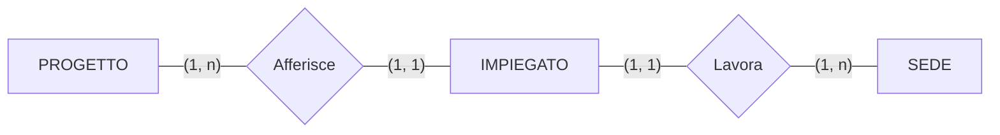

---

## 12. Identificatore esterno — Entità debole

### Esempio: POSTO e TEATRO
- POSTO con identificatore interno (**Fila, Numero**): ma la stessa fila/numero esiste in teatri diversi → non basta.
- Si potrebbe aggiungere l'attributo **Teatro** all'identificatore (Teatro, Fila, Numero) accanto a un'entità TEATRO(**Nome**, Indirizzo) — ma così il legame tra posto e teatro non è rappresentato nello schema.

Istanze:
- POSTO: p1 (Verdi, A, 3), p2 (Verdi, A, 4), p3 (Olimpico, A, 3), p4 (Olimpico, B, 4), **p5 (La Scala, C, 1)**
- TEATRO: t1 (Verdi, indirizzo1), t2 (Olimpico, indirizzo2), t3 (La Fenice, indirizzo3)
→ p5 fa riferimento a un teatro (**La Scala**) **che non esiste** in TEATRO: nulla lo impedisce.

### Soluzione: entità debole con identificatore esterno
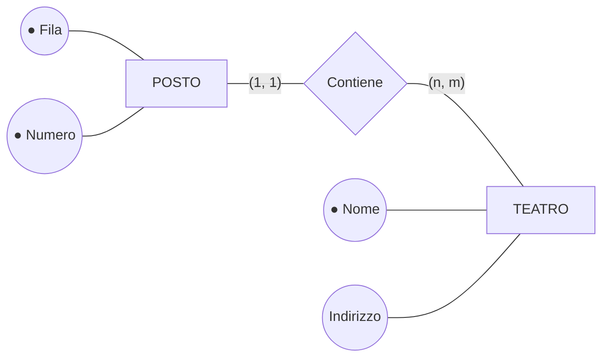
L'identificatore di POSTO è **{Fila, Numero} + TEATRO** (attraverso *Contiene*). Ora p5 (La Scala, C, 1) non può esistere senza un'occorrenza di TEATRO a cui sia collegato.

> [!abstract] Identificatore esterno — Entità debole
> - L'identificatore è formato dall'**identificatore dell'entità alla quale è collegata** (mediante associazione) e da **eventuali attributi dell'entità debole**.
> - Graficamente: tutti gli attributi coinvolti nell'identificazione vengono attraversati da un **segmento (con pallino nero)** che prosegue fino a **tagliare il segmento che collega l'entità debole all'associazione**.
> - La partecipazione dell'entità debole all'associazione che la lega all'entità che la identifica **deve essere (1,1)**.

### Esempio: Studente e Università
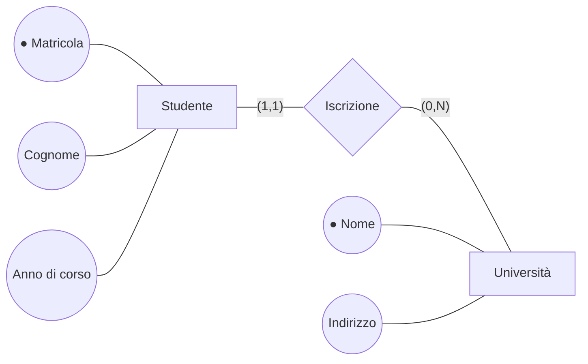
Lo studente è identificato da **Matricola + Università** (la stessa matricola può esistere in università diverse).

Riprende in: [[Modello ER esteso#6. Vincoli non esprimibili]] (trasformazione di entità debole in entità forte).
