# Progettazione concettuale: metodologia e strategie

> [!info] Fonte
> Slides *"Progettazione concettuale"* — Prof. Vittoria de Nitto Personè (a.a. 2026/27).
> Prerequisiti: [[Modello Entity-Relationship]] · [[Modello ER esteso]]. Prosegue in: [[Progettazione logica - Ristrutturazione dello schema E-R]]. Collegamenti: [[00 Indice|Indice]]

> [!tip] Notazione dei diagrammi in questa nota
> Nei diagrammi Mermaid: **rettangolo** = entità, **rombo** = associazione (relationship), **cerchio** = attributo. Le cardinalità sono etichette sulle linee.

---

## 1. Collocazione nella metodologia

La progettazione concettuale è la fase della progettazione che si colloca dentro il **ciclo di vita** dei sistemi informativi (studio di fattibilità → raccolta e analisi dei requisiti → **progettazione** → realizzazione → validazione e collaudo → funzionamento, vedi [[Modello Entity-Relationship#3. Ciclo di vita dei sistemi informativi]]).

> [!abstract] Obiettivo della progettazione concettuale
> Produrre una **rappresentazione accurata e naturale dei dati di interesse** dal punto di vista del **significato** che hanno nell'applicazione.

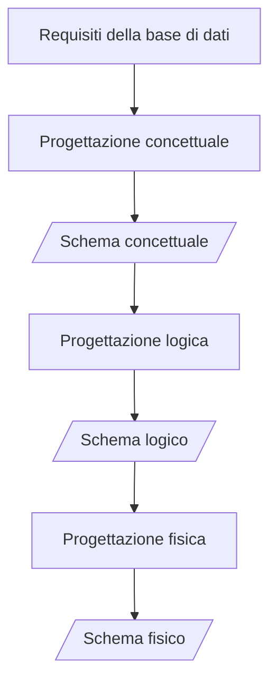

## 2. Analisi dei requisiti e progettazione concettuale ("Analisi dei dati")

Comprende attività (**interconnesse**) di:
- **acquisizione dei requisiti** — *non standardizzabile!*
- **analisi dei requisiti**
- **costruzione dello schema concettuale**
- **costruzione del glossario**

## 3. Acquisizione dei requisiti

Possibili **fonti** dei requisiti:
- **utenti e committenti**, attraverso:
	- interviste
	- documentazione apposita
- **documentazione esistente**:
	- normative (leggi, regolamenti di settore)
	- regolamenti interni, procedure aziendali
	- realizzazioni preesistenti
- **modulistica**

### Acquisizione per interviste
- utenti diversi possono fornire **informazioni diverse**;
- utenti a livello più alto hanno spesso una visione **più ampia ma meno dettagliata**;
- le interviste portano spesso ad una acquisizione dei requisiti "**per raffinamenti successivi**".

### Interazione con gli utenti
Spunti pratici:
- effettuare spesso **verifiche di comprensione e coerenza**;
- verificare anche per mezzo di **esempi** (generali e relativi a **casi limite**);
- richiedere **definizioni e classificazioni**;
- far evidenziare gli aspetti **essenziali** rispetto a quelli marginali.

## 4. Analisi dei requisiti

### Documentazione descrittiva — regole generali
- scegliere il corretto **livello di astrazione**;
- **standardizzare** la struttura delle frasi;
- **suddividere** le frasi articolate;
- **separare** le frasi sui dati da quelle sulle funzioni.

### Costruzione del glossario — organizzazione di termini e concetti
- individuare **omonimi e sinonimi** e unificare i termini;
- rendere **esplicito il riferimento** fra termini;
- **riorganizzare le frasi per concetti**;
- costruire un **glossario dei termini**.

---

## 5. Esempio guida: Società di formazione

### Requisiti originali (testo del committente)

> [!example] Società di formazione (1)
> Si vuole realizzare una base di dati per una società che eroga corsi, di cui vogliamo rappresentare i dati dei partecipanti ai corsi e dei docenti. Per gli studenti (circa 5000), identificati da un codice, si vuole memorizzare il codice fiscale, il cognome, l'età, il sesso, il luogo di nascita, il nome dei loro attuali datori di lavoro, i posti dove hanno lavorato in precedenza insieme al periodo, l'indirizzo e il numero di telefono, i corsi che hanno frequentato (i corsi sono in tutto circa 200) e il giudizio finale.

> [!example] Società di formazione (2)
> Rappresentiamo anche i seminari che stanno attualmente frequentando e, per ogni giorno, i luoghi e le ore dove sono tenute le lezioni. I corsi hanno un codice, un titolo e possono avere varie edizioni con date di inizio e fine e numero di partecipanti. Se gli studenti sono liberi professionisti, vogliamo conoscere l'area di interesse e, se lo possiedono, il titolo. Per quelli che lavorano alle dipendenze di altri, vogliamo conoscere invece il loro livello e la posizione ricoperta.

> [!example] Società di formazione (3)
> Per gli insegnanti (circa 300), rappresentiamo il cognome, l'età, il posto dove sono nati, il nome del corso che insegnano, quelli che hanno insegnato nel passato e quelli che possono insegnare. Rappresentiamo anche tutti i loro recapiti telefonici. I docenti possono essere dipendenti interni della società o collaboratori esterni.

Nell'analisi si evidenziano le ambiguità del testo: "studenti" e "partecipanti" sono **sinonimi**, "il titolo" va disambiguato in **titolo professionale**, "giudizio finale" diventa **votazione in decimi**, "seminari" è sinonimo di "corsi".

### Glossario dei termini

| Termine | Descrizione | Sinonimi | Collegamenti |
|---|---|---|---|
| Partecipante | Persona che partecipa ai corsi | Studente | Corso, Società |
| Docente | Docente dei corsi. Può essere esterno | Insegnante | Corso |
| Corso | Corso organizzato dalla società. Può avere più edizioni | Seminario | Docente |
| Società | Ente presso cui i partecipanti lavorano o hanno lavorato | Posti | Partecipante |

### Strutturazione dei requisiti in gruppi di frasi omogenee

**Frasi di carattere generale** — Si vuole realizzare una base di dati per una società che eroga corsi, di cui vogliamo rappresentare i dati dei partecipanti ai corsi e dei docenti.

**Frasi relative ai partecipanti** — Per i partecipanti (circa 5000), identificati da un codice, rappresentiamo il codice fiscale, il cognome, l'età, il sesso, la città di nascita, i nomi dei loro attuali datori di lavoro e di quelli precedenti (insieme alle date di inizio e fine rapporto), le edizioni dei corsi che stanno attualmente frequentando e quelli che hanno frequentato nel passato, con la relativa votazione finale in decimi.

**Frasi relative ai datori di lavoro** — Relativamente ai datori di lavoro presenti e passati dei partecipanti, rappresentiamo il nome, l'indirizzo e il numero di telefono.

**Frasi relative ai corsi** — Per i corsi (circa 200), rappresentiamo il titolo e il codice, le varie edizioni con date di inizio e fine e, per ogni edizione, rappresentiamo il numero di partecipanti e il giorno della settimana, le aule e le ore dove sono tenute le lezioni.

**Frasi relative a tipi specifici di partecipanti** — Per i partecipanti che sono liberi professionisti, rappresentiamo l'area di interesse e, se lo possiedono, il titolo professionale. Per i partecipanti che sono dipendenti, rappresentiamo invece il loro livello e la posizione ricoperta.

**Frasi relative ai docenti** — Per i docenti (circa 300), rappresentiamo il cognome, l'età, la città di nascita, tutti i numeri di telefono, il titolo del corso che insegnano, di quelli che hanno insegnato nel passato e di quelli che possono insegnare. I docenti possono essere dipendenti interni della società di formazione o collaboratori esterni.

### Operazioni sui dati (con frequenze)

| # | Operazione | Frequenza |
|---|---|---|
| 1 | inserisci un nuovo partecipante con tutti i suoi dati | 40 volte al giorno |
| 2 | assegna un partecipante ad una edizione di corso | 50 volte al giorno |
| 3 | inserisci un nuovo docente con tutti i suoi dati e i corsi che può insegnare | 2 volte al giorno |
| 4 | assegna un docente abilitato ad una edizione di corso | 15 volte al giorno |
| 5 | stampa tutte le info sulle edizioni passate di un corso con titolo, orari lezione e n° partecipanti | 10 volte al giorno |
| 6 | stampa tutti i corsi offerti, con informazioni sui docenti che possono insegnarli | 20 volte al giorno |
| 7 | per ogni docente, trova i partecipanti a tutti i corsi da lui/lei insegnati | 5 volte a settimana |
| 8 | effettua una statistica su tutti i partecipanti a un corso con tutte le informazioni su di essi, sull'edizione a cui hanno partecipato e sulla rispettiva votazione | 10 volte al mese |

---

## 6. Dai requisiti discorsivi ai costrutti E-R

Quale costrutto E-R va utilizzato per rappresentare un concetto presente nelle specifiche? Bisogna basarsi sulle **definizioni dei costrutti** del modello E-R. Se il concetto:
- ha **proprietà significative** e descrive oggetti con **esistenza autonoma** → **entità**;
- è **semplice** e **non ha proprietà** → **attributo**;
- **correla due o più concetti** → **relationship**;
- è **caso particolare** di un altro → **generalizzazione**.

---

## 7. Schemi notevoli (pattern di modellazione)

### 7.1 Reificazione di attributo di entità
Un attributo (es. `Strumento` di MUSICISTA, o `Nome Azienda` di IMPIEGATO) può essere promosso ("reificato") a **entità** collegata da una relationship, quando ha interesse autonomo:

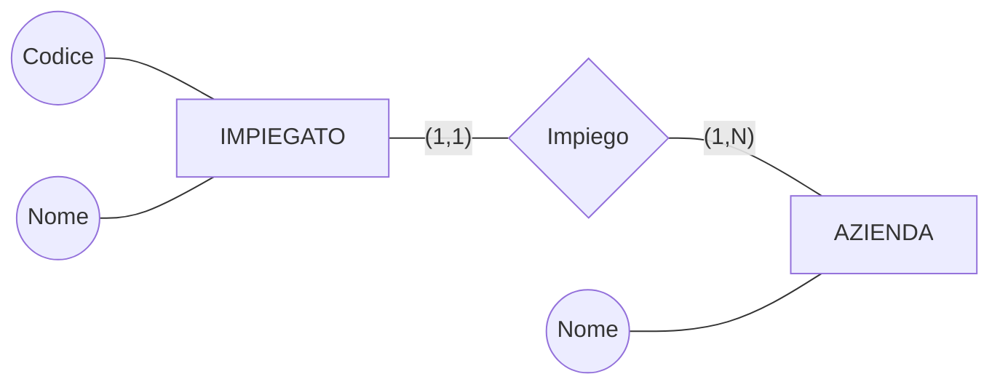
Prima: IMPIEGATO(Codice, Nome, Azienda). Dopo: l'azienda è un'entità a sé, con i suoi attributi. Analogamente MUSICISTA con attributo multivalore `Strumento (1,n)` → MUSICISTA —(1,n)— *Suona* —(1,n)— STRUMENTO.

### 7.2 Reificazione di relazione binaria
La relationship ESAME tra STUDENTE (0,N) e CORSO (0,N), con attributi `Voto` e `Data`, può essere reificata in un'**entità** ESAME con due relationship (1,1) verso le entità originarie:

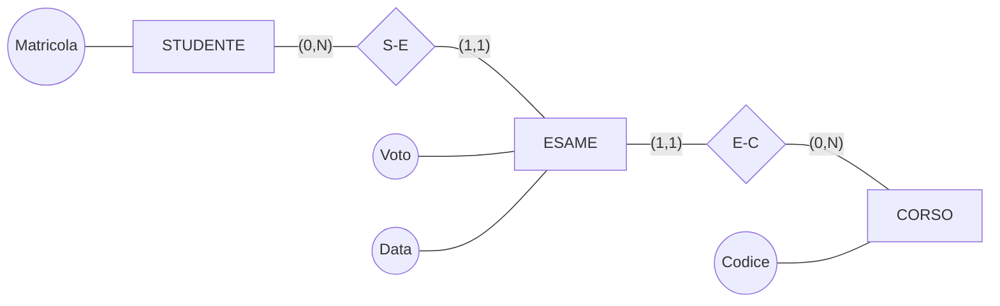
- 1ª versione (relationship con attributi Voto, Data): uno studente può sostenere **al più un esame** per corso.
- 2ª versione (entità ESAME identificata esternamente da STUDENTE e CORSO + `Data`): lo stesso studente può sostenere **più esami dello stesso corso in date diverse**.
- 3ª versione (entità ESAME con identificatore interno `Codice`): identificazione autonoma delle occorrenze.

Esempio analogo: *…un paziente può essere visitato da diversi medici, e anche più volte dallo stesso medico, ma in questo caso in giorni diversi…*

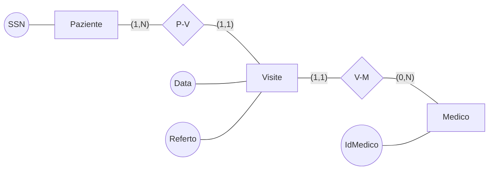
L'entità Visite è identificata esternamente da Paziente e Medico insieme all'attributo `Data` (così la stessa coppia paziente-medico può ripetersi solo in giorni diversi).

### 7.3 Reificazione di associazione binaria e di un suo attributo
MUSICISTA —(1,N)— PARTECIPAZ. (con attributo `Strumento`) —(1,N)— ORCHESTRA: si reifica sia l'associazione sia l'attributo `Strumento`:

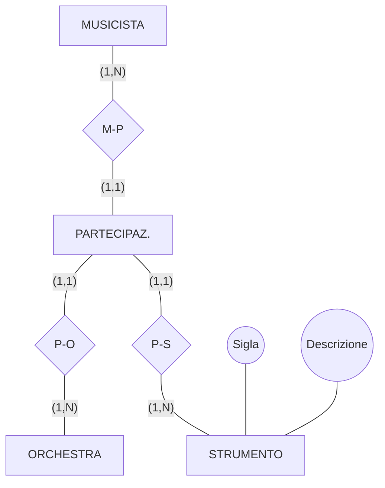
MUSICISTA(Codice, Nome); ORCHESTRA(Nome, Tipologia); STRUMENTO(Sigla, Descrizione).

### 7.4 Reificazione di relazione ternaria
*…le lezioni di un corso si tengono in diverse aule, ma un corso non ha mai due o più lezioni lo stesso giorno…*

Prima (ternaria): Corso (1,5) — **Lezione** — Aula (1,N), con `Giorno (1,N)` come ramo/attributo. Dopo la reificazione:

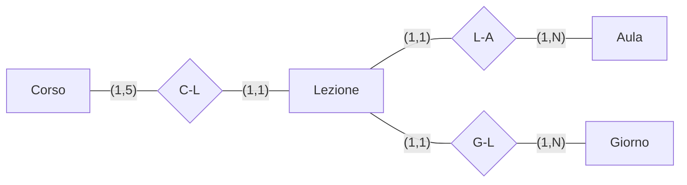
Lezione è identificata esternamente da Corso e Giorno (vincolo: un corso non ha due lezioni lo stesso giorno).

### 7.5 Un caso di analisi: libri e copie
*…in una biblioteca si vogliono mantenere informazioni sui libri (titolo, autore, anno, codice ISBN, stato conservazione) e sui prestiti relativi (data prestito, eventuale data restituzione, utente), segnalando eventuali danni apportati al volume…*

Primo tentativo: Libro(ISBN, titolo, Autori (1,N), anno, Stato_conservazione) —(0,N)— Prestito(danni, Data_prest, Data_rest) —(1,N)— Utente(Num_tessera, Nome).

> [!warning] Concetti diversi: un libro e le sue copie!
> Lo *stato di conservazione* e il *prestito* riguardano la **copia fisica**, non il libro come opera. Bisogna separare i due concetti.

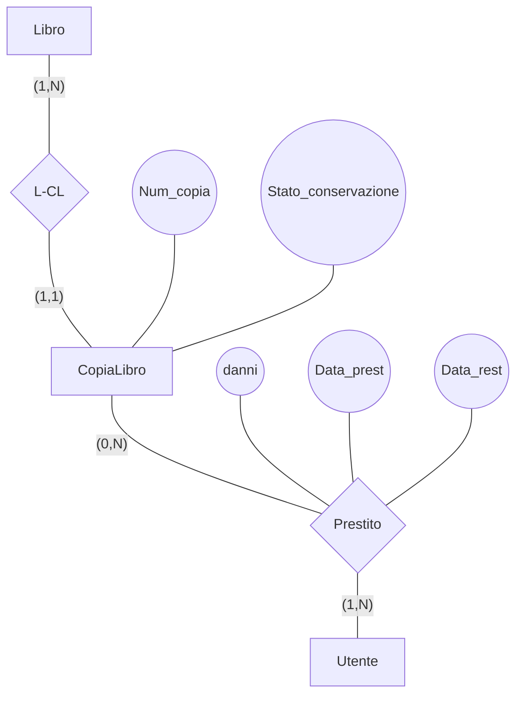
Libro(ISBN, titolo, Autori (1,N), anno); CopiaLibro è **entità debole** identificata da `Num_copia` + Libro. In questo schema, però, un utente **non può prendere in prestito la stessa copia più volte** (la coppia copia-utente è unica). Per permetterlo si **reifica anche il Prestito**:

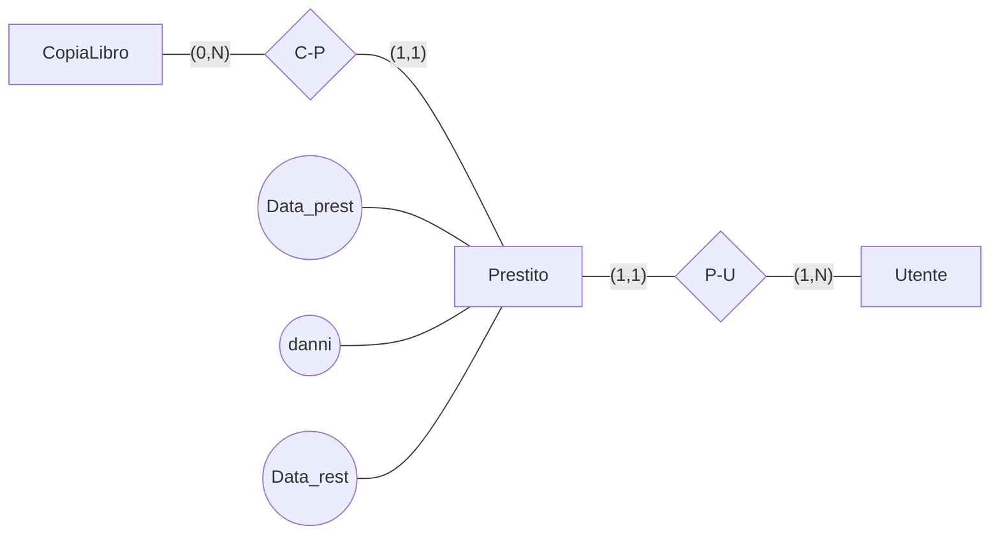
Prestito è identificato esternamente da CopiaLibro e Utente insieme a `Data_prest`.

### 7.6 Part-of
Relazione "parte di" espressa con una relationship di composizione:

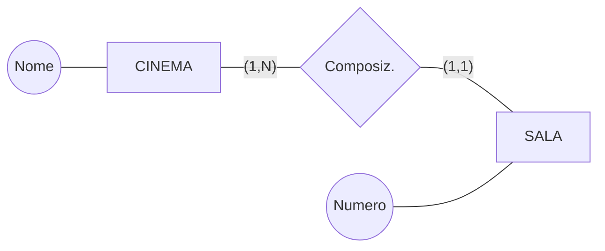
La SALA è identificata esternamente da `Numero` + CINEMA. Variante: TEAM —(1,N)— Composiz. —(0,1)— TECNICO(Codice): il tecnico ha identificatore proprio e può non appartenere a nessun team.

### 7.7 Instance-of
Relazione "istanza di" tra un concetto generale e le sue occorrenze concrete:

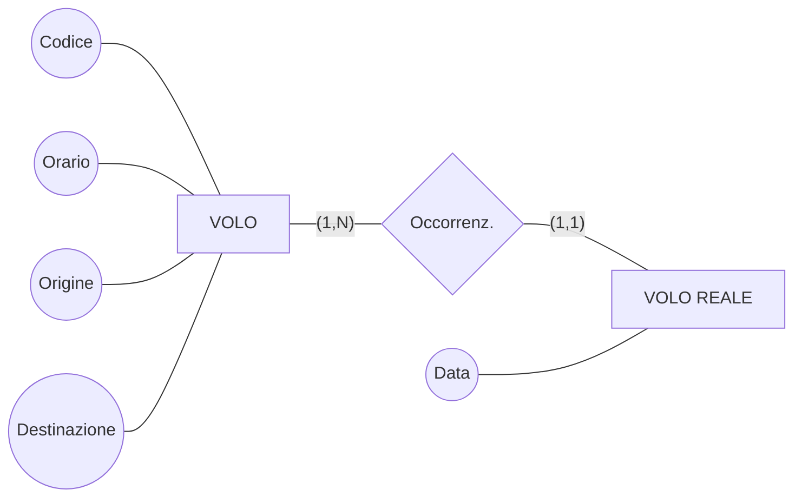
VOLO REALE è identificato esternamente da `Data` + VOLO. Analogamente TORNEO(Nome) —(1,N)— Occorrenz. —(1,1)— EDIZIONE TORNEO(Anno).

### 7.8 Caso particolare
Un "caso particolare" può essere modellato con una **generalizzazione** più una relationship dedicata:

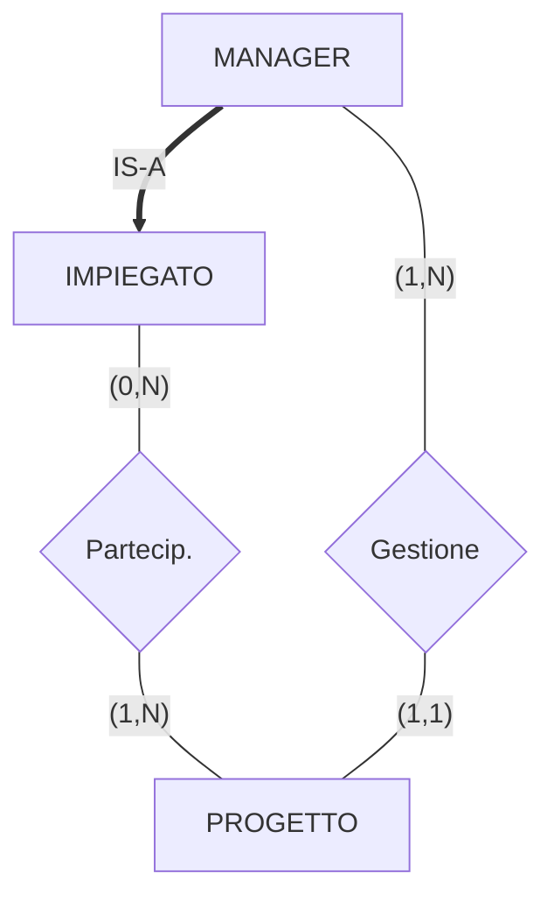
IMPIEGATO(Codice, Nome); PROGETTO(Nome, Scadenza). Serve una **regola di vincolo** esterna (es. il manager che gestisce un progetto deve parteciparvi), vedi [[Modello ER esteso#6. Vincoli non esprimibili]].

### 7.9 Storicizzazione di concetto
Per tener traccia della storia di un concetto (es. SOFTWARE(Nome, Dimensione, Data rilascio, S.O., Requisiti)) si possono introdurre specializzazioni SOFTWARE OBSOLETO (con `Data fine validità`) e SOFTWARE AGGIORNATO.

Per l'impiego di una persona:

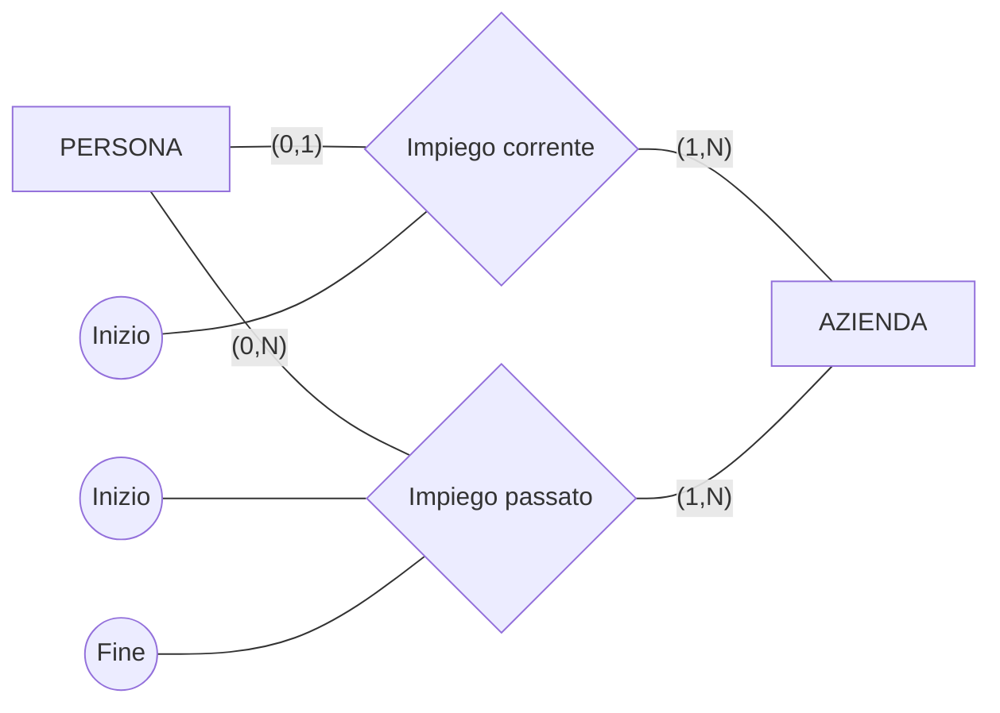
In alternativa si **reifica** IMPIEGO come entità (identificata esternamente da PERSONA e AZIENDA + `Inizio`) specializzata in IMPIEGO CORRENTE e IMPIEGO PASSATO (quest'ultimo con `Fine`), con PERSONA —(0,1)— verso l'impiego corrente: anche qui serve una **regola di vincolo**.

### 7.10 Evoluzione di concetto
Un concetto che evolve (es. un progetto che viene accettato) si modella con una **specializzazione**: PROGETTO(Codice, Nome, Obiettivo) —(1,N)— Partecip. —(1,1)— RICERCATORE(Nome, CV); PROGETTO ACCETTATO IS-A PROGETTO, con in più `Finanziamento` e `Data inizio`.

---

## 8. Strategie di progetto (concettuale)

### Top-down
1. considerare le specifiche **globalmente** e produrre uno schema iniziale completo ma con **pochi concetti molto astratti**;
2. **raffinare** i concetti astratti fino ad arrivare allo schema concettuale **completo in ogni dettaglio**.

Primitive di raffinamento top-down: un'entità astratta (es. `Persona`) si raffina in una generalizzazione (`Uomo`/`Donna`), un'entità si separa in due entità collegate da relationship (`Studente` —Esame— `Corso`), si aggiungono attributi (`Cognome`, `Età`, `Stipendio`).

### Bottom-up
1. **decomporre** le specifiche iniziali in **parti elementari** (frasi che descrivono lo stesso concetto);
2. **generare gli schemi** (dettagliati) per tutte le parti elementari individuate;
3. **fondere gli schemi** (introducendo altri costrutti del modello E-R) in modo da **integrare** tutti gli schemi componenti e generare lo **schema finale**.

Primitive di raffinamento bottom-up: concetti separati vengono collegati introducendo relationship (`Esame` fra Studente e Corso) e generalizzazioni (`Persona` sopra Uomo/Donna).

### Inside-out
1. **individuare** nelle specifiche alcuni **concetti importanti** (detti concetti **guida**);
2. **generare gli schemi** per i concetti guida e per quelli ad essi correlati.

Si parte da alcuni concetti importanti e si procede da questi "**a macchia d'olio**", "navigando" tra le specifiche (es. dallo schema aziendale: da `Impiegato` verso Direzione/Afferenza/Dipartimento, poi Partecipazione/Progetto, Composizione/Sede, vedi [[Modello ER esteso#4. Esempio di schema aziendale]]).

### Pro e contro

| Strategia | Pro | Contro |
|---|---|---|
| **Top-down** | non è inizialmente necessario specificare i dettagli | richiede sin dall'inizio una visione globale del problema, non sempre ottenibile in casi complessi; alte capacità di astrazione |
| **Bottom-up** | permette una ripartizione delle attività | richiede una fase di integrazione (non banale per schemi complessi) |
| **Inside-out** | non richiede passi di integrazione; facilità di scoprire nuovi concetti vicini ai precedenti (ma non sempre!); permette di cominciare la progettazione quando la raccolta dei requisiti non è ancora finita o non sono ancora disponibili tutti i dati | richiede ad ogni passo di esaminare tutte le specifiche disponibili per trovare i concetti non ancora rappresentati; una vista globale del dominio dell'applicazione è costruita solo alla fine |

### In pratica: strategia mista
Si procede di solito con una **strategia mista**:
- si individuano i concetti principali e si realizza uno **schema scheletro**;
- sulla base di questo si può **decomporre**;
- poi si **raffina**, si **espande**, si **integra**.

La strategia mista cerca di combinare gli aspetti positivi di top-down e bottom-up: i requisiti sono suddivisi in componenti elementari (bottom-up) ma identificando lo scheletro base (top-down). È la **più flessibile** perché si adatta mediamente bene ad esigenze contrapposte: suddividere il problema in sottoproblemi e procedere per raffinamenti successivi (in parallelo all'analisi dei requisiti).

**Definizione dello schema scheletro**: si individuano i concetti **più importanti** — ad esempio perché più citati o perché indicati esplicitamente come cruciali — e li si organizza in un semplice schema concettuale.

## 9. Una metodologia

- **Analisi dei requisiti**
	- analizzare i requisiti ed eliminare le ambiguità;
	- costruire un glossario dei termini;
	- raggruppare i requisiti in insiemi omogenei.
- **Passo base**
	- definire uno schema scheletro con i concetti più rilevanti.
- **Passo iterativo** (da ripetere finché non si è soddisfatti)
	- raffinare i concetti presenti sulla base delle loro specifiche;
	- aggiungere concetti per descrivere specifiche non descritte.
- **Analisi di qualità** (ripetuta e distribuita)
	- verificare le qualità dello schema e modificarlo.

## 10. Qualità di uno schema concettuale

- **Correttezza** — assenza di errori **sintattici** (es. generalizzazione tra associazioni) e **semantici** (es. usare una associazione per esprimere il fatto che una entità è specializzazione di un'altra);
- **Completezza** — verifica sulle specifiche: **tutti** i concetti sono rappresentati e **tutte** le operazioni possono essere eseguite;
- **Leggibilità**;
- **Minimalità** — tutte le specifiche sono rappresentate **una sola volta** nello schema (a volte la ridondanza è una scelta, ma va **documentata**).

---

## 11. Esempio completo: progettazione della Società di formazione

### Schema scheletro
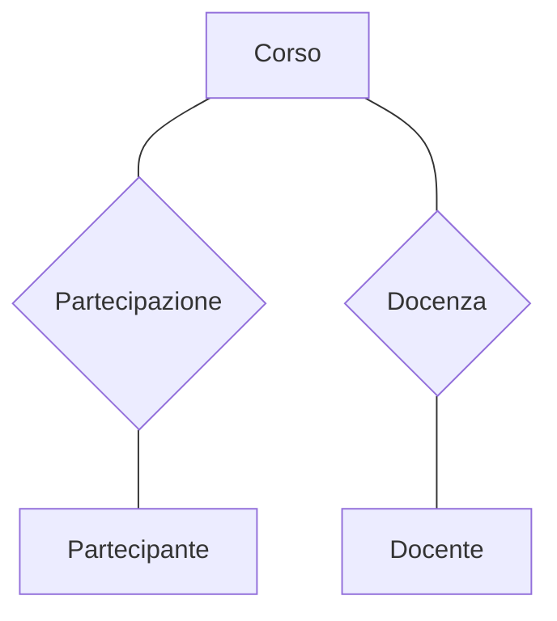

### Raffinamento: Partecipante e datori di lavoro
Partecipante(CF, Codice, …). Dalle frasi sui datori di lavoro:

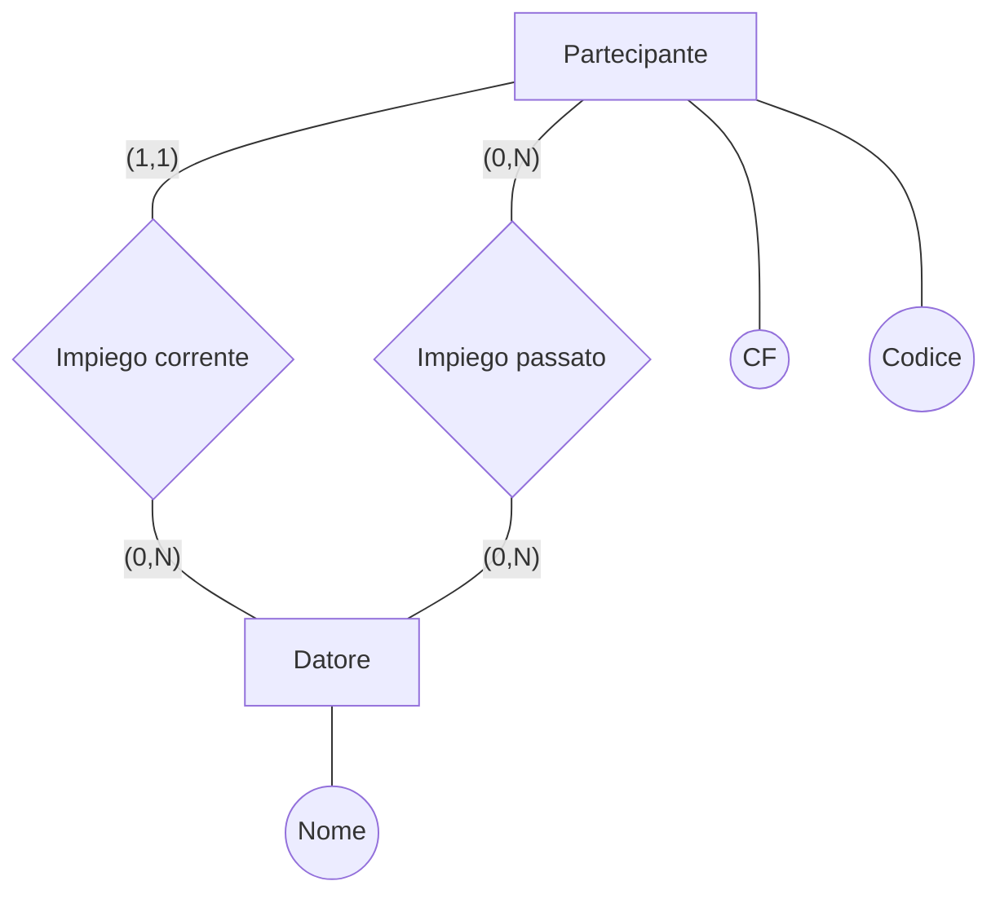

### Raffinamento: tipi specifici di partecipanti
Generalizzazione di Partecipante in **Dipendente** (`Livello`, `Posizione`) e **Professionista** (`Titolo prof.`, `Area`):

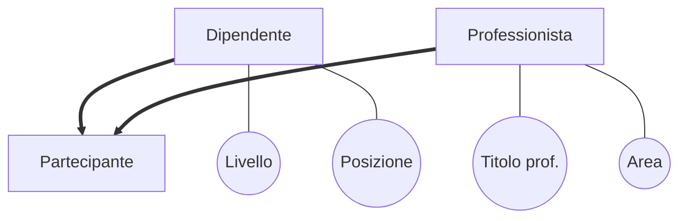

### Raffinamento: partecipazione ai corsi
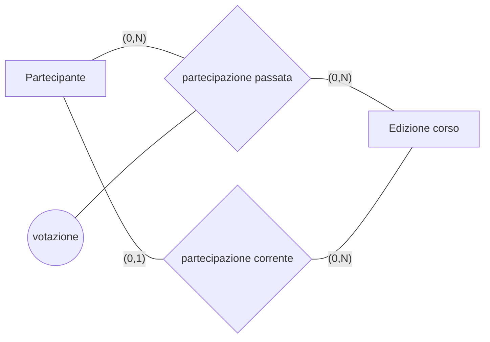

### Raffinamento: corsi, edizioni e lezioni
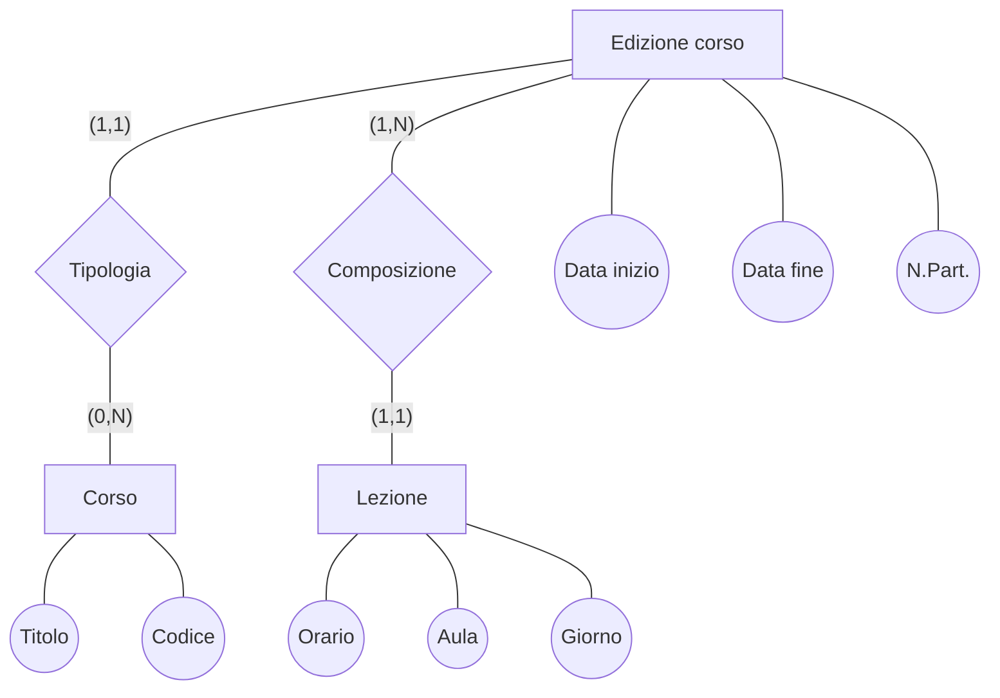
La relationship Tipologia è di tipo **instance-of**: Edizione corso è identificata esternamente da `Data inizio` + Corso.

### Raffinamento: docenti e docenza
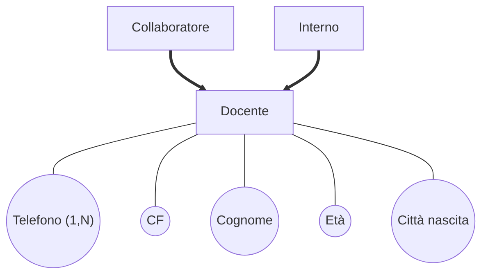

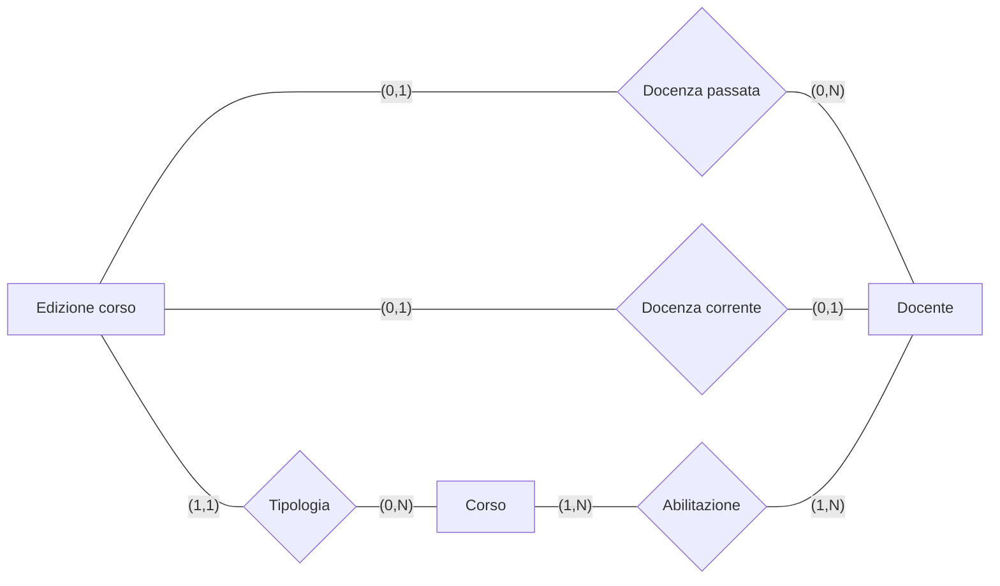

### Integrazione e verifica di qualità
I sotto-schemi si **integrano** sullo scheletro Corso–Partecipazione–Partecipante / Corso–Docenza–Docente. Nella verifica di **completezza** si controlla che ogni operazione sia eseguibile: ad esempio l'**operazione 7** (*per ogni docente, trova i partecipanti a tutti i corsi da lui/lei insegnati*) si esegue percorrendo Docente → Docenza passata/corrente → Edizione corso → partecipazione passata/corrente → Partecipante.
