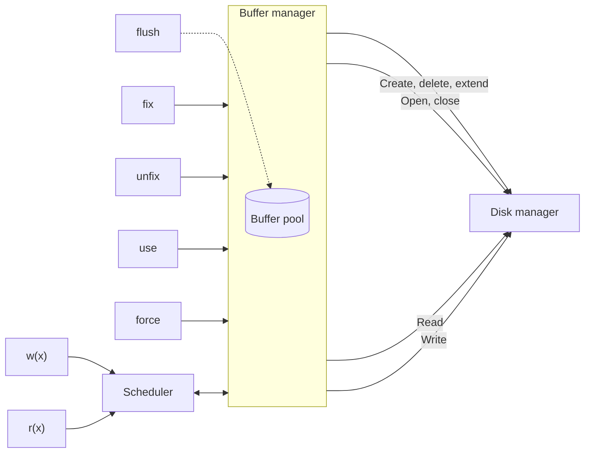

# Buffer Manager

> [!info] Fonte
> Slides *"Buffer Manager"* — Prof. Alessandro Pellegrini (a.pellegrini@ing.uniroma2.it).
> Collegamenti: [[Organizzazione fisica dei dati]] (architettura del DBMS) · [[00 Indice|Indice]]

---

## 1. Posizione nell'architettura del DBMS
Il **buffer manager** si trova tra l'**access file manager** (sopra) e il **disk manager** (sotto); interagisce con il **transaction manager** e il **security and recovery manager** (vedi [[Organizzazione fisica dei dati#1. Architettura di un DBMS]]).

## 2. Il buffer
- Il **buffer** (o **buffer pool**) è un'**area in memoria principale preallocata dal DBMS**.
- È **condivisa fra le transazioni**.
- Funziona come **sistema di caching** dei dati.
- Permette di **abbattere il divario nei tempi di accesso** tra memoria principale e secondaria:
  - in **lettura**, se la pagina è già presente nel buffer, non è necessario accedere alla memoria secondaria;
  - in **scrittura**, il gestore del buffer può decidere di **differire la scrittura fisica** (facendo attenzione all'**affidabilità**).

## 3. Architettura del buffer manager

- Il buffer manager riceve le primitive **fix, unfix, use, force** (e **flush**, interno);
- verso il **disk manager** invia: *create, delete, extend*; *open, close*; *read*; *write*;
- lo **scheduler** (che riceve le operazioni di lettura/scrittura delle transazioni `r(x)`, `w(x)`) interagisce con il buffer manager.

## 4. Il buffer pool
- Il buffer pool è organizzato in **frame**.
- Ciascun frame è **una pagina in memoria principale**, tipicamente pari alla **dimensione di un blocco**.
- Il buffer pool è gestito secondo le **stesse strategie delle memorie cache**:
  - **principio di località**;
  - **strategia di rimpiazzo a blocco**;
  - euristiche: **l'80% delle applicazioni accedono il 20% delle pagine**.

## 5. Il gestore del buffer: operazioni primitive
Il gestore del buffer offre agli altri componenti del DBMS alcune operazioni primitive:

| Primitiva | Significato |
|---|---|
| **fix** | caricamento di una pagina |
| **unfix** | rilascio di una pagina |
| **use** | utilizzo di una pagina nel buffer pool |
| **force** | trasferimento **sincrono** verso la memoria secondaria |
| **flush** | trasferimento **asincrono** verso la memoria secondaria |

### L'operazione fix
- Richiede il **caricamento di una pagina in un frame** del buffer.
- Per ciascun frame, il gestore del buffer mantiene:
  - l'informazione su **quale pagina** esso contiene;
  - **pin counter**: un contatore che indica **quante transazioni attualmente attive utilizzano la pagina** contenuta nel frame (inizialmente **zero**);
  - **dirty bit**: un bit il cui valore indica se la pagina contenuta nel frame è stata **modificata** o meno (inizialmente **falso**).

#### Algoritmo — la pagina P è richiesta mediante fix
1. Il gestore del buffer verifica se esiste un frame **F** nel buffer pool che **contiene già P**.
2. In caso **affermativo**, **incrementa il pin counter** di F.
3. In caso **negativo**:
   1. un frame **F'** viene selezionato per ospitare la pagina P secondo una determinata **strategia di rimpiazzo**;
   2. il pin counter della pagina viene impostato a **1**;
   3. se il **dirty bit** di F' è impostato (utilizzo di una strategia di **steal**), la pagina P' contenuta in F' è **scritta in memoria secondaria**;
   4. la pagina P viene **caricata da disco** e scritta in F'.
4. L'**indirizzo del frame** contenente P viene restituito.

### Le altre operazioni
- **Unfix**:
  - la transazione **rilascia** la pagina da un frame;
  - il **pin counter viene decrementato**.
- **Use**:
  - la transazione **modifica** il contenuto di una pagina;
  - il **dirty bit viene impostato a true**.
- **Force**:
  - trasferimento **sincrono** di una pagina verso la memoria secondaria;
  - la transazione **attende il completamento** dell'operazione per andare in **commit**.
- **Flush**:
  - trasferimento **asincrono** di una pagina verso la memoria secondaria;
  - eseguito quando il buffer manager **non è occupato** a servire altre richieste.

---

## 6. Politiche di rimpiazzo

### Strategia di base
- Il frame da rimpiazzare (la **vittima**) viene scelto tra quelli con **pin counter = 0**.
- Se non esiste alcun frame con pin counter = 0, la richiesta viene **messa in coda**, oppure la transazione viene **abortita**.
- È possibile implementare **altre politiche** di rimpiazzo.

### LRU (Least Recently Used)
- **Ordina le pagine per tempo di ultimo accesso** (utilizzando una **coda di priorità**).
- Viene sempre rimpiazzata la pagina **acceduta meno recentemente**.
- È una politica **costosa** (perché? → ad ogni accesso bisogna aggiornare la coda di priorità).

### Clock Approximation
- Viene mantenuto un "**orologio dell'ultimo utilizzo**" (i frame disposti in cerchio).
- "**La lancetta**" (**current**) si muove sull'orologio.
- I frame mantengono un booleano **referenced**.
- Quando il pin counter = 0, **referenced viene impostato a true** per indicare che il frame è un buon candidato per il rimpiazzo ma è stato usato di recente.
- Per scegliere la vittima, si controlla il frame puntato da current:
  - se **pin counter > 0** → si fa muovere current al frame successivo;
  - se **pin counter = 0 e referenced = true** → si imposta referenced a **false** e si incrementa current, per indicare che è passato un po' di tempo dall'ultimo uso;
  - se **pin counter = 0 e referenced = false** → il frame è **selezionato come vittima**.
- **Approssima LRU**, perché le pagine accedute di recente sono selezionate con **minore probabilità**.

### MRU (Most Recently Used)
- **Perché mai vorremmo usare una politica di questo tipo!?**
- Suggerimento: considerate la **scansione di un file di 1 milione di pagine**, ma abbiamo a disposizione soltanto **1000 frame**…
- **Sequential flooding**: con LRU, **ciascun accesso a pagina causa un'operazione di I/O** (la pagina che servirà di nuovo è proprio quella appena rimpiazzata).
- Consideriamo la seguente operazione:
$$\textit{studente} \bowtie_{\textit{idcorso}=\textit{id}} \textit{corso}$$
- Come possiamo implementarla? (nested loop)
```text
per ogni tupla s di studente:
    per ogni tupla c di corso:
        se s[idcorso] == c[id]:
            x = ⟨nome, cognome, idcorso, id, nomecorso⟩
            includi x nel result set
```
- Le tuple sono memorizzate in **file diversi**.
- Dopo che una pagina di *corso* è stata processata, **non servirà più per un po'**.
- Le ulteriori tuple in una pagina di *studente* vengono processate **dopo** che la relazione *corso* è stata processata completamente.
- Il **pin counter** permette di **mantenere la pagina di studente** e **scartare quella di corso** (la più recentemente usata) → MRU.

---

## 7. Strategie di steal e force
| Strategia | Significato |
|---|---|
| **steal** | permettiamo di scegliere la vittima **tra le pagine con dirty = true** |
| **no-steal** | se dirty = true, la pagina **non può** essere selezionata come vittima |
| **force** | **tutte** le pagine attive di una transazione sono scritte su memoria secondaria **al momento del commit** |
| **no-force** | le pagine di una transazione attiva sono scritte in memoria secondaria mediante un'operazione di **flush** (quando conviene) |

### Confronto
- **no-steal** e **force** sono le operazioni **più semplici per il recovery**:
  - **no-steal**: transazioni soggette a **rollback** possono essere **annullate facilmente** (nessuna loro modifica è finita su disco);
  - **force**: transazioni andate in **commit** vedono i dati scritti in maniera **persistente** su disco.
- Tuttavia:
  - **no-steal**: utilizzo **meno efficiente del buffer pool** (tante pagine attive presenti nel buffer);
  - **force**: le **operazioni di I/O tendono a crescere**.
- > Configurazione tipica dei DBMS: **steal, no-force** → consente un **utilizzo efficiente del buffer pool**.
