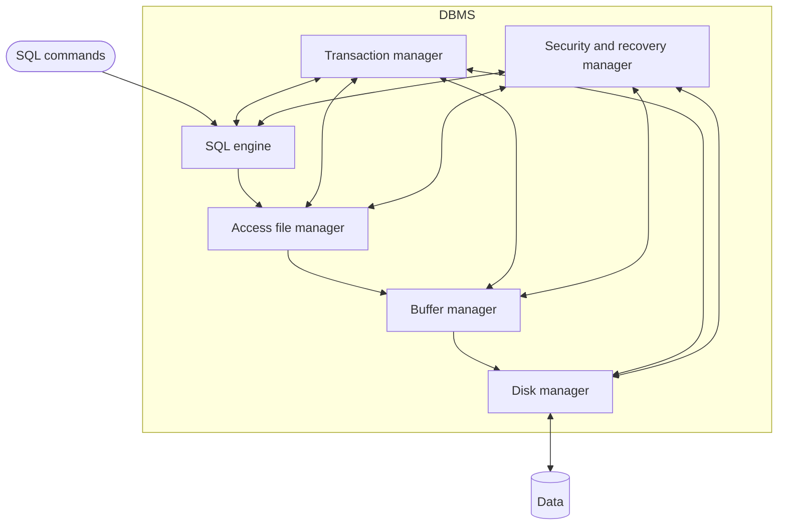
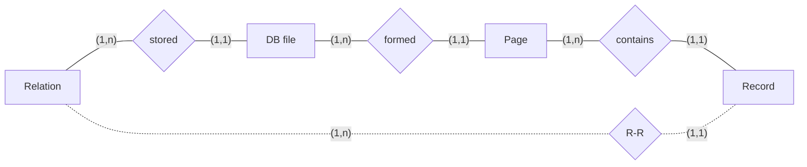
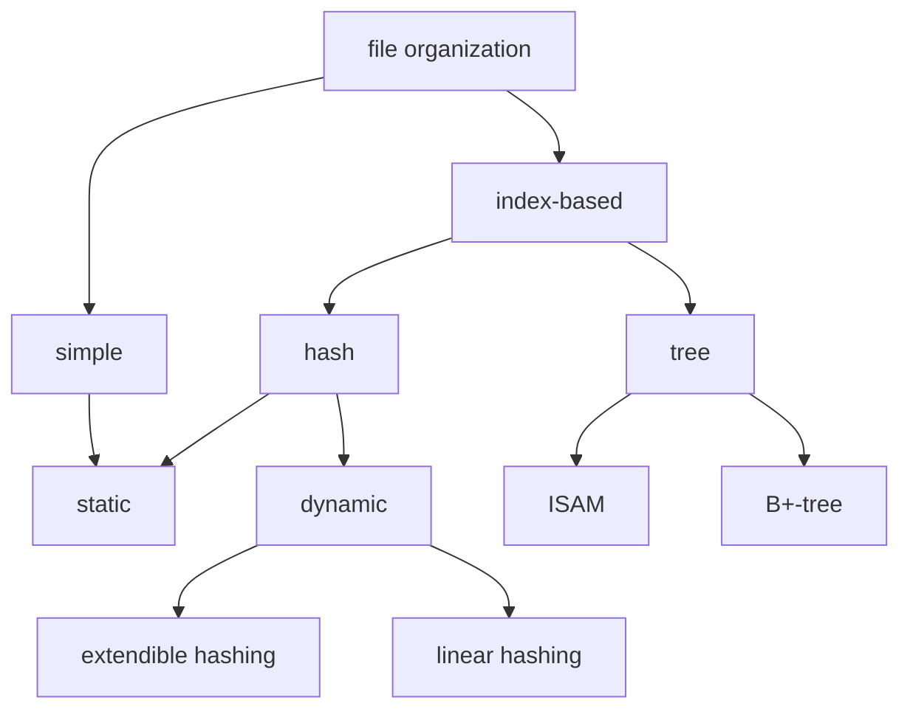

# Organizzazione fisica

> [!info] Fonte
> Slides *"Organizzazione fisica"* — Prof. Alessandro Pellegrini (a.pellegrini@ing.uniroma2.it).
> Collegamenti: [[Buffer Manager]] · [[SQL - Definizione dei dati (DDL)#6. Livelli di progettazione e indici]] · [[00 Indice|Indice]]

---

## 1. Architettura di un DBMS


- Pila centrale: **SQL engine → Access file manager → Buffer manager → Disk manager → Data**.
- Ai lati, interagiscono con tutti i livelli: **Transaction manager** e **Security and recovery manager**.

---

## 2. Memoria principale e secondaria
- I programmi possono fare riferimento **solo a dati in memoria principale**.
- Le basi di dati debbono essere (sostanzialmente) in **memoria secondaria** per due motivi:
  - **dimensioni**
  - **persistenza**
- I dati in memoria secondaria possono essere utilizzati **solo se prima trasferiti in memoria principale** (questo spiega i termini "principale" e "secondaria").

### Blocchi e pagine
- I dispositivi di memoria secondaria sono organizzati in **blocchi** di lunghezza (di solito) **fissa** (ordine di grandezza: **alcuni KB**).
- Le **uniche operazioni** sui dispositivi sono la **lettura** e la **scrittura di una pagina**, cioè dei dati di un blocco (cioè di una stringa di byte).
- Per comodità consideriamo **blocco e pagina sinonimi**.

### Costo di accesso (dischi magnetici)
| Componente | Tempo |
|---|---|
| tempo di **posizionamento della testina** (seek) | 10–50 ms |
| tempo di **latenza** (rotazione) | 5–10 ms |
| tempo di **trasferimento** | 1–2 ms |

- In media **non meno di 10 ms**: **ordini di grandezza in più** rispetto alla memoria centrale.
- Accessi a blocchi "**vicini**" costano meno (**contiguità**).

## 3. DBMS e file system
- Il **file system** è il componente del sistema operativo che gestisce la memoria secondaria.
- I DBMS ne utilizzano le funzionalità, ma **in misura limitata**: per **creare ed eliminare file** e per **leggere e scrivere singoli blocchi o sequenze di blocchi contigui**.
- L'**organizzazione dei file**, sia in termini di **distribuzione dei record nei blocchi** sia relativamente alla **struttura all'interno dei singoli blocchi**, è gestita **direttamente dal DBMS**.
- Il DBMS gestisce i blocchi dei file allocati **come se fossero un unico grande spazio** di memoria secondaria e costruisce, in tale spazio, le **strutture fisiche** con cui implementa le relazioni.

---

## 4. Pagine e record

### Relazioni, file, pagine e record (schema E-R)

- una **relazione** è memorizzata in uno o più **file** (ogni file appartiene a una relazione);
- un **file** è formato da una o più **pagine**;
- una **pagina** contiene uno o più **record**;
- (tratteggiato) ogni record corrisponde a una ennupla di una relazione (R-R).

### Pagine
- La **dimensione tipica** è quella di **un blocco**.
- Un blocco contiene un insieme di record (tipicamente **di una relazione**).
- Fisicamente, è una **collezione di slot** (uno per ciascun record).
- Ciascun record ha un identificatore (**record id**, o **rid**):
$$rid = \langle \textit{page id},\ \textit{slot number} \rangle$$

### Pagine con record di lunghezza fissa
- **Organizzazione impacchettata** (*packed*): i record occupano gli slot 1…N in modo contiguo, seguiti dallo spazio libero; in fondo alla pagina c'è il **numero di record N**. Lo **spostamento di un record cambia la sua posizione** (il suo rid), e questo è un **problema quando i record sono citati da altre pagine**.
- **Organizzazione non impacchettata** (*unpacked*): M slot, con una **bitmap** in fondo alla pagina (1 = slot occupato, 0 = libero) e il **numero di slot M**. L'identificazione di un record richiede la **scansione della bitmap** per verificare se lo slot è libero.

### Pagina con record di lunghezza variabile
- In fondo alla pagina c'è una **slot directory**: per ogni slot (1…N) una coppia (offset di inizio record, lunghezza), più il **numero di slot (# slots)** e il **puntatore all'inizio dello spazio libero**.
  - Es.: Rid = (i,1) a offset 24, Rid = (i,2) a offset 16, Rid = (i,N) a offset 20 con lunghezza 20.
- **Nessun problema nello spostare i record** (il rid punta allo slot, non all'offset).
- **Cancellare** un record significa impostare a **-1** il valore dello slot corrispondente e spostare lo spazio del record nell'area di spazio libero.
  - Area dati e spazio libero **riorganizzati quando necessario**.

### Formato di un record a taglia fissa
- Campi F1, F2, F3, F4 di lunghezze L1, L2, L3, L4; dato l'indirizzo base B, l'indirizzo di F3 è **B + L1 + L2**.
- Le informazioni sui campi sono **le stesse per tutti i record** di un certo tipo e sono memorizzate nel **catalogo del sistema**.
- Per trovare il campo i-esimo è necessario scandire il record (sommando le lunghezze dei campi precedenti).

### Formato di record a taglia variabile
- Il **numero di campi è fissato**.
- Due alternative di rappresentazione:
  1. **Terminatore di campo**: in testa il numero di campi (es. 4), poi i campi separati da simboli speciali (`$`) — *fields separated by special symbols*;
  2. **Vettore di spiazzamenti** (*array of offsets*): in testa un array di offset che puntano all'inizio di ogni campo.
- La **seconda alternativa** consente un **accesso diretto ai campi** ed una **memorizzazione efficiente dei valori nulli** (**due puntatori consecutivi identici identificano un valore nullo**).

---

## 5. Organizzazione dei file

### File e organizzazione dei file
- Un **file** è una **collezione di pagine**, ciascuna contenente una collezione di record.
- È necessario supportare le seguenti operazioni sui file:
  - **inserimento / eliminazione / aggiornamento** di un record;
  - **lettura** di un record dato il suo **rid**;
  - **scansione** di tutti i record, eventualmente concentrandosi sui record che soddisfano una data condizione.

### Heap file (organizzazione a mucchio)
- Il file che rappresenta la relazione contiene i record nelle pagine **senza alcun criterio particolare**.
- Quando la relazione cresce o si riduce, le pagine vengono **allocate o deallocate**.
- Per supportare le operazioni, è necessario:
  - tenere traccia delle **pagine appartenenti al file**;
  - tenere traccia dello **spazio libero** nelle pagine del file;
  - tenere traccia dei **record** nelle pagine del file.

#### Rappresentazione tramite liste
- Una **header page** punta a due liste doppiamente collegate: **pagine piene** (*full pages*) e **pagine con spazio libero** (*pages with free space*).
- Quando è necessaria una pagina, la richiesta viene inoltrata al **gestore del disco**.
- La pagina restituita dal gestore del disco viene inserita come **prima pagina dell'elenco delle pagine con spazio libero**.
- Quando una pagina non è più utilizzata (cioè è costituita solo da spazio libero), viene **cancellata** dall'elenco delle pagine con spazio libero.

#### Rappresentazione con directory
- La **directory** è un **elenco di pagine** (a sua volta organizzata in pagine collegate, a partire dalla header page):
  - ogni entry contiene un **puntatore a una pagina dati** (Data Page 1 … N).
- Ogni entry si riferisce a una pagina e indica se la pagina ha spazio libero (attraverso un **contatore**).
- La ricerca di una pagina con spazio libero è **più efficiente**:
  - perché il numero di accessi è **lineare rispetto alla dimensione della directory**, non alla dimensione della relazione.

### File con pagine ordinate
- I record sono **ordinati secondo un insieme di campi** (la **chiave di ricerca**).
- Le pagine sono ordinate secondo l'ordinamento dei propri record.
- Le pagine sono organizzate in una **struttura sequenziale**: l'ordine delle pagine riflette l'ordinamento dei record.
- Questa organizzazione generale può essere implementata con **strutture dati differenti**.

#### File lineare ordinato
- I record sono memorizzati **nell'ordine prescelto su disco**.
- L'operazione di ricerca di un record è **veloce: ricerca binaria**.
- Costi più elevati in caso di:
  - **inserimento**
  - **eliminazione**
  - **ricerca per chiave diversa** dalla chiave di ricerca.

### Hashed file
- Le pagine della relazione sono organizzate in gruppi (**bucket**), numerati 0 … N-1.
- Un bucket consiste di:
  - una **pagina primaria**;
  - possibili altre pagine (**di overflow**) collegate alla pagina primaria.
- Un insieme di campi della relazione è scelto come **chiave di ricerca**.
- Per cercare un record R, data una chiave di ricerca K, si può individuare l'indirizzo del bucket che contiene R usando una **funzione hash**: bucket $= h(k) \bmod N$.

---

## 6. Modello di costo (tempo di esecuzione)
- Le **operazioni di I/O dominano** il processamento in memoria centrale.
- Per caratterizzare il tempo di esecuzione delle operazioni, ci possiamo concentrare sul **numero di pagine accedute**.

**Parametri del modello di costo:**
| Simbolo | Significato | Esempio |
|---|---|---|
| $B$ | numero di **pagine** nel file | |
| $R$ | numero di **record per pagina** | |
| $D$ | tempo medio di **scrittura/lettura di una pagina** | 15 ms |
| $C$ | tempo medio di **processamento di un record** (es. confronto di un campo con un valore) | 100 ns |

### Operazioni sui dati
- **Scansione** dei record di un file
  - costo di caricamento delle pagine del file
  - costo di CPU per individuare i record nelle pagine
- **Selezione basata su uguaglianza**
  - costo di caricamento delle pagine con record rilevanti
  - costo di CPU per identificare i record nelle pagine
  - il record da individuare è **unico** se l'uguaglianza è **sulla chiave**
- **Selezione basata su intervallo**
  - costo di caricamento delle pagine con record rilevanti
  - costo di CPU per identificare i record nelle pagine
- **Inserimento** di un record
  - costo di individuazione della pagina in cui avviene l'inserimento
  - costo di caricamento della pagina
  - costo di modifica della pagina
  - costo di riscrittura della pagina modificata
  - costo di caricamento, modifica e scrittura di altre pagine, se necessario
- **Eliminazione** di un record: operazioni analoghe a quelle dell'inserimento.

### Istanziazione del modello per heap file
| Operazione | Costo | Note |
|---|---|---|
| Scansione | $B(D + RC)$ | per ciascuna delle B pagine: caricala (D); per ciascuno degli R record: processalo (C) |
| Selezione su uguaglianza | $B(D + RC)$ | il record può non essere presente, o più di un record può soddisfare la condizione |
| Selezione su intervallo | $B(D + RC)$ | |
| Inserimento | $D + C + D$ | caricamento dell'ultima pagina, inserimento nella pagina, scrittura della pagina |
| Eliminazione (dato il rid) | $D + C + D$ | |
| Eliminazione (selezione) | $B(D + RC) + XC + YD$ | X = n. di record da eliminare; Y = n. di pagine contenenti record da eliminare |

### Istanziazione del modello per file ordinato
| Operazione | Costo |
|---|---|
| Scansione | $B(D + RC)$ |
| Selezione su uguaglianza | $D\log_2 B + C\log_2 R$ (caso peggiore) |
| Selezione su intervallo | simile al precedente, più il caricamento di ulteriori pagine se i record rilevanti non sono in una singola pagina |
| Inserimento | $D\log_2 B + C\log_2 R + C + 2B(D + RC)$ |
| Eliminazione | simile all'inserimento |

- **Selezione su uguaglianza**:
  - ricerca binaria per identificare la pagina con il primo record rilevante: $\log_2 B$ passi;
  - ad ogni passo, una operazione di I/O e due confronti (che possiamo ignorare);
  - ricerca binaria per identificare il primo record rilevante nella pagina: $\log_2 R$.
- **Inserimento**:
  - caso peggiore: **prima pagina, prima posizione**;
  - costo di ricerca della pagina: $D\log_2 B + C\log_2 R$;
  - inserimento del record: $C$;
  - caricamento e scrittura delle altre pagine (per far scorrere i record): $2B(D + RC)$.
- **Eliminazione**: simile al caso precedente; se la condizione è una selezione di uguaglianza su **campi non chiave**, o una selezione per **intervallo**, il costo dipende anche dal **numero di record da eliminare**.

### Istanziazione del modello per file hash (approssimata)
| Operazione | Costo | Note |
|---|---|---|
| Scansione | $1.25\,B(D + RC)$ | pagine occupate all'**80%** (tipico) per minimizzare gli overflow quando il file cresce |
| Selezione su uguaglianza | $(D + RC) \cdot \textit{numero di record rilevanti}$ | accesso diretto attraverso la funzione hash |
| Selezione su intervallo | $1.25\,B(D + RC)$ | l'hash non aiuta: scansione completa |
| Inserimento | $2D + RC$ | |
| Eliminazione | $\textit{costo della ricerca} + D + RC$ | |

---

## 7. File indicizzati

### Concetto di indice
- Un **indice** è una **struttura dati ausiliaria** che permette l'**ottimizzazione della ricerca** di un record in un file, basata sul valore di uno o più campi prefissati, che formano la cosiddetta **chiave di ricerca**.
- Un **qualsiasi sottoinsieme** dei campi di una relazione può formare la chiave di ricerca per l'indice.

> [!warning] Nota: la **chiave di ricerca è differente dalla chiave di una relazione**
> La chiave di ricerca può **non** essere l'insieme minimo di attributi che identificano i record di una relazione.

### Entry dati, entry indice, data record
L'implementazione di una relazione R mediante un'organizzazione basata su indici comprende:
- **File di indice**, contenente:
  - **Entry dati**: ciascuna contenente un valore K della chiave di ricerca; vengono utilizzate per identificare nel file dati i record dati associati al valore K;
  - **Entry indice**: utilizzate per la **gestione del file di indice**; non necessariamente presenti in tutte le organizzazioni.
- **File di dati**: contiene i record della relazione R.

### Proprietà di un indice
- L'organizzazione del file di indice può seguire differenti strategie: **basato su alberi**, **basato su funzioni hash**
- **Struttura delle entry dati**
- **Raggruppato / non raggruppato** (clustered / unclustered)
- **Denso / sparso**
- **Primario / secondario**
- **Chiavi semplici o composite**

### Struttura di una entry dati
Tre tecniche **alternative** per memorizzare una entry dati $K^*$ con chiave di ricerca $K$:
1. **$K^*$ è un record dati**: caso estremo, perché le entry dati non sono separate dai record di dati (caso del **file hash**);
2. **$K^*$ è una coppia $(K, rid)$**: il file di indice è **indipendente** dal file dati;
3. **$K^*$ è una coppia $(K, \text{lista-rid})$**:
   - lista-rid è una lista di identificatori di record dati con chiave di ricerca pari a K;
   - il file di indice è indipendente dal file dati;
   - **utilizzo migliore dello spazio**, al prezzo dell'utilizzo di entry dati di **taglia variabile**.

> [!important] Se utilizziamo più di un indice sullo stesso file dati, **al più uno** può utilizzare la prima tecnica.

### Raggruppato / Non raggruppato
- Un indice è **raggruppato** (*clustered*) quando le sue entry dati sono memorizzate secondo un **ordine coerente con (o identico a) l'ordine dei record dati** nel file dati.
- In caso contrario, l'indice è **non raggruppato** (*unclustered*).
- Un indice le cui entry sono memorizzate con la **tecnica 1 è raggruppato per definizione**.
- Nel caso delle altre alternative, un indice è raggruppato **solo se i record dati sono memorizzati nel file dati secondo la chiave di ricerca**.
- Se l'indice **non è raggruppato**, **non può essere usato per le ricerche basate su intervallo**.
- Ci può essere **al più un indice raggruppato per ciascun data file**: l'ordine dei record dati nel file dati può essere coerente con al più una chiave di ricerca associata ad un solo indice.

### Indici primari e secondari
- Un **indice primario** è un indice di una relazione R la cui chiave di ricerca **include la chiave primaria** di R.
- Se un indice non è primario, allora è **secondario**.
- Considerando due entry dati **duplicate** (stesso valore della chiave di ricerca):
  - un indice **primario non può contenere duplicati**;
  - un indice **secondario contiene tipicamente duplicati**;
  - un indice secondario è chiamato **unico (unique)** se la sua chiave di ricerca contiene una chiave (non primaria) → un indice secondario unico **non contiene duplicati**.

### Indici sparsi e densi
- Un indice è **denso** se **ogni valore della chiave di ricerca** che compare nel file dati compare anche in **almeno una entry dati** dell'indice.
- In caso contrario, l'indice è **sparso**.
- Un indice che usa la **tecnica 1 è denso** per definizione.
- Un indice sparso è **più compatto** ed è **raggruppato** (vi è **un** indice sparso per ciascun file dati).

### Chiavi semplici o composite
- Una chiave di ricerca è **semplice** se è composta da un **singolo attributo**; altrimenti è **composita**.
- Se la chiave è composita:
  - una query basata su uguaglianza (**equality query**) è una query che ha **fissato ogni valore** degli attributi;
  - altrimenti, è una query su intervallo (**range query**).
- Un indice composito **supporta un gran numero di query**:
  - una singola query può estrarre più informazioni;
  - possiamo anche **evitare di accedere al data record** se i campi rilevanti della query sono parte della chiave di ricerca.
- Un indice composito viene **aggiornato più frequentemente**.

**Esempio** — data records ordinati per *name*: (Azzurri, 20, 4000), (Bianchi, 30, 3000), (Neri, 40, 6003), (Verdi, 22, 6003). Indici possibili:
| Indice | Entry (ordinate) |
|---|---|
| ⟨age, sal⟩ | 20,4000 · 22,6003 · 30,3000 · 40,6003 |
| ⟨sal, age⟩ | 3000,30 · 4000,20 · 6003,22 · 6003,40 |
| ⟨age⟩ | 20 · 22 · 30 · 40 |
| ⟨sal⟩ | 3000 · 4000 · 6003 · 6003 |

### Indici e organizzazioni degli indici

(l'hash statico **coincide con l'hashed file**)

---

## 8. Indici ad albero

### Concetti di base
- Esempio di interrogazione: *trova tutti gli studenti con media > 27*.
  - Se gli studenti sono ordinati per media, possiamo usare la **ricerca binaria**.
  - Tuttavia, la ricerca binaria può essere **costosa per file grandi**.
- Approccio di ottimizzazione: usare una **struttura dati ausiliaria** (l'indice) che riferisce il file ordinato.
  - La ricerca binaria può essere eseguita su un **file più piccolo**:
    - le entry dell'indice sono più piccole;
    - ci sono meno entry (**una per pagina del file dati**).

### Caratteristiche generali
- Se **iteriamo** questo processo fino a quando la struttura ausiliaria **entra in una sola pagina**, otteniamo un **indice ad albero**.
- In un indice ad albero le entry dati sono organizzate in una **struttura ad albero**, basata sul valore della chiave di ricerca.
- Cercare un record significa cercare la pagina con l'entry dati desiderata con l'ausilio dell'albero:
  - **ogni nodo descrive una pagina**;
  - le pagine con le entry dati sono le **foglie** dell'albero;
  - le ricerche **partono dalla radice e terminano su una foglia**;
  - i collegamenti tra i nodi corrispondono a **puntatori tra pagine**.

### Struttura di un nodo intermedio (e della radice)
```
| P0 | K1 | P1 | K2 | P2 | ... | Km | Pm |
```
- Sequenza di **m+1 puntatori P**, separati da vari valori **K** ordinati secondo la chiave di ricerca.
- Il puntatore $P_{i-1}$ a **sinistra** del valore $K_i$ ($1 \le i \le m$) punta al sottoalbero contenente entry dati con valori **minori** di $K_i$.
- Il puntatore $P_i$ a **destra** del valore $K_i$ ($1 \le i \le m$) punta al sottoalbero contenente entry dati con valori **maggiori** di $K_i$.

### Indice B⁺-tree
- Un B⁺-tree è un albero **bilanciato** in cui la lunghezza del percorso dalla radice alla foglia è **la stessa per tutte le foglie**.
- Ogni nodo contiene $m$ tuple, con $d \le m \le 2d$, dove $d$ è il **rango** dell'albero.
  - Per ogni nodo $N$ (eccetto la radice), $m$ è scelto in modo tale che **almeno il 50% di N sia riempito**.
- Le **foglie** (data entry) sono **collegate attraverso una lista ordinata** per chiave di ricerca.
  - Utile per le **range query**:
    - cerchiamo il primo valore dell'intervallo e accediamo alla foglia $L$ "corretta";
    - scorriamo la lista dalla foglia $L$ alla foglia con l'ultimo valore dell'intervallo.

### Ricerca in un B⁺-tree
Cerchiamo le entry dati con **22 < età ≤ 44**:
- radice [12 | 78]: age < 12 → sinistra; 12 ≤ age < 78 → centro; 78 ≤ age → destra;
- nodo [19 | 56]: 19 ≤ age < 56 → nodo [33 | 44];
- foglie: **F1** (Verdi 22,6003; Viola 26,5000), **F2** (Neri 40,6003), **F3** (Rossi 44,3000; Bianchi 50,5004).
- Individuiamo la foglia con il **limite inferiore** nell'albero: troviamo **F1**; **scandiamo la lista da F1 a F3**, che contiene il primo record con il valore fuori dall'intervallo (Bianchi, 50).

### Ricerca: osservazioni
- Il numero di accessi a pagina necessario per un'operazione di ricerca è **al più l'altezza dell'albero**:
$$\log_F N$$
  - $F$ è il **fanout medio**; $N$ è il **numero delle foglie**.
- Un valore tipico è $F = 100$:
  - con questo valore, se abbiamo **1 milione di pagine**, il costo della ricerca è **4 operazioni di I/O** (o **3 se la radice è nel buffer**);
  - la maggior parte delle pagine è occupata dalle **foglie**.
- I B⁺-tree sono **ottimali per le ricerche basate su intervalli**, ma si comportano **anche bene per la ricerca basata su uguaglianza**.

### Inserimento in un B⁺-tree
Per mantenere l'albero bilanciato, quando si effettua un inserimento in una **foglia L piena**:
- le tuple di L vengono **distribuite equamente** in L ed in un **nuovo nodo L2**;
- nel genitore di L si inserisce una nuova entry dati che punta a L2: la chiave di ricerca è il **minimo tra i valori che compaiono in L2**;
- **ricorsivamente** si applica la stessa strategia fino alla radice;
- quando un **nodo intermedio** viene diviso, **spostiamo il valore medio** del nodo nel genitore.

#### Esempio: inserimento della chiave 8
Albero iniziale: radice [13 | 17 | 24 | 30]; foglie [2* 3* 5* 7*], [14* 16*], [19* 20* 22*], [24* 27* 29*], [33* 34* 38* 39*].
1. La foglia [2* 3* 5* 7*] è piena → split: **L** = [2* 3*], **L2** = [5* 7* 8*]; data entry da aggiungere al padre: **5** (*5 compare nella foglia e nel padre* — viene **copiato**).
2. La radice [13 17 24 30] è piena → split del nodo intermedio: [5 | 13] e [24 | 30]; data entry da aggiungere al padre: **17** (*17 non compare nel figlio* — viene **spostato**).
3. Nuova radice [17]:
```
                    [17]
             /               \
        [5 | 13]            [24 | 30]
       /   |    \          /    |    \
 [2*3*] [5*7*8*] [14*16*] [19*20*22*] [24*27*29*] [33*34*38*39*]
```
- **L'albero è cresciuto di altezza.**
- **Tipicamente, l'albero cresce in ampiezza.**
- L'**unico caso** in cui l'albero cresce in altezza è quando effettuiamo un **inserimento nella radice piena**.

### Indice B⁺-tree raggruppato (costi)
- Assumiamo l'**alternativa 1**.
- Studi empirici dimostrano che in media un B⁺-tree ha le **foglie piene al 67%**:
  - il numero di pagine con entry dati è circa $1.5B$;
  - $B$ è il numero minimo di pagine necessario per la memorizzazione delle entry dati;
  - il numero di pagine fisiche per le foglie è $B' = 1.5B$.

| Operazione | Costo | Note |
|---|---|---|
| Scansione | $1.5B(D + RC)$ | |
| Selezione per uguaglianza | $D\log_F(1.5B) + C\log_2 R$ | cerca la prima pagina con un record di interesse; cerca il primo record con ricerca binaria nella pagina; tipicamente i record di interesse compaiono in una sola pagina |
| Selezione per intervallo | come per uguaglianza | + I/O aggiuntive se i record sono su più foglie collegate |
| Inserimento | $D\log_F(1.5B) + C\log_2 R + C + D$ | ricerca + inserimento + scrittura; ignoriamo i costi addizionali dell'inserimento in una pagina piena |
| Eliminazione | analogo all'inserimento | ignoriamo i costi addizionali dovuti al rilascio di una pagina vuota |

- Nella pratica, **la radice è bufferizzata**, quindi evitiamo un accesso.

### Indice B⁺-tree non raggruppato (costi)
- Assumiamo che il file dati sia un **heap file**.
- Assumiamo l'**alternativa 2**.
- Supponiamo che la dimensione di un'entry dati in una foglia sia **1/10 di un record dati**.
- Numero di foglie nell'indice: $0.1(1.5B) = 0.15B$
- Numero di entry dati in una pagina foglia (piena al 67%): $10(0.67R) = 6.7R$
- **Scansione**: $0.15B(D + 6.7RC) + BR(D + C)$
  - scansione di tutte le entry dati dell'indice: $0.15B(D + 6.7RC)$;
  - ogni data entry in una foglia **può** puntare a una pagina nel file dati differente: $BR(D + C)$.
- Il costo è **altissimo**.
- **Strategia alternativa**: scandire il file dati e **ordinarlo per chiave**:
  - file dati composto da $B$ pagine;
  - algoritmo a **due passaggi**: ad ogni passaggio leggi e scrivi l'intero file;
  - costo: $4B$.

> [!tip] **Conviene ignorare l'indice!**
