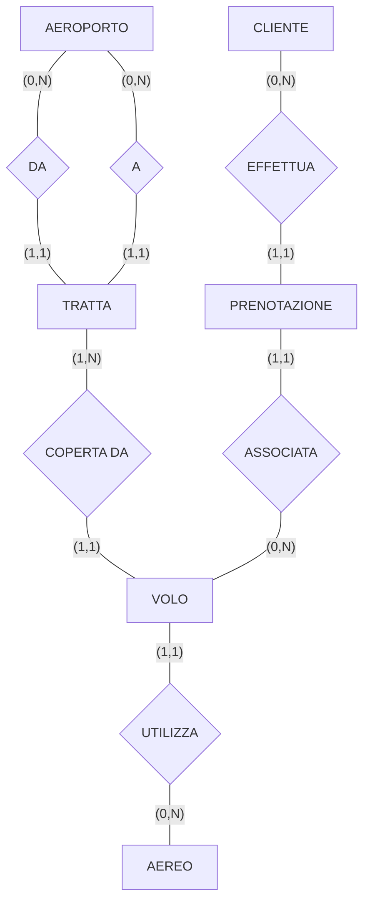

# Esercitazione finale — Report di progetto: "Sistema di gestione di voli di una compagnia aerea"

> [!info] Fonte e scopo
> Documento *"Basi di Dati e Conoscenza — Progetto A.A. 2025/2026"*: esempio completo di **report di progetto** (struttura da seguire per il proprio progetto).
> Mette in pratica: [[Modello Entity-Relationship]] · [[Modello ER esteso]] · [[Modello relazionale]] · [[SQL - Definizione dei dati (DDL)]] · [[SQL - Interrogazioni e aggiornamenti (DML)]] · [[Organizzazione fisica dei dati]] · [[00 Indice|Indice]]

## Struttura del report (indice)
1. **Descrizione del Minimondo**
2. **Analisi dei Requisiti**
3. **Progettazione concettuale**
4. **Progettazione logica**
5. **Progettazione fisica**

---

## 1. Descrizione del Minimondo
(testo originale, con le righe numerate — servono per riferire i termini ambigui)

> 1 Si vuole realizzare un sistema informatico per la gestione delle prenotazioni di biglietti
> 2 aerei di una compagnia nazionale di piccola dimensione. L'agenzia permette agli addetti di
> 3 segreteria, mediante contatto telefonico, di consentire ai clienti di prenotare biglietti aerei
> 4 su voli operanti nelle tratte coperte.
> 5 Il sistema deve permettere di gestire tutti i voli coperti dalla compagnia. Quando entra in
> 6 contatto con la segreteria, l'utente comunica il proprio nome e cognome e indica per quale
> 7 tratta, identificata da aeroporto di partenza e arrivo e da orario di partenza e arrivo, vuole
> 8 effettuare la prenotazione. Non è possibile acquistare più di un biglietto per volta. Per fini
> 9 statistici, la segreteria può generare dei report settimanali in cui viene dettagliata
> 10 l'occupazione degli aerei.
> 11 Gli amministratori della compagnia tengono traccia delle tipologie di aerei che hanno a
> 12 disposizione e associano un aereo a ciascun volo.
> 13 L'amministrazione può generare un report che mostri l'elenco dei prenotati per tutti quei
> 14 voli in cui c'è almeno una prenotazione. Inoltre, può inserire nuovi voli. Le tratte sono
> 15 prefissate e non sono soggette ad aggiornamento. Nel periodo estivo, vengono talvolta
> 16 organizzati charter da e verso destinazioni esotiche.

---

## 2. Analisi dei Requisiti

### Identificazione dei termini ambigui e correzioni possibili
| Linea | Termine | Nuovo termine | Motivo correzione |
|---|---|---|---|
| 7 | Tratta | Volo | La prenotazione è relativa ad un volo, non ad una tratta. |
| 10, 11 | Aereo | Tipologia di aereo | A valle del contatto con il cliente, si è capito che il sistema non deve gestire la singola istanza di aereo. |
| 6 | Utente | Cliente | Le prenotazioni vengono gestite dalla segreteria. |
| 7 | Identificata | Associato ad una tratta identificata | Confusione tra volo e tratta: la tratta lega gli aeroporti, non il volo. |
| 8 | Acquistare | Prenotare | Il sistema gestisce le prenotazioni, non le transazioni d'acquisto. |
| 10 | Aerei | Voli | Non viene gestita l'associazione aereo-volo. |
| 13 | Prenotati | Clienti | Le prenotazioni si riferiscono ai clienti. |
| 15 | Charter | Tratte | Non c'è differenza semantica nel minimondo di riferimento. |
| 16 | Destinazione | Aeroporto | Le tratte sono associate ad aeroporti, la destinazione è quindi semanticamente equivalente all'aeroporto. |

### Specifica disambiguata
> Si vuole realizzare un sistema informatico per la gestione delle prenotazioni di biglietti aerei di una compagnia nazionale di piccola dimensione. L'agenzia permette agli addetti di segreteria, mediante contatto telefonico, di consentire ai clienti di prenotare biglietti aerei su voli operanti nelle tratte coperte.
> Il sistema deve permettere di gestire tutti i voli coperti dalla compagnia. Quando entra in contatto con la segreteria, il **cliente** comunica il proprio nome e cognome e indica per quale **volo** (specificando l'orario di partenza e arrivo), **associato ad una tratta identificata** da aeroporto di partenza e arrivo, vuole effettuare la prenotazione. Non è possibile **prenotare** più di un biglietto per volta. Per fini statistici, la segreteria può generare dei report settimanali in cui viene dettagliata l'occupazione dei **voli**.
> Gli amministratori della compagnia tengono traccia delle tipologie di aerei che hanno a disposizione e associano una **tipologia di aereo** a ciascun volo. L'amministrazione può generare un report che mostri l'elenco dei **clienti** per tutti quei voli in cui c'è almeno una prenotazione. Inoltre, può inserire nuovi voli. Le tratte sono prefissate e non sono soggette ad aggiornamento. Nel periodo estivo, vengono talvolta coperte **tratte** da e verso **aeroporti** in località esotiche.

### Glossario dei termini
| Termine | Descrizione | Sinonimi | Collegamenti |
|---|---|---|---|
| Prenotazione | Il cliente, tramite contatto telefonico, riserva un posto su un volo. | Acquisto | Cliente, Volo. |
| Tratta | Descrive il collegamento tra due aeroporti. | Volo, aereo, charter | Aeroporto, Volo. |
| Volo | Rappresenta il collegamento fisico, a mezzo di un'istanza di aereo, tra due aeroporti per coprire una determinata tratta. | Aereo | Tratta, Prenotazione. |
| Cliente | È colui che effettua una prenotazione. | Utente, prenotato | Prenotazione. |
| Aeroporto | Identifica il punto di partenza o di arrivo di una determinata tratta. | Destinazione | Tratta. |
| Tipologia di aereo | Rappresenta una classe di aerei, di cui interessa conoscere il numero di posti. | Aereo | Volo. |

### Raggruppamento dei requisiti in insiemi omogenei
**Frasi relative a Prenotazione**
- Si vuole realizzare un sistema informatico per la gestione delle prenotazioni di biglietti aerei di una compagnia nazionale di piccola dimensione. L'agenzia permette agli addetti di segreteria, mediante contatto telefonico, di consentire ai clienti di prenotare biglietti aerei su voli operanti nelle tratte coperte.
- Il cliente comunica il proprio nome e cognome e indica per quale volo (specificando l'orario di partenza e arrivo) […] vuole effettuare la prenotazione. Non è possibile prenotare più di un biglietto per volta.
- L'amministrazione può generare un report che mostri l'elenco dei clienti per tutti quei voli in cui c'è almeno una prenotazione.
- Nel periodo estivo, vengono talvolta coperte tratte da e verso aeroporti in località esotiche.

**Frasi relative a Tratta**
- L'agenzia permette agli addetti di segreteria, mediante contatto telefonico, di consentire ai clienti di prenotare biglietti aerei su voli operanti nelle tratte coperte.
- [La] tratta [è] identificata da aeroporto di partenza e arrivo.
- Le tratte sono prefissate e non sono soggette ad aggiornamento.

**Frasi relative a Volo**
- L'agenzia permette agli addetti di segreteria […] di prenotare biglietti aerei su voli operanti nelle tratte coperte.
- Il sistema deve permettere di gestire tutti i voli coperti dalla compagnia.
- Il cliente comunica [telefonicamente alla segreteria] il proprio nome e cognome e indica per quale volo (specificando l'orario di partenza e arrivo) […] vuole effettuare la prenotazione.
- Per fini statistici, la segreteria può generare dei report settimanali in cui viene dettagliata l'occupazione dei voli.
- Gli amministratori della compagnia […] associano una tipologia di aereo a ciascun volo.
- L'amministrazione può generare un report che mostri l'elenco dei clienti per tutti quei voli in cui c'è almeno una prenotazione.
- [L'amministrazione] può inserire nuovi voli.

**Frasi relative a Cliente**
- L'agenzia permette agli addetti di segreteria […] di consentire ai clienti di prenotare biglietti aerei su voli operanti nelle tratte coperte.
- Quando entra in contatto con la segreteria, il cliente comunica il proprio nome e cognome e indica per quale volo […] vuole effettuare la prenotazione.
- L'amministrazione può generare un report che mostri l'elenco dei clienti per tutti quei voli in cui c'è almeno una prenotazione.

**Frasi relative a Aeroporto**
- [La] tratta identificata da aeroporto di partenza e arrivo e da orario di partenza e arrivo.
- Nel periodo estivo, vengono talvolta coperte tratte da e verso aeroporti in località esotiche.

**Frasi relative a Tipologia di aereo**
- Gli amministratori della compagnia tengono traccia delle tipologie di aerei che hanno a disposizione e associano una tipologia di aereo a ciascun volo.

---

## 3. Progettazione concettuale

### Costruzione dello schema E-R
*[omesso per brevità, si faccia riferimento a quanto discusso a lezione]*

### Integrazione finale (schema E-R)

- **AEROPORTO**: Città ●, Nazione
- **TRATTA**: identificatore esterno **Da + A** (i due aeroporti)
- **VOLO**: Codice, Giorno; identificatore **Codice + Giorno + COPERTA DA** (tratta)
- **CLIENTE**: identificatore **Nome + Cognome**
- **PRENOTAZIONE**: Codice; identificatore **Codice + ASSOCIATA** (volo)
- **AEREO**: Tipo ●, Passeggeri

### Regole aziendali
- Un cliente **non può avere più di una prenotazione per volo**.
- Il numero di prenotazioni per un volo **non può superare la capienza dell'aereo**.
- Il numero di posti di un aereo deve essere **maggiore di zero**.
- La data/ora di partenza deve essere **precedente** alla data/ora di arrivo.

### Dizionario dei dati
| Entità | Descrizione | Attributi | Identificatori |
|---|---|---|---|
| Aeroporto | Un aeroporto situato in una località servita dalla compagnia | Nazione | Città |
| Tratta | Il collegamento tra due aeroporti | | Da, A |
| Cliente | Le informazioni sul cliente che effettua una prenotazione | | Nome, cognome |
| Prenotazione | La prenotazione di un singolo posto effettuata dal cliente | | Codice, Associata |
| Volo | Il collegamento, in una certa data, per coprire una determinata tratta | | Codice, coperto da, giorno |
| Aereo | La classificazione delle tipologie di aereo utilizzate dalla compagnia | Passeggeri | Tipo |

---

## 4. Progettazione logica

### Volume dei dati
Ipotesi:
- il sistema mantiene i dati relativi a clienti e prenotazioni per un periodo **non superiore a 10 anni**; lo stesso vale per i voli;
- vengono coperte, ogni giorno, il **15% delle tratte possibili**;
- mediamente ciascun aereo ha **50 posti** e le prenotazioni occupano il **50%** della disponibilità;
- il **60%** delle prenotazioni viene da **clienti ricorrenti**;
- le informazioni legate alle tratte coperte sono considerate **fisse**, data la dimensione relativamente piccola della compagnia.

| Concetto nello schema | Tipo | Volume atteso |
|---|---|---|
| Aeroporto | E | 20 |
| Tratta | E | 300 |
| Cliente | E | 500.000 |
| Prenotazione | E | 4.100.000 |
| Volo | E | 165.000 |
| Aereo | E | 5 |
| Da | R | 300 |
| A | R | 300 |
| Effettua | R | 4.100.000 |
| Associata | R | 4.100.000 |
| Coperto da | R | 165.000 |
| Utilizza | R | 165.000 |

### Tavola delle operazioni
| Cod. | Descrizione | Frequenza attesa |
|---|---|---|
| AG1 | Lista voli | 500/giorno |
| AG2 | Registra prenotazione | 340/giorno |
| AG3 | Report prenotazioni | 40/mese |
| AM1 | Registra volo | 30/anno |
| AM2 | Report occupazione voli | 10/mese |
| L1 | Login | 200/giorno |

### Costo delle operazioni
**AG1 – Lista voli** (accessi per esecuzione):
- Volo: 165.000
- Tratta: 165.000
- Aeroporto: 330.000
- Coperta da: 165.000
- Da: 165.000
- A: 165.000
- **Costo totale: 1.155.000** → **Accessi/giorno: 577.500.000** (× 500/giorno)

**Accorpando le entità**:
- Volo: 165.000 × 500 = **82.500.000**
- **Risparmio 495.000.000 di accessi**

### Ristrutturazione dello schema E-R (schema logico risultante)
- **Aeroporto**(<u>Citta</u> VARCHAR(45), Nazione VARCHAR(45))
- **Volo**(<u>idVolo</u> VARCHAR(45), <u>Giorno</u> DATE, CittaPart VARCHAR(45), OraPart TIME, CittaArr VARCHAR(45), OraArr TIME, TipoAereo VARCHAR(45))
  - CittaPart, CittaArr → FK verso Aeroporto; TipoAereo → FK verso Aereo
  - (Tratta accorpata nel Volo: le città di partenza/arrivo sono attributi del volo)
- **Aereo**(<u>TipoAereo</u> VARCHAR(45), NumPasseggeri INT) — indice PRIMARY
- **Prenotazione**(<u>codice</u> INT, idVolo VARCHAR(45), Giorno DATE, Nome VARCHAR(45), Cognome VARCHAR(45))
  - (idVolo, Giorno) → FK verso Volo
  - indici: PRIMARY, fk_Prenotazione_Volo1_idx, unique_reservation
  - trigger: BEFORE INSERT `Check_Prenotazione`
  - (Cliente accorpato nella Prenotazione tramite Nome, Cognome)

### Normalizzazione del modello relazionale
- Il modello **non** è in forma normale. Vi sono **anomalie di aggiornamento, inserimento ed eliminazione** sulla relazione Prenotazione e Volo.
- Tuttavia, dato il **significativo risparmio prestazionale** e la tipologia di operazioni previste, si decide di **mantenere il modello dei dati in questa forma**.

---

## 5. Progettazione fisica

### Utenti e privilegi
Si prevedono **tre ruoli**, per implementare il **Principle of Least Privilege**:
- **Login**: grant in esecuzione sull'operazione **L1**
- **Agenzia**: grant in esecuzione sulle operazioni **AG1, AG2, AG3**
- **Amministratore**: grant in esecuzione sulle operazioni **AM1 e AM2**

Per identificare gli utenti si introduce una tabella **Utenti** per mantenerne le credenziali.

### Strutture di memorizzazione
**Tabella Utenti**
| Colonna | Tipo di dato | Attributi |
|---|---|---|
| username | Varchar(45) | PK, NN |
| password | Char(32) | NN |
| Ruolo | ENUM('amministratore', 'agenzia') | NN |

**Tabella Aereo**
| Colonna | Tipo di dato | Attributi |
|---|---|---|
| TipoAereo | Varchar(45) | PK, NN |
| NumPasseggeri | UNSIGNED INT | NN |

**Tabella Aeroporto**
| Colonna | Tipo di dato | Attributi |
|---|---|---|
| Citta | Varchar(45) | PK, NN |
| Nazione | Varchar(45) | NN |

**Tabella Prenotazione**
| Colonna | Tipo di dato | Attributi |
|---|---|---|
| Codice | INT | PK, NN, AI |
| idVolo | Varchar(45) | NN |
| Giorno | DATE | NN |
| Nome | Varchar(45) | NN |
| Cognome | Varchar(45) | NN |

**Tabella Volo**
| Colonna | Tipo di dato | Attributi |
|---|---|---|
| idVolo | Varchar(45) | PK, NN |
| Giorno | DATE | PK, NN |
| CittaPart | Varchar(45) | NN |
| OraPart | TIME | NN |
| CittaArr | Varchar(45) | NN |
| OraArr | TIME | NN |
| TipoAereo | Varchar(45) | NN |

(PK = primary key, NN = not null, AI = auto increment)

### Indici
Per garantire che la prenotazione su un volo in un dato giorno da parte di un cliente sia **unica**, viene introdotto il seguente **indice unique**:

| Tabella Prenotazione | Tipo |
|---|---|
| Indice `unique_reservation` | UQ |
| idVolo, Giorno, Nome, Cognome | |

L'introduzione di un **indice secondario** migliora drasticamente il tempo d'accesso ai dati per l'operazione **AG1** (si faccia riferimento alle slide, [[Organizzazione fisica dei dati#7. File indicizzati]]), pertanto si utilizza:

| Tabella Volo | Tipo |
|---|---|
| Indice `departure` | IDX |
| Giorno, OraPart | |

### Trigger
**Tabella Prenotazione: BEFORE INSERT** — implementa un controllo per evitare che si effettui una prenotazione che fa **superare la capienza** di un aereo.
```sql
DELIMITER $$
DROP TRIGGER IF EXISTS `airports`.`Check_Prenotazione` $$
CREATE TRIGGER `airports`.`Check_Prenotazione` BEFORE INSERT ON `airports`.`Prenotazione`
FOR EACH ROW
BEGIN
    declare var_numPasseggeri int;
    declare var_prenotazioni int;

    select `Aereo`.`NumPasseggeri`, coalesce(count(`Prenotazione`.`codice`), 0) as `prenotazioni`
    into var_numPasseggeri, var_prenotazioni
    from `Volo`
        join `Aereo` on `Volo`.`TipoAereo` = `Aereo`.`TipoAereo`
        left join `Prenotazione` on `Prenotazione`.`idVolo` = `Volo`.`idVolo`
                                and `Prenotazione`.`Giorno` = `Volo`.`Giorno`
    where `Volo`.`idVolo` = NEW.`idVolo` and `Volo`.`Giorno` = NEW.`Giorno`
    group by `Aereo`.`NumPasseggeri`;

    if var_prenotazioni + 1 > var_numPasseggeri then
        signal sqlstate '45001' set message_text = 'Disponibilità esaurita';
    end if;
END$$
DELIMITER ;
```

### Eventi
Non sono stati utilizzati eventi.

### Viste
Non sono state utilizzate viste.

### Stored Procedures e transazioni

**Operazione AG1 – Lista voli**
```sql
CREATE PROCEDURE `airports`.`lista_voli`(in var_dataPartenza timestamp)
BEGIN
    declare exit handler for sqlexception
    begin
        rollback;
        resignal;
    end;

    set transaction isolation level read committed;
    set transaction read only;
    start transaction;
        select
            `Volo`.`idVolo`,
            `CittaPart`,
            TIMESTAMP(`Volo`.`Giorno`, `Volo`.`OraPart`) as `Partenza`,
            `CittaArr`,
            TIMESTAMP(`Volo`.`Giorno`, `Volo`.`OraArr`) as `Arrivo`,
            `NumPasseggeri` - count(codice) as `Disponibili`
        from `Volo`
        left join `Prenotazione` on `Prenotazione`.`idVolo` = `Volo`.`idVolo`
                                and `Prenotazione`.`Giorno` = `Volo`.`Giorno`
        join `Aereo` on `Volo`.`TipoAereo` = `Aereo`.`TipoAereo`
        group by `idVolo`, `Partenza`
        having `Disponibili` > 0 and `Partenza` >= var_dataPartenza;
    commit;
END$$
```

**Operazione AG2 – Registra prenotazione**
```sql
CREATE PROCEDURE `airports`.`registra_prenotazione` (in var_idVolo varchar(45), in var_giorno date,
    in var_nome varchar(45), in var_cognome varchar(45), out codice_prenotazione int)
BEGIN
    declare exit handler for sqlexception
    begin
        rollback;
        resignal;
    end;

    set transaction isolation level serializable; -- The associated trigger cannot use 'for update'
    start transaction;
        insert into `Prenotazione` (`idVolo`, `Giorno`, `Nome`, `Cognome`)
            values (var_idVolo, var_giorno, var_nome, var_cognome);
    commit;

    set codice_prenotazione = last_insert_id();
END$$
```

**Operazione AG3 – Report prenotazioni**
> [!warning] L'implementazione di questa procedura è **fortemente subottimale**, viene mostrata unicamente per illustrare il funzionamento di alcuni costrutti SQL (cursori, handler, tabelle temporanee).
```sql
CREATE PROCEDURE `airports`.`report_prenotazioni` ()
BEGIN
    declare done int default false;
    declare var_idVolo varchar(45);
    declare var_cittaPart varchar(45);
    declare var_cittaArr varchar(45);
    declare var_data date;

    declare cur cursor for
        select `Volo`.`idVolo`, `CittaPart`, `CittaArr`, `Volo`.`Giorno` as `Data`
        from `Volo`
        left join `Prenotazione` on `Prenotazione`.`idVolo` = `Volo`.`idVolo`
                                and `Prenotazione`.`Giorno` = `Volo`.`Giorno`
        group by `Volo`.`idVolo`, `Data`
        having count(codice) > 0;

    declare exit handler for sqlexception
    begin
        rollback;
        resignal;
    end;

    declare continue handler for not found set done = true;

    -- Create a table to store temporary results to be returned to the caller
    -- A temporary table is per-session
    drop temporary table if exists `ListaVoli`;
    create temporary table `ListaVoli` (
        `idVolo` varchar(45),
        `CittaPart` varchar(45),
        `CittaArr` varchar(45),
        `Data` date
    );

    set transaction isolation level serializable;
    set transaction read only;
    start transaction;
        open cur;
        read_loop: loop
            fetch cur into var_idVolo, var_cittaPart, var_cittaArr, var_data;
            if done then
                leave read_loop;
            end if;
            insert into `ListaVoli` values (var_idVolo, var_cittaPart, var_cittaArr, var_data);
        end loop;
        close cur;

        -- Return the list of flights with a reservation
        select * from `ListaVoli`;

        -- Now return information about people that reserved a seat
        open cur;
        set done = false;
        read_loop: loop
            fetch cur into var_idVolo, var_cittaPart, var_cittaArr, var_data;
            if done then
                leave read_loop;
            end if;
            select `Cognome`, `Nome` from `Prenotazione`
            where `idVolo` = var_idVolo and `Giorno` = var_data
            order by `Cognome`, `Nome`;
        end loop;
        close cur;
    commit;
END$$
```

**Operazione AM1 – Registra volo**
```sql
CREATE PROCEDURE `airports`.`registra_volo` (in var_idVolo varchar(45), in var_giorno date,
    in var_cittaPart varchar(45), in var_oraPart time, in var_cittaArr varchar(45),
    in var_oraArr time, in var_tipoAereo varchar(45))
BEGIN
    insert into `Volo` (`idVolo`, `Giorno`, `CittaPart`, `OraPart`, `CittaArr`, `OraArr`, `TipoAereo`)
        values (var_idVolo, var_giorno, var_cittaPart, var_oraPart, var_cittaArr, var_oraArr, var_tipoAereo);
END$$
```

**Operazione AM2 – Report occupazione voli**
```sql
CREATE PROCEDURE `airports`.`report_occupazione_voli` ()
BEGIN
    declare exit handler for sqlexception
    begin
        rollback;
        resignal;
    end;

    set transaction isolation level read committed;
    set transaction read only;
    start transaction;
        select
            `Volo`.`idVolo`,
            `CittaPart`,
            TIMESTAMP(`Volo`.`Giorno`, `Volo`.`OraPart`) as `Partenza`,
            `CittaArr`,
            TIMESTAMP(`Volo`.`Giorno`, `Volo`.`OraArr`) as `Arrivo`,
            count(codice) as `Prenotati`,
            `NumPasseggeri` - count(codice) as `Disponibili`,
            count(codice) / `NumPasseggeri` * 100 as `Occupazione`
        from `Volo`
        left join `Prenotazione` on `Prenotazione`.`idVolo` = `Volo`.`idVolo`
                                and `Prenotazione`.`Giorno` = `Volo`.`Giorno`
        join `Aereo` on `Volo`.`TipoAereo` = `Aereo`.`TipoAereo`
        group by `idVolo`, `Partenza`;
    commit;
END$$
```

**Operazione L1 – Login**
```sql
CREATE PROCEDURE `airports`.`login` (in var_username varchar(45), in var_pass varchar(45), out var_role INT)
BEGIN
    declare var_user_role ENUM('amministratore', 'agenzia');

    select `ruolo` from `Utenti`
        where `username` = var_username
        and `password` = md5(var_pass)
        into var_user_role;

    -- See the corresponding enum in the client
    if var_user_role = 'amministratore' then
        set var_role = 1;
    elseif var_user_role = 'agenzia' then
        set var_role = 2;
    else
        set var_role = 3;
    end if;
END$$
```

> [!tip] Concetti SQL usati nelle procedure (riepilogo)
> - `declare exit handler for sqlexception … rollback; resignal;` → in caso di errore annulla la transazione e rilancia l'errore;
> - `set transaction isolation level read committed | serializable` e `set transaction read only` → livello di isolamento / transazioni di sola lettura;
> - `start transaction … commit` → delimitazione della transazione;
> - `left join` + `count(codice)` → conteggio delle prenotazioni anche per voli senza prenotazioni (0);
> - **cursori** (`declare cur cursor for …`, `open`, `fetch`, `close`) e `declare continue handler for not found`;
> - **tabelle temporanee** (per sessione);
> - `signal sqlstate '45001'` → errore personalizzato nel trigger;
> - `last_insert_id()` → chiave generata dall'AUTO_INCREMENT.
