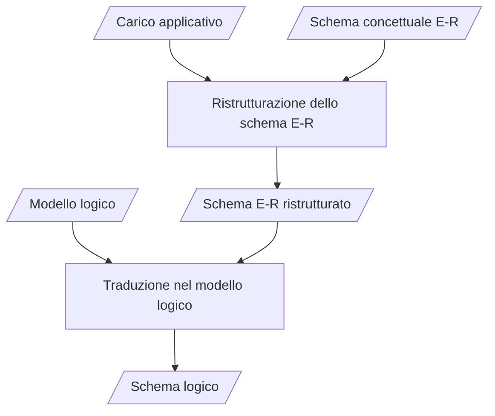
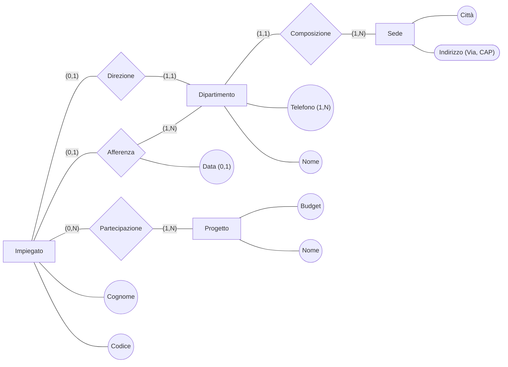
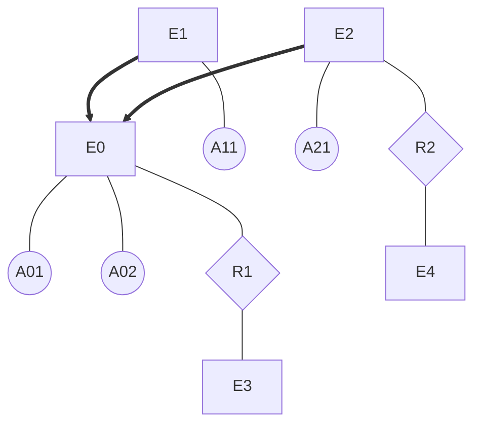
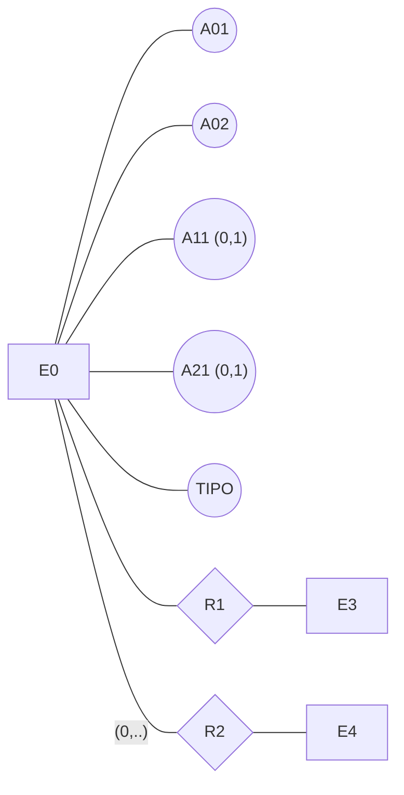
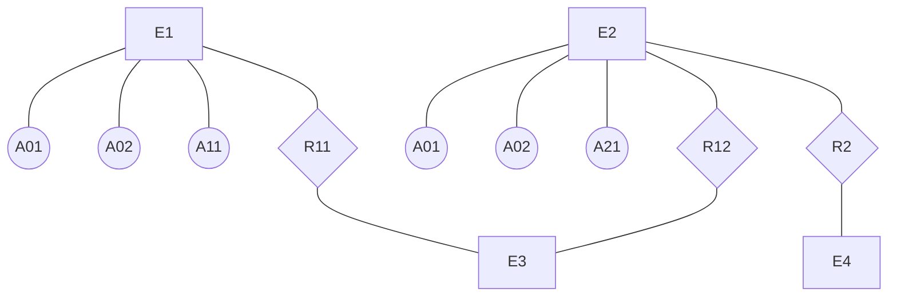
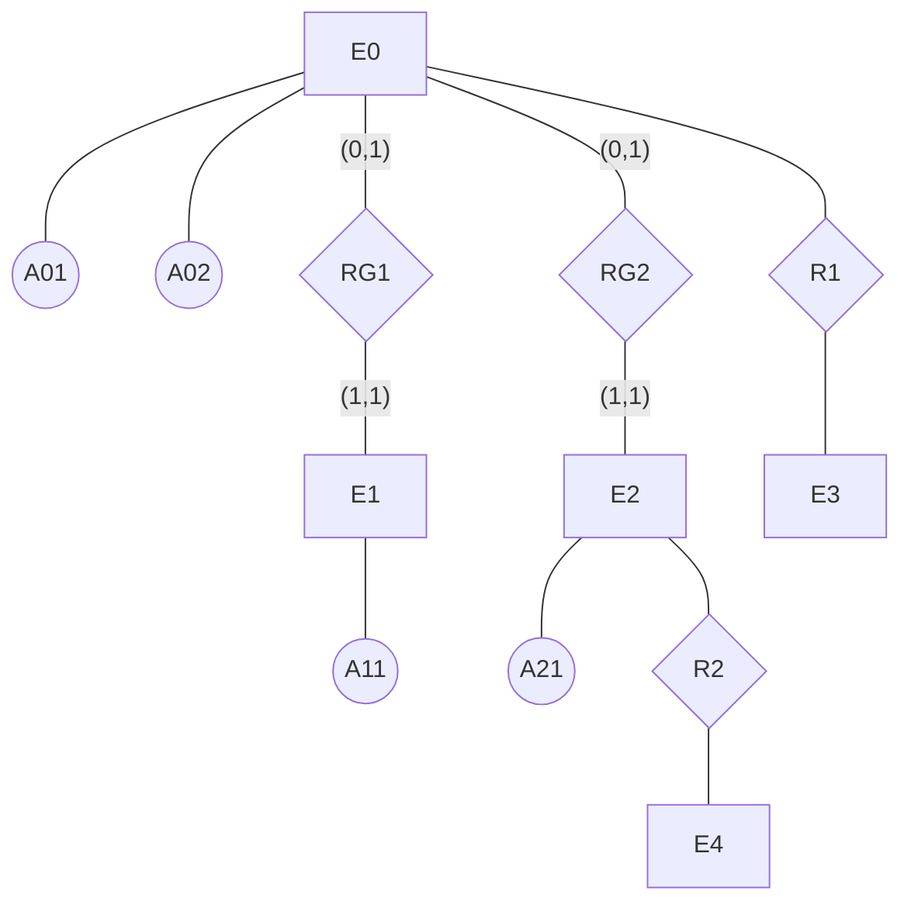
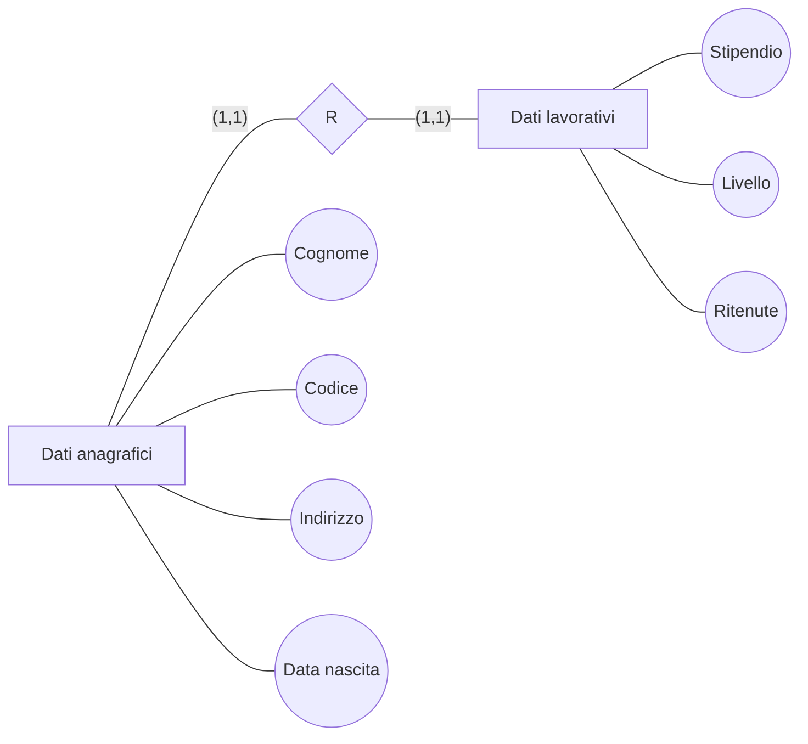
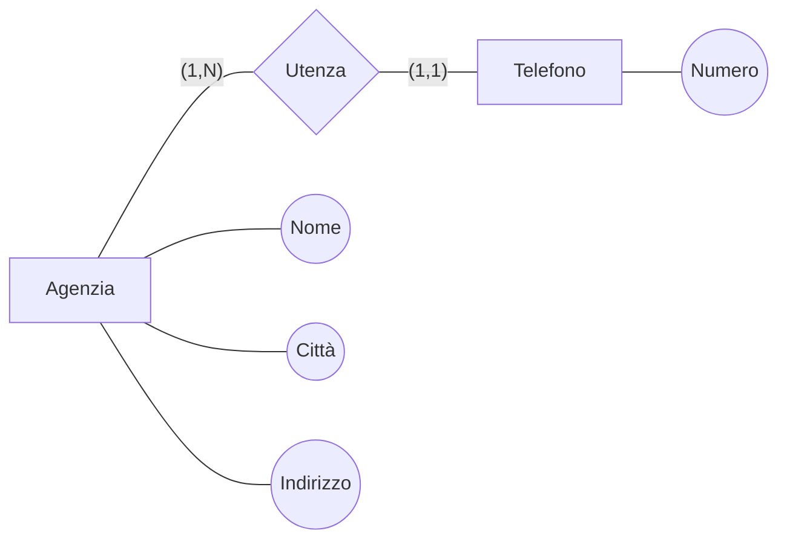
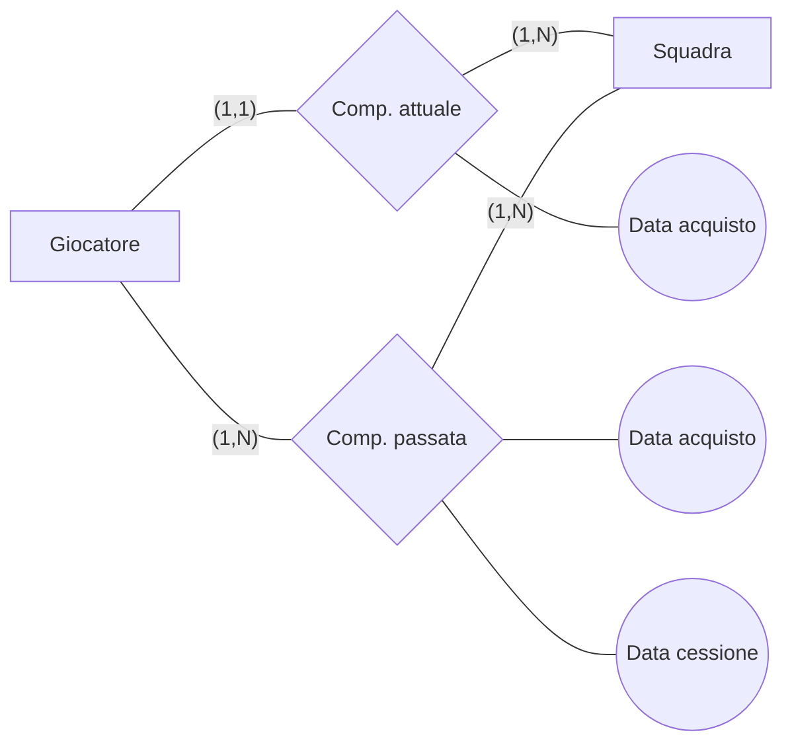

# Progettazione logica: ristrutturazione dello schema E-R

> [!info] Fonte
> Slides *"Progettazione logica — ristrutturazione dello schema E-R"* — Prof. Vittoria de Nitto Personè (a.a. 2026/27).
> Prerequisiti: [[Modello Entity-Relationship]] · [[Modello ER esteso]] · [[Progettazione concettuale - Metodologia e strategie]]. Collegamenti: [[Modello relazionale]] · [[00 Indice|Indice]]

> [!tip] Notazione dei diagrammi in questa nota
> Nei diagrammi Mermaid: **rettangolo** = entità, **rombo** = associazione (relationship), **cerchio** = attributo. Le cardinalità sono etichette sulle linee.

---

## 1. Collocazione nella metodologia

La **progettazione logica** trasforma lo schema concettuale E-R in uno **schema logico** (relazionale). Si articola in due passi:

Gli ingressi della ristrutturazione sono lo **schema concettuale E-R** e il **carico applicativo** (le operazioni con le loro frequenze); l'ingresso della traduzione è anche il **modello logico** di destinazione (per noi il [[Modello relazionale|modello relazionale]]). Questa nota copre il **primo passo** (ristrutturazione).

## 2. Carico applicativo: esempio di riferimento

Si riprende lo schema aziendale (vedi [[Modello ER esteso#4. Esempio di schema aziendale]]):

Operazioni del carico applicativo:
- **Operazione 1**: assegna un impiegato ad un progetto;
- **Operazione 2**: trova tutti i dati di un impiegato, del dipartimento nel quale lavora e dei progetti ai quali partecipa;
- **Operazione 3**: trova i dati di tutti gli impiegati di un certo dipartimento;
- **Operazione 4**: per ogni sede, trova i suoi dipartimenti con il cognome del direttore e l'elenco degli impiegati del dipartimento.

### Tavola dei volumi
Per ogni concetto (Entità o Relationship) si stima il **volume** (numero di occorrenze):

| Concetto | Tipo | Volume |
|---|---|---|
| Sede | E | 10 |
| Dipartimento | E | 80 |
| Impiegato | E | 2000 |
| Progetto | E | 500 |
| Composizione | R | 80 |
| Afferenza | R | 1900 |
| Direzione | R | 80 |
| Partecipazione | R | 6000 |

### Valutazione di costo: tavola degli accessi
Per un'operazione si traccia lo **schema di operazione** (il cammino sullo schema E-R) e si contano gli **accessi** ai concetti attraversati, distinguendo il tipo: **L** = lettura, **S** = scrittura.

Esempio, **operazione 2** (dati di un impiegato, del suo dipartimento e dei progetti a cui partecipa — in media un impiegato partecipa a 3 progetti):

| Concetto | Costrutto | Accessi | Tipo |
|---|---|---|---|
| Impiegato | Entità | 1 | L |
| Afferenza | Relationship | 1 | L |
| Dipartimento | Entità | 1 | L |
| Partecipazione | Relationship | 3 | L |
| Progetto | Entità | 3 | L |

## 3. Attività della ristrutturazione

1. **Analisi delle ridondanze**
2. **Eliminazione delle generalizzazioni**
3. **Partizionamento/accorpamento di entità e relationship**
4. **Scelta degli identificatori primari**

---

## 4. Analisi delle ridondanze

### Forme di ridondanza in uno schema E-R
- **attributi derivabili**:
	- da altri attributi della **stessa entità** (o relationship);
	- da attributi di **altre entità** (o relationship);
- **relationship derivabili** dalla composizione di altre (più in generale: **cicli di relationship**).

**Attributo derivabile (stessa entità)** — Fattura(`Importo netto`, `IVA`, `Importo lordo`): l'importo lordo è derivabile dagli altri due.

**Attributo derivabile da altra entità** — Acquisto(`Importo totale`) —(1,N)— Composizione(`Quantità`) —(0,N)— Prodotto(`Prezzo`): l'importo totale è derivabile da quantità e prezzi dei prodotti.

**Ridondanza dovuta a ciclo** — Studente —(0,N)— Frequenza —(1,N)— Corso; Corso —(1,1)— Insegnamento —(0,N)— Professore; Studente —(0,N)— Docenza —(0,N)— Professore: la relationship **Docenza** è derivabile componendo Frequenza e Insegnamento.

### Analisi di una ridondanza: esempio Persona–Città
Si valuta se conservare l'attributo ridondante `Numero abitanti` di Città (derivabile contando le occorrenze di Residenza):

Persona —— Residenza —— Città(`Numero abitanti`)

| Concetto | Tipo | Volume |
|---|---|---|
| Città | E | 200 |
| Persona | E | 1.000.000 |
| Residenza | R | 1.000.000 |

Carico applicativo:
- **Operazione 1**: memorizza una nuova persona con la relativa città di residenza (**500 volte al giorno**);
- **Operazione 2**: stampa tutti i dati di una città, incluso il numero di abitanti (**2 volte al giorno**).

**Presenza di ridondanza** (l'attributo c'è e va mantenuto aggiornato):

| Operazione 1 | Costrutto | Accessi | Tipo |
|---|---|---|---|
| Persona | Entità | 1 | S |
| Residenza | Associaz. | 1 | S |
| Città | Entità | 1 | L |
| Città | Entità | 1 | S |

| Operazione 2 | Costrutto | Accessi | Tipo |
|---|---|---|---|
| Città | Entità | 1 | L |

**Assenza di ridondanza** (il numero di abitanti si ricalcola quando serve):

| Operazione 1 | Costrutto | Accessi | Tipo |
|---|---|---|---|
| Persona | Entità | 1 | S |
| Residenza | Associaz. | 1 | S |

| Operazione 2 | Costrutto | Accessi | Tipo |
|---|---|---|---|
| Città | Entità | 1 | L |
| Residenza | Associaz. | 5000 | L |

Con la ridondanza l'operazione 1 (frequentissima) paga 2 accessi in più (di cui una scrittura, tipicamente più costosa) ogni volta; senza ridondanza l'operazione 2 (rara) paga 5000 letture. Il confronto dei costi complessivi, pesati con le frequenze, guida la scelta. *(integrazione: nelle slides il confronto numerico è lasciato come osservazione; con questi numeri la ridondanza conviene solo se le scritture aggiuntive costano meno delle 10000 letture giornaliere risparmiate — in questo caso 2 × 5000 letture contro 500 × (1 L + 1 S).)*

---

## 5. Eliminazione delle generalizzazioni

Il modello relazionale non ha il costrutto di generalizzazione: ogni generalizzazione va eliminata. **Tre possibilità**:
1. **accorpamento delle figlie** della generalizzazione **nel genitore**;
2. **accorpamento del genitore** della generalizzazione **nelle figlie**;
3. **sostituzione della generalizzazione con relationship**.

Schema di partenza (generico): E0(`A01`, `A02`) genitore di E1(`A11`) ed E2(`A21`); E0 —R1— E3; E2 —R2— E4.

### Possibilità 1: figlie accorpate nel genitore
E0 assorbe gli attributi delle figlie, resi opzionali, più un attributo discriminante `TIPO`:

R2 si sposta su E0 con partecipazione opzionale `(0,..)`. **Conviene se gli accessi al genitore e alle figlie sono contestuali.**

### Possibilità 2: genitore accorpato nelle figlie
Gli attributi di E0 vengono replicati nelle figlie; le relationship di E0 si sdoppiano:

R1 diventa R11 (da E1) e R12 (da E2) verso E3. **Conviene se gli accessi alle figlie sono distinti.** Possibile solo se la generalizzazione è **totale** *(integrazione: altrimenti le occorrenze del solo genitore andrebbero perse)*.

### Possibilità 3: sostituzione con relationship
La generalizzazione diventa una o più relationship RG1, RG2 tra genitore e figlie:

Le figlie sono identificate esternamente tramite RG1/RG2 e mantengono solo i propri attributi. **Conviene se gli accessi alle entità figlie sono separati dagli accessi al padre.**

Le possibilità si possono anche **combinare**: ad esempio accorpare E1 in E0 (con `A11 (0,1)` e `TIPO`) e mantenere E2 separata collegata da RG2 con E0 —(0,1)— RG2 —(1,1)— E2 (soluzione ibrida, utile se solo gli accessi a E2 sono separati).

---

## 6. Partizionamento e accorpamento di entità e relationship

Gli accessi si riducono:
- **separando** attributi di un concetto a cui si accede in operazioni diverse (**partizionamento**);
- **raggruppando** attributi di concetti diversi a cui si accede nelle stesse operazioni (**accorpamento**).

### Partizionamento verticale di entità
Impiegato(`Codice`, `Cognome`, `Indirizzo`, `Data nascita`, `Livello`, `Stipendio`, `Ritenute`) si separa in due entità collegate da una relationship uno-a-uno, se dati anagrafici e dati lavorativi sono acceduti da operazioni diverse:

I Dati lavorativi sono identificati esternamente tramite R.

### Eliminazione di attributi multivalore
Agenzia(`Nome`, `Città`, `Indirizzo`, `Telefono (1,N)`): l'attributo multivalore `Telefono` diventa un'entità collegata:

Telefono è identificato esternamente da `Numero` + Agenzia tramite Utenza.

### Accorpamento di entità
Persona(`Codice fiscale`, `Cognome`, `Indirizzo`, `Data nascita`) —(0,1)— Intestazione —(1,1)— Appartamento(`Interno`, `Indirizzo`): se le due entità sono quasi sempre accedute insieme, si accorpano in un'unica entità Persona(`Codice fiscale`, `Cognome`, `Indirizzo`, `Data nascita`, `Interno (0,1)`, `Indirizzo appartamento (0,1)`), con attributi dell'appartamento opzionali (per le persone senza appartamento intestato).

### Partizionamento orizzontale di associazione
Giocatore(`Ruolo`, `Cognome`) —(1,N)— Composizione(`Data acquisto`, `Data cessione (0,1)`) —(1,N)— Squadra(`Città`, `Nome`): se le operazioni distinguono la composizione attuale da quella passata, la relationship si partiziona **orizzontalmente** (sulle occorrenze):

## 7. Scelta degli identificatori primari

Ultima attività della ristrutturazione: per ogni entità si sceglie, tra gli identificatori, quello **primario** (su cui si baserà la traduzione nel modello relazionale). *(integrazione: i criteri di scelta e la traduzione verso il modello logico sono trattati nelle slides successive del corso.)*
