# Progettazione logica: traduzione nel modello relazionale

> [!info] Fonte
> Slides *"Traduzione nel modello logico"* — Prof. Vittoria de Nitto Personè (a.a. 2026/27).
> Passo precedente: [[Progettazione logica - Ristrutturazione dello schema E-R]]. Prerequisiti: [[Modello Entity-Relationship]] · [[Modello relazionale]]. Verifica dello schema ottenuto: [[Normalizzazione]]. Collegamenti: [[00 Indice|Indice]]

> [!tip] Notazione usata in questa nota
> - Diagrammi Mermaid: **rettangolo** = entità, **rombo** = associazione, **cerchio** = attributo (un attributo identificatore è indicato con `●`), cardinalità come etichette sulle linee.
> - Schemi relazionali: `NOME(`<u>chiave</u>`, Attr, …)`, con la **chiave primaria sottolineata**.
> - Abbreviazioni delle slides: **sr** = schema relazionale, **am** = attributo multivalore, **kp** = chiave primaria, **vir** = vincolo di integrità referenziale (vedi [[Modello relazionale#9. Chiave esterna e integrità referenziale]]).

---

## 1. Collocazione nella metodologia

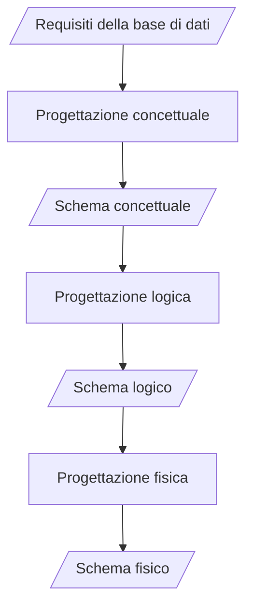

- La **progettazione concettuale** mira a una *rappresentazione accurata e naturale dei dati di interesse dal punto di vista del significato che hanno nell'applicazione*.
- La **progettazione logica** riguarda l'*effettiva realizzazione* e *deve tenere conto delle sue prestazioni*.

Il progetto logico si compone di due passi: la **ristrutturazione dello schema E-R** (vedi [[Progettazione logica - Ristrutturazione dello schema E-R]]) e la **traduzione nel modello logico**, oggetto di questa nota:

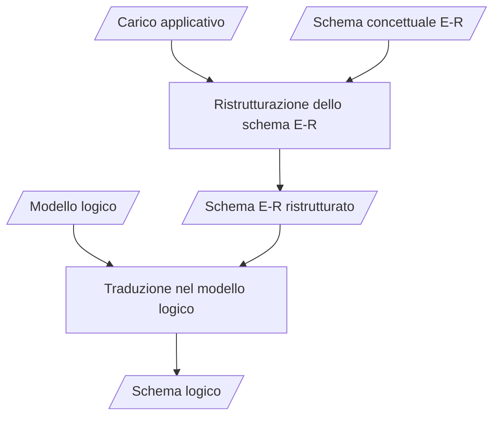

## 2. Idea di base

> [!abstract] Traduzione verso il modello relazionale
> - le **entità** diventano **relazioni sugli stessi attributi**;
> - le **relationship** diventano **relazioni sugli identificatori delle entità coinvolte** (più gli attributi propri).

Schema di riferimento (lo schema aziendale già visto in [[Progettazione logica - Ristrutturazione dello schema E-R|ristrutturazione]]):

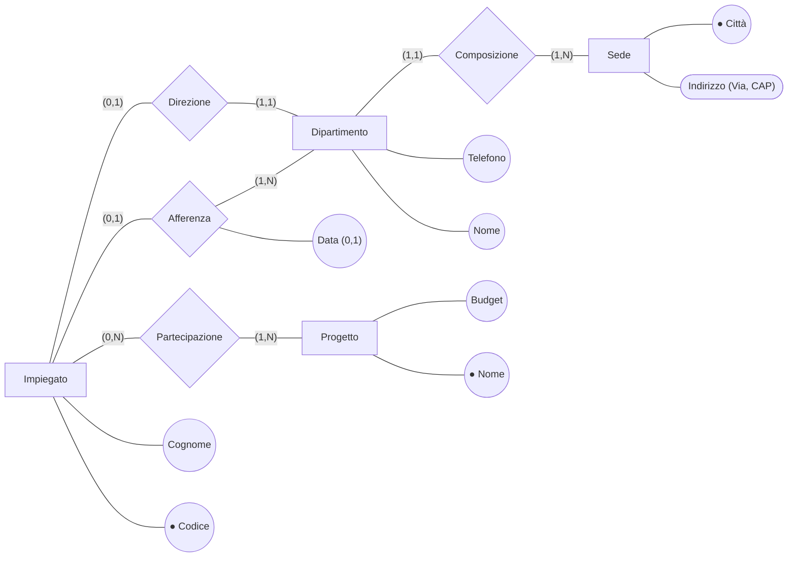

Nelle slides seguenti le regole sono illustrate con un esempio "musicale" (Musicista, Strumento, Brano) e con l'esempio Posto/Teatro delle [[Modello Entity-Relationship#12. Identificatore esterno — Entità debole|entità deboli]].

---

## 3. Traduzione di un'entità forte

> [!abstract] Regola
> - Creare uno schema relazionale il cui **nome è il nome dell'entità**.
> - Gli attributi dello schema relazionale sono **tutti gli attributi dell'entità**.
> - L'attributo che **identifica** l'entità è la **chiave primaria** dello schema relazionale.

Esempi di entità forti:

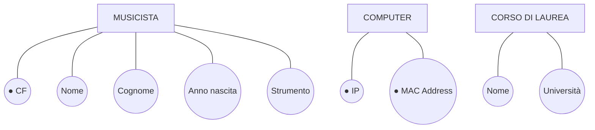

| Entità | Identificatore | Schema relazionale |
|---|---|---|
| MUSICISTA | `CF` | MUSICISTA(<u>CF</u>, Nome, Cognome, AnnoNascita, Strumento) |
| COMPUTER | `IP` e `MAC Address` sono **due identificatori distinti** (due chiavi candidate) | COMPUTER(<u>IP</u>, MACAddress) *(integrazione: si sceglie una delle due come chiave primaria, l'altra resta chiave candidata — vincolo `unique`)* |
| CORSO DI LAUREA | **identificatore composto** `Nome` + `Università` | CORSODILAUREA(<u>Nome</u>, <u>Università</u>) |

Caso più complesso: MUSICISTA con l'attributo **composto opzionale** `Indirizzo (0,1)` = (`Via`, `Numero`, `Città`) e l'attributo **multivalore** `Strumento (0,n)`:

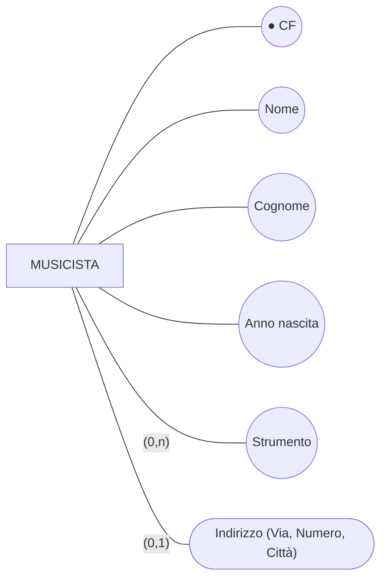

L'attributo composto si "appiattisce" nei suoi sotto-attributi (che possono valere `NULL`, essendo opzionale); l'attributo multivalore richiede una relazione a parte (§4).

## 4. Traduzione di un attributo multivalore

> [!abstract] Regola
> - Creare uno **sr** il cui **nome è il nome dell'attributo multivalore** (am).
> - Gli attributi del nuovo schema sono: **il nome dell'attributo** e la **chiave primaria dello sr relativo all'entità**.
> - La chiave primaria dello schema generato sarà la **composizione di tutti gli attributi** (*non sempre!*).
> - Aggiungere un **vir** tra lo sr dell'am e lo sr principale.

Esempio: MUSICISTA con `Indirizzo (0,1)` composto e `Strumento (0,n)` multivalore.

MUSICISTA(<u>CF</u>, Nome, Cognome, AnnoNascita, Via, Numero, Città)
STRUMENTO(<u>Nome</u>, <u>Musicista</u>) — vir: STRUMENTO.Musicista → MUSICISTA.CF

| MUSICISTA | CF | Nome | Cognome | Anno nascita | Via | Numero | Città |
|---|---|---|---|---|---|---|---|
| t1 | cf123 | Mario | Rossi | 1980 | Roma | 7 | Padova |
| t2 | cf456 | Alberto | Bianchi | 1988 | NULL | NULL | NULL |
| t3 | cf678 | Alessandro | Verdi | 1973 | Milano | 8b | Firenze |
| t4 | cf890 | Stefano | Neri | 1995 | Verdi | 140 | Venezia |
| t5 | cf098 | Alessandro | Bianchi | 1992 | XX Settembre | 57 | Milano |

| STRUMENTO | Nome | Musicista |
|---|---|---|
| t1 | Piano | cf123 |
| t2 | Sax | cf678 |
| t3 | Violino | cf890 |
| t4 | Violino | cf123 |

Si noti che: l'indirizzo opzionale di Bianchi (cf456) è rappresentato con tre `NULL`; Rossi (cf123) suona due strumenti (due ennuple in STRUMENTO); i musicisti che non suonano strumenti (cardinalità minima 0) semplicemente non compaiono in STRUMENTO.

### Da non confondere con… la reificazione di attributo di entità

Se l'attributo multivalore viene **reificato** in fase concettuale (vedi [[Progettazione concettuale - Metodologia e strategie#7. Schemi notevoli (pattern di modellazione)|schemi notevoli]]), lo strumento diventa un'**entità** con propri attributi, collegata a MUSICISTA da un'associazione:

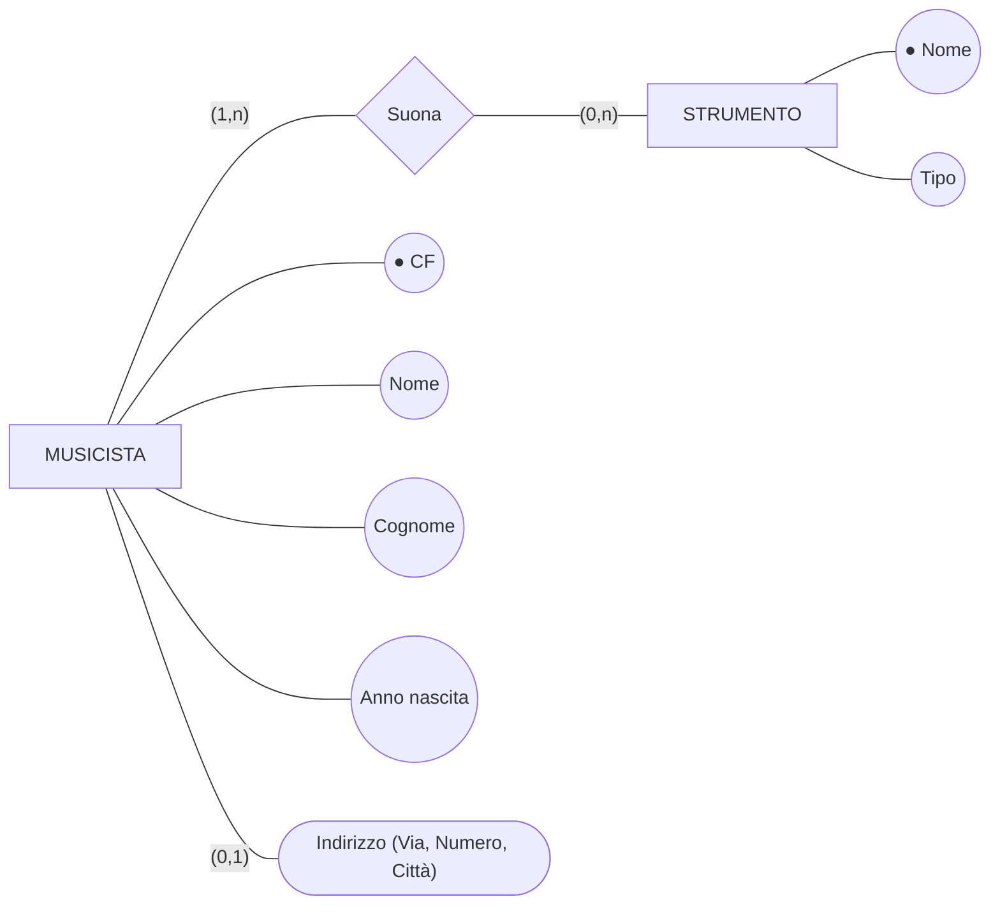

In questo caso STRUMENTO è un'entità vera e propria (con il suo identificatore `Nome` e l'attributo `Tipo`) e la traduzione segue le regole delle **associazioni** (§5), non quelle dell'attributo multivalore.

---

## 5. Traduzione di un'associazione molti a molti

> [!abstract] Regola
> - Trasformare le **due entità** nei due sr corrispondenti (v. traduzione entità forte).
> - Aggiungere uno **sr corrispondente all'associazione** che ha come attributi le **kp delle due entità** partecipanti ed eventuali **attributi dell'associazione**.
> - La kp di questo nuovo schema sarà la **composizione delle due kp**.
> - Aggiungere **due vir** tra gli attributi della chiave composta e le kp.

MUSICISTA(<u>CF</u>, Nome, Cognome)
STRUMENTO(<u>Nome</u>, Tipo)
SUONA(<u>Musicista</u>, <u>Strumento</u>, AnnoInizio) — vir: SUONA.Musicista → MUSICISTA.CF; SUONA.Strumento → STRUMENTO.Nome

| MUSICISTA | <u>CF</u> | Nome | Cognome |
|---|---|---|---|
| t1 | cf123 | Mario | Rossi |
| t2 | cf456 | Alberto | Bianchi |
| t3 | cf678 | Alessandro | Verdi |

| STRUMENTO | <u>Nome</u> | Tipo |
|---|---|---|
| t1 | Piano | corda |
| t2 | Sax | fiato |
| t3 | Violino | corda |
| t4 | Chitarra | corda |

| SUONA | <u>Musicista</u> | <u>Strumento</u> | Anno inizio |
|---|---|---|---|
| t1 | cf123 | Piano | 1980 |
| t2 | cf123 | Violino | 1979 |
| t3 | cf456 | Sax | 1977 |
| t4 | cf678 | Violino | 2003 |

Nelle slides i valori di `Musicista` in SUONA sono evidenziati con lo stesso colore del `CF` corrispondente in MUSICISTA: ogni valore della chiave esterna deve comparire come chiave in MUSICISTA. Un musicista può comparire più volte (cf123 suona Piano e Violino) e uno strumento può non comparire mai (Chitarra: partecipazione (0,n)).

## 6. Traduzione di un'associazione con cardinalità massima 1

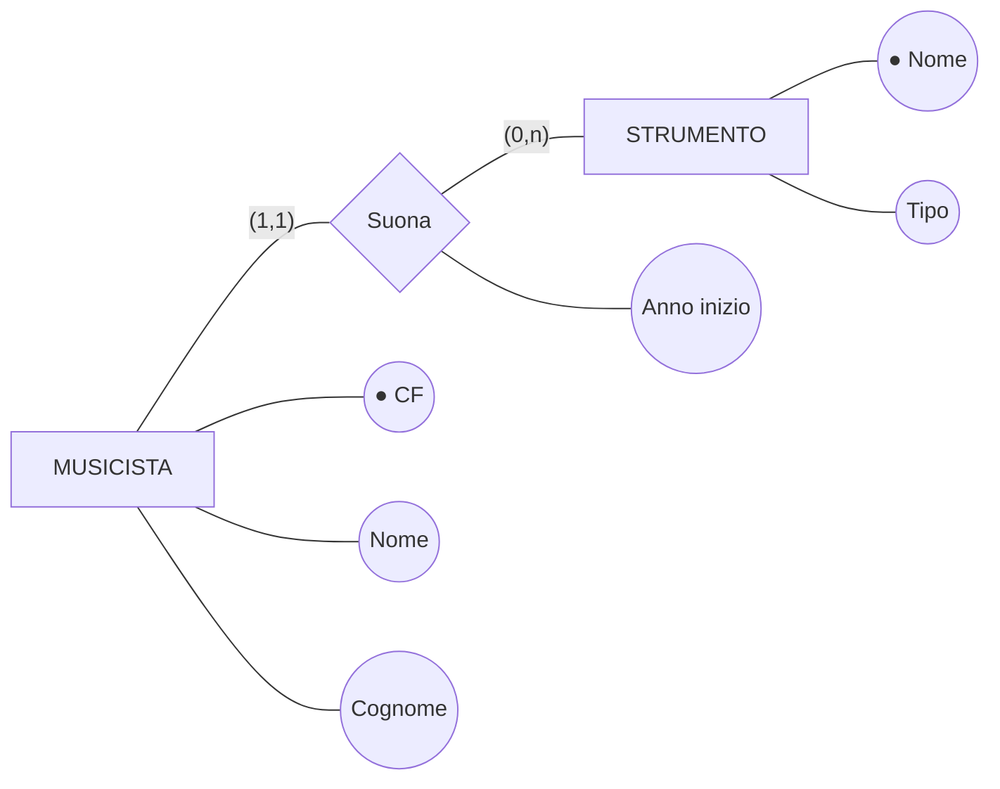

Ogni musicista suona **esattamente uno** strumento.

### Prima soluzione (non ottima): relazione separata per l'associazione

> [!abstract] Regola
> - Trasformare le **due entità** nei due sr corrispondenti (v. traduzione entità forte).
> - Aggiungere uno **sr corrispondente all'associazione** che ha come attributi le kp delle due entità partecipanti ed eventuali attributi dell'associazione.
> - La kp di questo nuovo schema è la **kp dell'entità che partecipa con cardinalità massima pari ad 1**.
> - Aggiungere **due vir** tra gli attributi del nuovo schema e quelli derivati dalle entità forti.

MUSICISTA(<u>CF</u>, Nome, Cognome) · STRUMENTO(<u>Nome</u>, Tipo) · SUONA(<u>Musicista</u>, Strumento, AnnoInizio)

**Istanza della trasformazione non ottima**:

| MUSICISTA | CF | Nome | Cognome |
|---|---|---|---|
| t1 | cf123 | Mario | Rossi |
| t2 | cf456 | Alberto | Bianchi |
| t3 | cf678 | Alessandro | Verdi |

| STRUMENTO | Nome | Tipo |
|---|---|---|
| t1 | Piano | corda |
| t2 | Sax | fiato |
| t3 | Violino | corda |
| t4 | Chitarra | corda |

| SUONA | Musicista | Strumento | Anno inizio |
|---|---|---|---|
| t1 | cf123 | Piano | 1980 |
| t2 | cf456 | Sax | 1977 |
| t3 | cf678 | Violino | 2003 |

SUONA ha esattamente una ennupla per ogni musicista: è una relazione in più (e un join in più nelle interrogazioni) senza alcun vantaggio.

### Soluzione ottima: associazione con partecipazione (1,1) accorpata nell'entità

> [!abstract] Regola — associazione con partecipazione (1,1)
> - Trasformare l'entità che partecipa con **cardinalità massima n** nello sr corrispondente (v. traduzione entità forte).
> - L'entità che partecipa con **card max 1** si trasforma allo stesso modo, ma ad essa vanno **aggiunti**:
>     - gli **attributi della kp dell'altro schema**;
>     - gli eventuali **attributi dell'associazione**.
> - La kp di quest'ultimo schema è la **kp dell'entità che partecipa con cardinalità massima pari ad 1**.
> - Aggiungere il **vir** sugli attributi aggiunti dall'altra entità.

MUSICISTA(<u>CF</u>, Nome, Cognome, Strumento, AnnoInizio) — vir: MUSICISTA.Strumento → STRUMENTO.Nome
STRUMENTO(<u>Nome</u>, Tipo)

**Istanza della trasformazione ottima**:

| MUSICISTA | CF | Nome | Cognome | Strumento | Anno inizio |
|---|---|---|---|---|---|
| t1 | cf123 | Mario | Rossi | Piano | 1980 |
| t2 | cf456 | Alberto | Bianchi | Sax | 1977 |
| t3 | cf678 | Alessandro | Verdi | Violino | 2003 |

| STRUMENTO | Nome | Tipo |
|---|---|---|
| t1 | Piano | corda |
| t2 | Sax | fiato |
| t3 | Violino | corda |
| t4 | Chitarra | corda |

## 7. Associazione con cardinalità massima 1 opzionale — (0,1)

Ogni musicista suona **al più** uno strumento. Le slides mostrano le due alternative.

**Alternativa A — accorpamento nell'entità** (con valori nulli per chi non partecipa):

| MUSICISTA | CF | Nome | Cognome | Strumento | Anno inizio |
|---|---|---|---|---|---|
| t1 | cf123 | Mario | Rossi | Piano | 1980 |
| t2 | cf456 | Alberto | Bianchi | NULL | NULL |
| t3 | cf678 | Alessandro | Verdi | Violino | 2003 |
| t3 | cf890 | Stefano | Neri | NULL | NULL |

| STRUMENTO | Nome | Tipo |
|---|---|---|
| t1 | Piano | corda |
| t2 | Sax | fiato |
| t3 | Violino | corda |
| t4 | Chitarra | corda |

**Alternativa B — relazione separata per l'associazione** (nessun valore nullo):

| MUSICISTA | CF | Nome | Cognome |
|---|---|---|---|
| t1 | cf123 | Mario | Rossi |
| t2 | cf456 | Alberto | Bianchi |
| t3 | cf678 | Alessandro | Verdi |
| t3 | cf890 | Stefano | Neri |

| STRUMENTO | Nome | Tipo |
|---|---|---|
| t1 | Piano | corda |
| t2 | Sax | fiato |
| t3 | Violino | corda |
| t4 | Chitarra | corda |

| SUONA | Musicista | Strumento | Anno inizio |
|---|---|---|---|
| t1 | cf123 | Piano | 1980 |
| t2 | cf678 | Violino | 2003 |

*(integrazione: la scelta dipende dalla percentuale di musicisti che partecipano all'associazione — se sono pochi, l'alternativa A introduce molti `NULL` e conviene B; se sono molti, A evita un join. Nelle slides l'ultima ennupla di MUSICISTA è etichettata "t3" anziché "t4": è un refuso.)*

## 8. Associazione con entrambe le entità con cardinalità massima 1

*(integrazione: le slides mostrano solo lo schema. Con associazione uno a uno, la kp di un'entità e gli attributi dell'associazione si possono aggiungere indifferentemente a uno qualsiasi dei due schemi, ad es. MUSICISTA(<u>CF</u>, Nome, Cognome, Strumento, AnnoInizio) con vincolo `unique` su Strumento e vir verso STRUMENTO; con partecipazione (1,1) da entrambe le parti è possibile anche fondere le due entità in un'unica relazione. Se una delle partecipazioni è (0,1), conviene aggiungere la chiave nello schema dell'entità con partecipazione obbligatoria, per evitare valori nulli.)*

---

## 9. Traduzione di un'associazione ricorsiva

> [!abstract] Regola
> - Trasformare l'entità forte nello sr corrispondente.
> - Aggiungere uno sr corrispondente all'associazione che ha come attributi la **kp dello schema**, che però deve essere **ripetuta due volte, con nomi diversi**, ed eventuali attributi dell'associazione.
> - La kp di questo nuovo schema sarà la **composizione delle due kp**.
> - Aggiungere **due vir** tra gli attributi della chiave composta e la kp.

### Senza ruoli

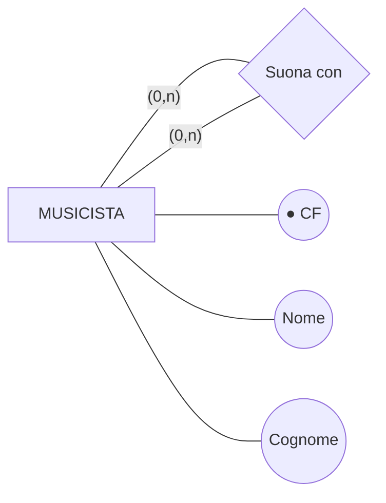

MUSICISTA(<u>CF</u>, Nome, Cognome) · SUONACON(<u>Musicista1</u>, <u>Musicista2</u>)

| MUSICISTA | CF | Nome | Cognome |
|---|---|---|---|
| t1 | cf123 | Mario | Rossi |
| t2 | cf456 | Alberto | Bianchi |
| t3 | cf678 | Alessandro | Verdi |
| t3 | cf890 | Stefano | Neri |

| SUONA CON | Musicista1 | Musicista2 |
|---|---|---|
| t1 | cf123 | cf678 |
| t2 | cf123 | cf456 |
| t3 | cf678 | cf123 |
| t4 | cf456 | cf123 |

> [!warning] Ennuple "simmetriche"
> Nelle slides le ennuple t1 = (cf123, cf678) e t3 = (cf678, cf123) sono cerchiate: se l'associazione è **simmetrica** ("suona con") rappresentano **lo stesso fatto**, memorizzato due volte (lo stesso vale per t2 e t4). Senza ruoli, i nomi Musicista1/Musicista2 non dicono nulla sul significato dell'ordine.

### Con ruoli

Se l'associazione **non è simmetrica**, i due rami hanno **ruoli** (vedi [[Modello Entity-Relationship#10. Associazioni ricorsive]]) e i nomi dei ruoli diventano i nomi dei due attributi:

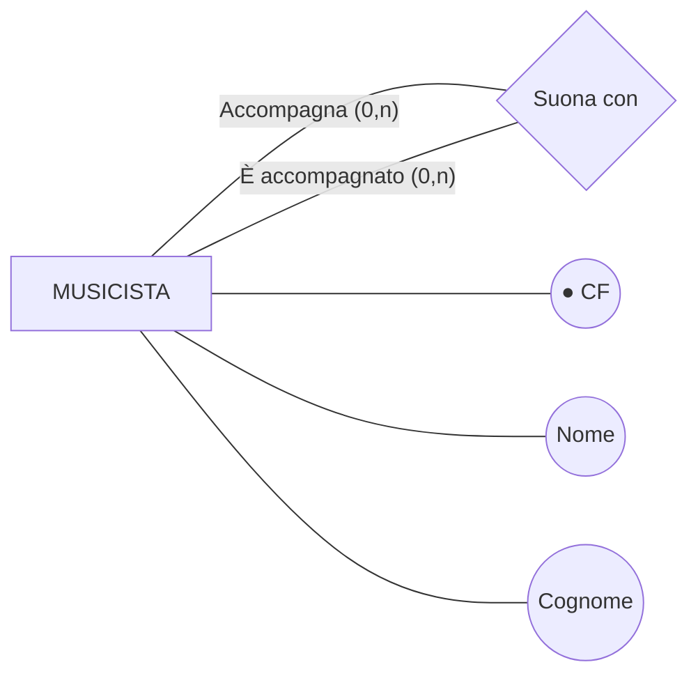

SUONACON(<u>ÈAccompagnato</u>, <u>Accompagna</u>) — vir: entrambi gli attributi → MUSICISTA.CF

| SUONA CON | È accompagnato | Accompagna |
|---|---|---|
| t1 | cf123 | cf678 |
| t2 | cf123 | cf456 |

(con la stessa tabella MUSICISTA di sopra)

## 10. Traduzione di un'associazione ternaria molti a molti

> [!abstract] Regola
> - Trasformare le **tre entità** nei tre sr corrispondenti (v. traduzione entità forte).
> - Aggiungere uno sr corrispondente all'associazione che ha come attributi le **kp delle tre entità** partecipanti ed eventuali attributi dell'associazione.
> - La kp di questo nuovo schema sarà la **composizione delle tre kp**.
> - Aggiungere **tre vir** tra gli attributi della chiave composta e le kp.

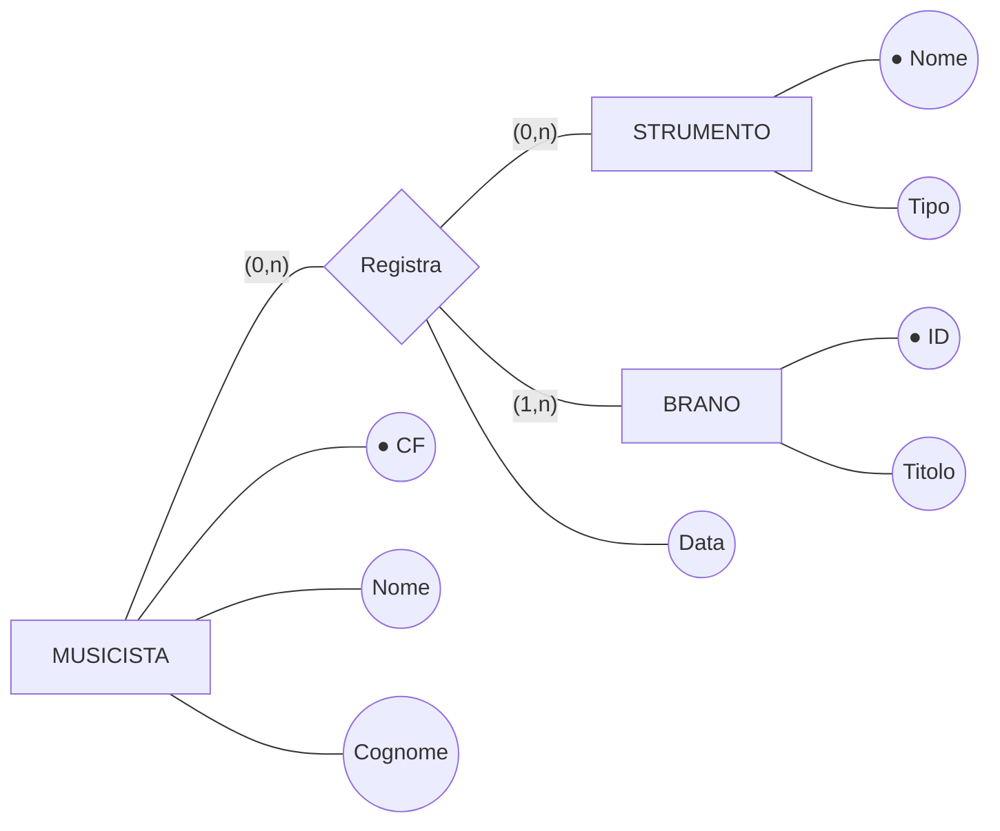

MUSICISTA(<u>CF</u>, Nome, Cognome) · STRUMENTO(<u>Nome</u>, Tipo) · BRANO(<u>ID</u>, Titolo)
REGISTRA(<u>Musicista</u>, <u>Strumento</u>, <u>Brano</u>, Data)

| MUSICISTA | CF | Nome | Cognome |
|---|---|---|---|
| t1 | cf123 | Mario | Rossi |
| t2 | cf456 | Alberto | Bianchi |
| t3 | cf678 | Alessandro | Verdi |

| STRUMENTO | Nome | Tipo |
|---|---|---|
| t1 | Piano | corda |
| t2 | Sax | fiato |
| t3 | Violino | corda |
| t4 | Chitarra | corda |

| REGISTRA | Musicista | Strumento | Brano | Data |
|---|---|---|---|---|
| t1 | cf123 | Piano | 1 | 2010 |
| t2 | cf123 | Violino | 1 | 2010 |
| t3 | cf456 | Sax | 2 | 1988 |
| t4 | cf123 | Violino | 3 | 2009 |

| BRANO | ID | Titolo |
|---|---|---|
| t1 | 1 | Le onde |
| t2 | 2 | Lontano |
| t3 | 3 | Ombre |

## 11. Traduzione di associazioni ternarie con cardinalità massima 1

> [!abstract] Regola
> - Trasformare le **due entità che partecipano con cardinalità massima n** nei due sr corrispondenti (v. traduzione entità forte).
> - Trasformare l'entità che partecipa con **cardinalità massima 1** in uno sr aggiungendo alla lista degli attributi le **kp degli altri due schemi** e gli eventuali **attributi dell'associazione**.
> - Aggiungere **due vir** tra gli attributi aggiunti a quest'ultimo schema e le kp dei due schemi corrispondenti.

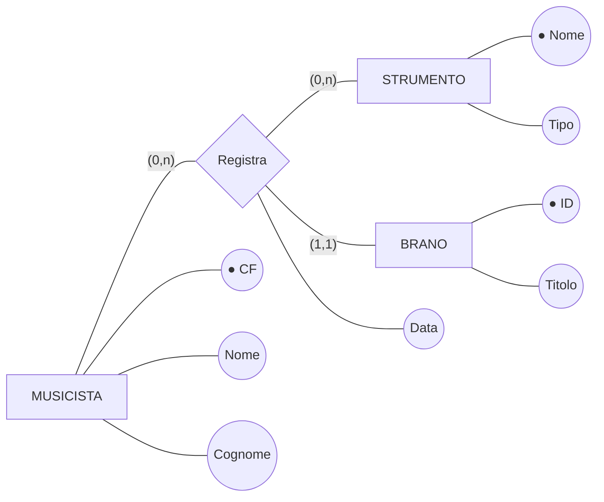

Ogni brano è registrato una sola volta, da un musicista con uno strumento:

MUSICISTA(<u>CF</u>, Nome, Cognome) · STRUMENTO(<u>Nome</u>, Tipo)
BRANO(<u>ID</u>, Titolo, Musicista, Strumento, Data) — vir: BRANO.Musicista → MUSICISTA.CF; BRANO.Strumento → STRUMENTO.Nome

| MUSICISTA | CF | Nome | Cognome |
|---|---|---|---|
| t1 | cf123 | Mario | Rossi |
| t2 | cf456 | Alberto | Bianchi |
| t3 | cf678 | Alessandro | Verdi |

| STRUMENTO | Nome | Tipo |
|---|---|---|
| t1 | Piano | corda |
| t2 | Sax | fiato |
| t3 | Violino | corda |
| t4 | Chitarra | corda |

| BRANO | ID | Titolo | Musicista | Strumento | Data |
|---|---|---|---|---|---|
| t1 | 1 | Le onde | cf123 | Piano | 2010 |
| t2 | 2 | Lontano | cf456 | Sax | 1998 |
| t3 | 3 | Ombre | cf123 | Violino | 2009 |

---

## 12. Traduzione di un'entità debole

> [!abstract] Regola
> - Trasformare l'**entità forte** nello sr corrispondente.
> - Trasformare l'**entità debole** aggiungendo alla lista degli attributi:
>     - gli **attributi della kp dello schema relativo all'entità forte**;
>     - gli eventuali **attributi dell'associazione**.
> - La kp di quest'ultimo schema è data dalla **composizione degli attributi che identificano l'entità debole** (che includono l'identificatore dell'entità forte).
> - Aggiungere il **vir** necessario.

Esempio (vedi [[Modello Entity-Relationship#12. Identificatore esterno — Entità debole]]): POSTO è identificato da `Fila`, `Numero` **e** dal TEATRO che lo contiene.

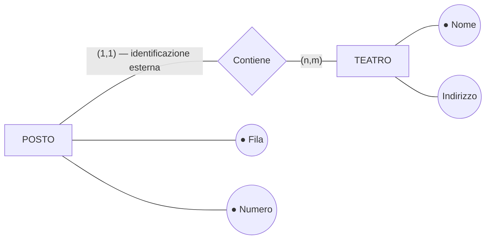

*(integrazione: traduzione secondo la regola)*
TEATRO(<u>Nome</u>, Indirizzo)
POSTO(<u>Fila</u>, <u>Numero</u>, <u>Teatro</u>) — vir: POSTO.Teatro → TEATRO.Nome

### Entità debole senza attributi identificativi

Un'entità debole può essere identificata **solo** tramite le associazioni con altre entità, senza attributi propri nell'identificatore:

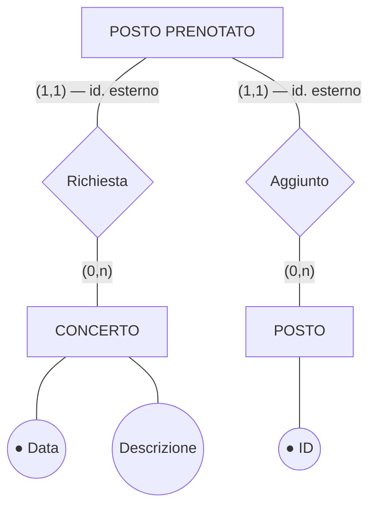

POSTO PRENOTATO è identificato dalla coppia (Concerto, Posto). *(integrazione: traduzione)* CONCERTO(<u>Data</u>, Descrizione) · POSTO(<u>ID</u>) · POSTOPRENOTATO(<u>Concerto</u>, <u>Posto</u>) — vir: POSTOPRENOTATO.Concerto → CONCERTO.Data; POSTOPRENOTATO.Posto → POSTO.ID.

### Entità deboli in cascata

Un'entità debole può essere identificata tramite entità a loro volta deboli:

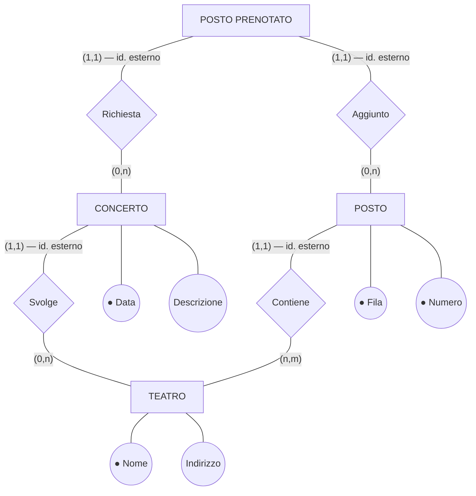

- CONCERTO è identificato da `Data` + TEATRO (tramite Svolge);
- POSTO è identificato da `Fila`, `Numero` + TEATRO (tramite Contiene);
- POSTO PRENOTATO è identificato da CONCERTO + POSTO.

*(integrazione: traducendo prima le entità forti e poi le deboli "dall'esterno verso l'interno", le chiavi si propagano in cascata)*

TEATRO(<u>Nome</u>, Indirizzo)
CONCERTO(<u>Data</u>, <u>Teatro</u>, Descrizione) — vir: Teatro → TEATRO.Nome
POSTO(<u>Fila</u>, <u>Numero</u>, <u>Teatro</u>) — vir: Teatro → TEATRO.Nome
POSTOPRENOTATO(<u>DataConcerto</u>, <u>TeatroConcerto</u>, <u>Fila</u>, <u>Numero</u>, <u>TeatroPosto</u>) — vir: (DataConcerto, TeatroConcerto) → CONCERTO; (Fila, Numero, TeatroPosto) → POSTO
*(integrazione: in genere si vorrà anche il vincolo TeatroConcerto = TeatroPosto — il posto prenotato deve essere nel teatro in cui si svolge il concerto — che non è esprimibile nello schema E-R.)*

---

## 13. Traduzione di uno schema E-R completo: ordine consigliato

> [!important] Ordine di traduzione
> 1. Trasformare le **entità forti** che partecipano con **cardinalità massima pari a n** a **tutte** le associazioni ad esse collegate.
> 2. Trasformare le **entità forti** che partecipano con cardinalità **(1,1)** ad almeno una delle associazioni ad esse collegate.
> 3. Trasformare le **entità forti** che partecipano con cardinalità **(0,1)** ad almeno una delle associazioni ad esse collegate.
> 4. Trasformare le **entità deboli**.
> 5. Trasformare **tutte le associazioni rimaste**.

*(integrazione: l'ordine garantisce che, quando si traduce uno schema che deve "ospitare" la chiave di un'altra entità — casi (1,1), (0,1) ed entità deboli — lo schema referenziato esista già.)*

## 14. Riepilogo delle regole

| Costrutto E-R | Relazioni prodotte | Chiave primaria | vir |
|---|---|---|---|
| Entità forte | una, con tutti gli attributi | identificatore dell'entità | — |
| Attributo multivalore | una in più: (attributo, kp entità) | composizione di tutti gli attributi (non sempre) | 1 verso l'entità |
| Associazione molti a molti | una in più: (kp entità + attributi dell'associazione) | composizione delle kp | 2 |
| Associazione con card max 1 (1,1) | nessuna: kp dell'altra entità + attributi aggiunti all'entità con card max 1 | kp dell'entità con card max 1 | 1 |
| Associazione con card max 1 (0,1) | accorpamento (con `NULL`) oppure relazione separata | kp dell'entità con card max 1 | 1 o 2 |
| Associazione ricorsiva | una in più: kp ripetuta due volte con nomi diversi (ruoli) | composizione delle due | 2 |
| Ternaria molti a molti | una in più con le tre kp | composizione delle tre kp | 3 |
| Ternaria con una card max 1 | nessuna: le altre due kp aggiunte all'entità con card max 1 | kp di quell'entità | 2 |
| Entità debole | una, con in più la kp dell'entità forte | attributi identificanti + kp entità forte | 1 |
