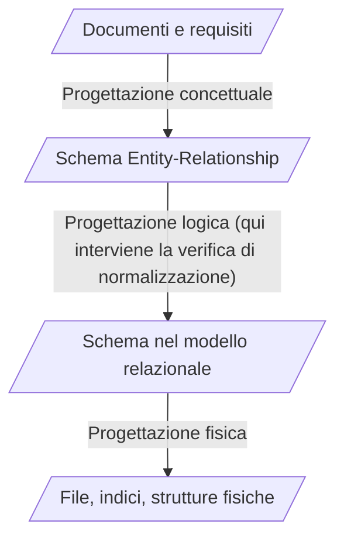
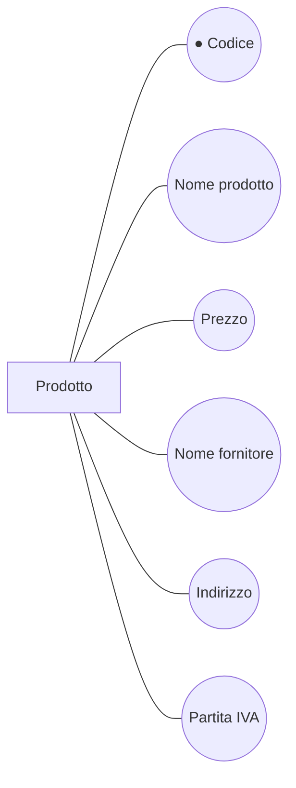
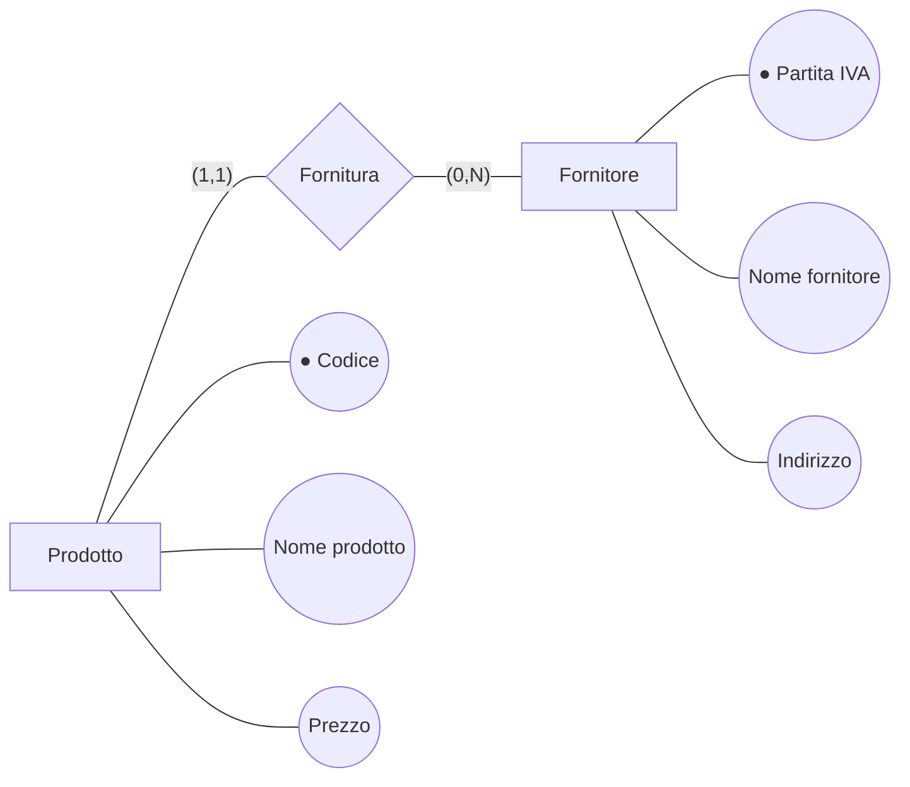
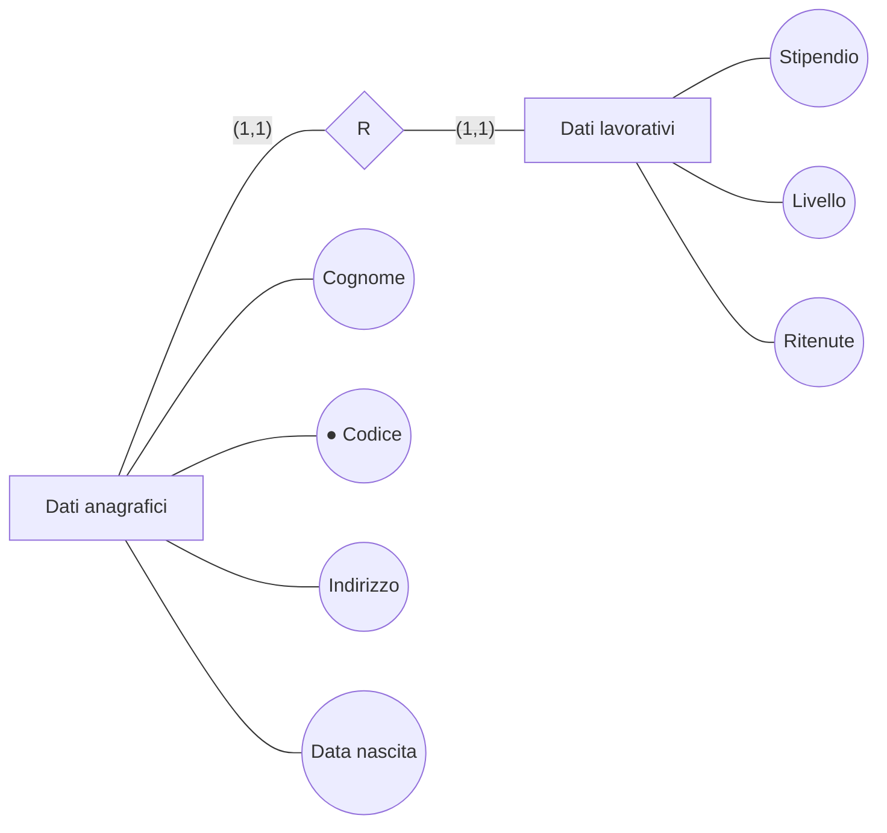
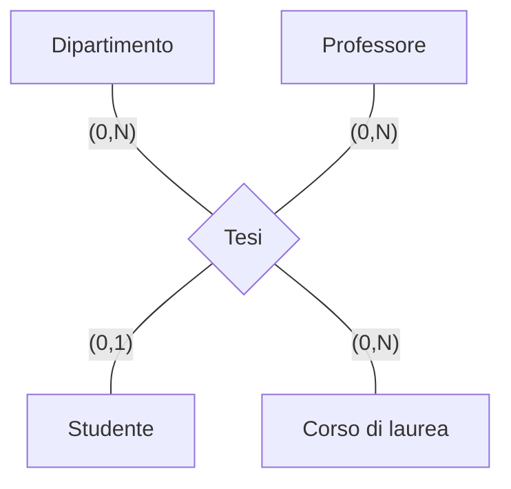
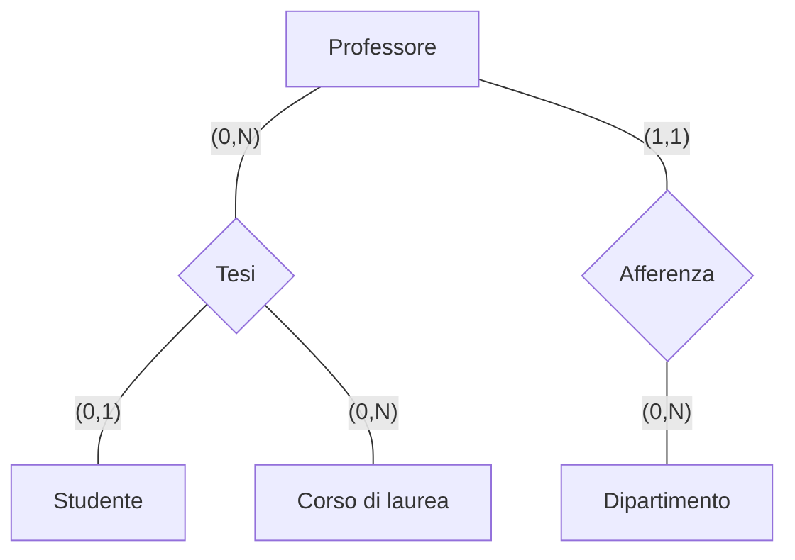
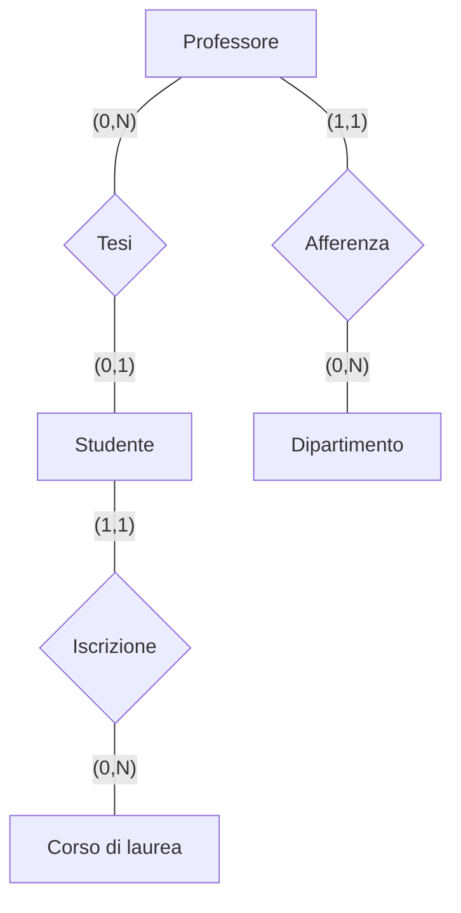

# La normalizzazione

> [!info] Fonte
> Slides *"La normalizzazione"* — Prof. Vittoria de Nitto Personè (a.a. 2026/27).
> Prerequisiti: [[Modello relazionale]] (chiavi e superchiavi) · [[Algebra relazionale]] (proiezione e join). Collegamenti: [[Progettazione logica - Traduzione nel modello relazionale]] · [[Progettazione logica - Ristrutturazione dello schema E-R]] · [[00 Indice|Indice]]

> [!note] Slides mancanti nel PDF
> Il PDF salta alcune slides (numerazione 7–11, 15–21, 23, 26–27, 41–42, 46, 48–67, 70, 75–76): in particolare la definizione formale di **dipendenza funzionale** non è presente; è riportata qui come *(integrazione)* in §3.

---

## 1. Forme normali e normalizzazione

> [!abstract] Forma normale
> Una **forma normale** è una proprietà di una base di dati relazionale che ne garantisce la **"qualità"**, cioè l'**assenza di determinati difetti**.

- Quando una relazione **non è normalizzata**:
	- presenta **ridondanze**;
	- si presta a **comportamenti poco desiderabili durante gli aggiornamenti**.
- Le forme normali sono di solito definite sul **modello relazionale**, ma hanno senso anche in altri contesti, ad esempio il **modello E-R**.

> [!abstract] Normalizzazione
> **Procedura** che permette di **trasformare schemi non normalizzati in schemi che soddisfano una forma normale**.

- La normalizzazione va utilizzata come **tecnica di verifica** dei risultati della progettazione di una base di dati.
- **Non costituisce una metodologia di progettazione.**

Collocazione: si applica al risultato della progettazione logica (lo schema relazionale ottenuto dall'E-R), prima della progettazione fisica.

---

## 2. Una relazione con anomalie

Relazione di esempio (chiave: <u>Impiegato</u>, <u>Progetto</u>):

| <u>Impiegato</u> | Stipendio | <u>Progetto</u> | Bilancio | Funzione |
|---|---|---|---|---|
| Rossi | 20 | Marte | 2 | tecnico |
| Verdi | 35 | Giove | 15 | progettista |
| Verdi | 35 | Venere | 15 | progettista |
| Neri | 55 | Venere | 15 | direttore |
| Neri | 55 | Giove | 15 | consulente |
| Neri | 55 | Marte | 2 | consulente |
| Mori | 48 | Marte | 2 | direttore |
| Mori | 48 | Venere | 15 | progettista |
| Bianchi | 48 | Venere | 15 | progettista |
| Bianchi | 48 | Giove | 15 | direttore |

Le slides evidenziano:
- **Ridondanza**: lo stipendio di un impiegato (es. 55 di Neri) è ripetuto in tutte le ennuple in cui compare; il bilancio di un progetto (2 per Marte, 15 per Venere/Giove) è ripetuto per ogni impiegato che vi partecipa.
- **Anomalia di aggiornamento**: se cambia lo stipendio di Neri, bisogna modificare **tutte** le ennuple di Neri (altrimenti la base di dati diventa inconsistente).
- **Anomalia di cancellazione**: se Neri lascia tutti i progetti (cancellando le sue ennuple Venere, Giove, Marte) si perdono anche i dati su Neri (il suo stipendio); analogamente, eliminando l'ultimo impiegato di un progetto si perde il bilancio del progetto.
- **Anomalia di inserimento**: non si può inserire un nuovo impiegato (es. **Lupi**) se non partecipa ad alcun progetto (Progetto fa parte della chiave e non può essere nullo); analogamente per un progetto senza impiegati.
- *etc.*

> [!important] Causa
> Si usa un'**unica relazione per rappresentare informazioni eterogenee** (impiegati, progetti, partecipazioni degli impiegati ai progetti).

---

## 3. Dipendenze funzionali

Proprietà dell'esempio:
- ogni impiegato ha **un solo stipendio** (anche se partecipa a più progetti);
- ogni progetto ha **un bilancio**;
- ogni impiegato in ciascun progetto ha **una sola funzione** (anche se può avere funzioni diverse in progetti diversi).

> [!abstract] Dipendenza funzionale *(integrazione — definizione non presente nel PDF)*
> Data una relazione $r$ su uno schema $R(X)$ e due sottoinsiemi non vuoti $Y, Z \subseteq X$, esiste in $r$ una **dipendenza funzionale (FD)** $Y \rightarrow Z$ se, per ogni coppia di ennuple $t_1, t_2$ di $r$ con gli stessi valori su $Y$, $t_1$ e $t_2$ hanno gli stessi valori anche su $Z$:
> $$\forall\, t_1, t_2 \in r:\ t_1[Y] = t_2[Y] \Rightarrow t_1[Z] = t_2[Z]$$
> Si dice che $Y$ **determina funzionalmente** $Z$. Le FD sono vincoli di integrità: si definiscono sullo schema e devono valere in ogni istanza corretta.

Le proprietà dell'esempio si esprimono con le FD:

$$\text{Impiegato} \rightarrow \text{Stipendio}$$
$$\text{Progetto} \rightarrow \text{Bilancio}$$
$$\text{Impiegato Progetto} \rightarrow \text{Funzione}$$

(in ciascuna, il lato sinistro è $Y$ e il lato destro è $Z$.)

### FD banali e non banali

Un inciso: altre FD, "particolari":
- $\text{Impiegato Progetto} \rightarrow \text{Progetto}$
- si tratta però di una FD **"banale"** (sempre soddisfatta).

> [!abstract] FD non banale
> - $Y \rightarrow A$ è **non banale** se $A$ **non appartiene** a $Y$.
> - $Y \rightarrow Z$ è **non banale** se **nessun attributo** in $Z$ appartiene a $Y$.

### Quali FD causano anomalie

- $\text{Impiegato} \rightarrow \text{Stipendio}$ e $\text{Progetto} \rightarrow \text{Bilancio}$ **causano anomalie**: il loro lato sinistro non è una chiave della relazione.
- $\text{Impiegato Progetto} \rightarrow \text{Funzione}$ è una **FD non banale che non causa anomalie**: il lato sinistro (Impiegato, Progetto) è la chiave.

*(integrazione: ogni chiave $K$ di $R(X)$ determina funzionalmente tutti gli attributi, $K \rightarrow X$; le FD "buone" sono quelle il cui lato sinistro contiene una chiave.)*

### Esempi di schemi con anomalie

**Esami**(Matricola, Nome, Provincia, AnnoNascita, Materia, Voto)
DF: $\{\ \text{Matricola} \rightarrow \text{Nome, Provincia, AnnoNascita};\ \ \text{Matricola, Materia} \rightarrow \text{Voto}\ \}$

**DotazioniLibri**(CodiceLibro, NomeNegozio, IndNegozio, Titolo, Quantità)
DF: $\{\ \text{CodiceLibro} \rightarrow \text{Titolo};\ \ \text{NomeNegozio} \rightarrow \text{IndNegozio};\ \ \text{CodiceLibro, NomeNegozio} \rightarrow \text{Quantità}\ \}$

---

## 4. Soluzione: decomposizione e forma normale di Boyce e Codd

**Soluzione**: **decomposizione** di schemi in schemi più piccoli, **equivalenti** e **di qualità** (forme normali): **1FN, 2FN, 3FN, FNBC**. Il corso si concentra sulla **forma normale di Boyce e Codd**.

> [!tip] Intuizione
> Se esiste in $R$ una dipendenza $Y \rightarrow Z$ **non banale** ed $Y$ **non è chiave**, allora $Y$ modella l'**identità di un'entità diversa** da quelle modellate dall'intera $R$.
> (Nell'esempio: Impiegato → Stipendio "descrive" l'entità impiegato, Progetto → Bilancio l'entità progetto.)

> [!abstract] Forma normale di Boyce e Codd (BCNF / FNBC)
> Uno schema $R(X)$ è in **forma normale di Boyce e Codd** se, per **ogni** dipendenza funzionale (non banale) $Y \rightarrow Z$ definita su di essa, **$Y$ è una superchiave di $R(X)$**.

- La forma normale richiede che i concetti in una relazione siano **omogenei** (solo proprietà direttamente associate alla chiave).

### Procedura intuitiva di normalizzazione

> [!warning] Validità limitata
> **Non valida in generale**, ma solo nei **"casi semplici"**.

- Per ogni dipendenza $Y \rightarrow Z$ che **viola la BCNF**, definire una **relazione su $YZ$** ed **eliminare $Z$** dalla relazione originaria.

Applicata all'esempio Impiegati/Progetti: si eliminano Stipendio e Bilancio dalla relazione originaria (nelle slides le colonne sono barrate) e si ottengono tre relazioni, una per ciascuna FD:

| <u>Impiegato</u> | Stipendio |
|---|---|
| Rossi | 20 |
| Verdi | 35 |
| Neri | 55 |
| Mori | 48 |
| Bianchi | 48 |

| <u>Progetto</u> | Bilancio |
|---|---|
| Marte | 2 |
| Giove | 15 |
| Venere | 15 |

| <u>Impiegato</u> | <u>Progetto</u> | Funzione |
|---|---|---|
| Rossi | Marte | tecnico |
| Verdi | Giove | progettista |
| Verdi | Venere | progettista |
| Neri | Venere | direttore |
| Neri | Giove | consulente |
| Neri | Marte | consulente |
| Mori | Marte | direttore |
| Mori | Venere | progettista |
| Bianchi | Venere | progettista |
| Bianchi | Giove | direttore |

*(integrazione: le tre tabelle risultanti sono ricavate dai dati dell'esempio; ciascuna è in BCNF perché in ognuna l'unica FD non banale ha come lato sinistro la chiave.)*

---

## 5. Non sempre così facile

| Impiegato | Progetto | Sede |
|---|---|---|
| Rossi | Marte | Roma |
| Verdi | Giove | Milano |
| Verdi | Venere | Milano |
| Neri | Saturno | Milano |
| Neri | Venere | Milano |

FD: $\text{Impiegato} \rightarrow \text{Sede}$, $\ \text{Progetto} \rightarrow \text{Sede}$ (ogni impiegato opera in una sede, ogni progetto si svolge in una sede).

### Decomponiamo sulla base delle dipendenze

Applicando la procedura intuitiva si elimina Sede e si creano le relazioni sulle due FD:

| Impiegato | Sede |
|---|---|
| Rossi | Roma |
| Verdi | Milano |
| Neri | Milano |

| Progetto | Sede |
|---|---|
| Marte | Roma |
| Giove | Milano |
| Saturno | Milano |
| Venere | Milano |

(Nelle slides sono evidenziate le due ennuple di Verdi, entrambe a Milano, e l'ennupla Saturno–Milano.)

### Proviamo a ricostruire

Il **join naturale** delle due proiezioni (sull'attributo comune Sede) dà:

| Impiegato | Progetto | Sede |
|---|---|---|
| Rossi | Marte | Roma |
| Verdi | Giove | Milano |
| Verdi | Venere | Milano |
| Neri | Saturno | Milano |
| Neri | Venere | Milano |
| **Verdi** | **Saturno** | **Milano** |
| **Neri** | **Giove** | **Milano** |

> [!warning] Diversa dalla relazione di partenza!
> Compaiono due **ennuple spurie** (Verdi–Saturno e Neri–Giove): la decomposizione ha **perso informazione** (non si sa più chi lavora a quale progetto).

### Due proprietà desiderabili di una decomposizione

1. **Decomposizione senza perdita** (conservazione dei dati, nozione **semantica**);
2. **Conservazione delle dipendenze**.

---

## 6. Decomposizione senza perdita

> [!abstract] Decomposizione senza perdita
> Uno schema $R(X)$ si **decompone senza perdita** su $X_1$ e $X_2$ se, per ogni istanza $r$, il **join delle proiezioni** su $X_1$ e $X_2$ è **uguale a $r$ stessa** (cioè non contiene ennuple spurie):
> $$\pi_{X_1}(r) \bowtie \pi_{X_2}(r) = r$$

> [!important] Condizione sufficiente
> La decomposizione senza perdita è **garantita** se gli **attributi comuni contengono una chiave per almeno una delle relazioni decomposte**.
> *(integrazione: formalmente, se $X_1 \cap X_2 \rightarrow X_1$ oppure $X_1 \cap X_2 \rightarrow X_2$.)*

Nell'esempio precedente: $X_1 = \{\text{Impiegato, Sede}\}$, $X_2 = \{\text{Progetto, Sede}\}$, $X_1 \cap X_2 = \{\text{Sede}\}$, che **non è chiave** né della prima né della seconda relazione → la decomposizione è con perdita.

### Proviamo a decomporre senza perdita

Si decompone su {Impiegato, Sede} e {Impiegato, Progetto}: l'attributo comune Impiegato è chiave della prima relazione ($\text{Impiegato} \rightarrow \text{Sede}$), quindi la decomposizione è **senza perdita**.

| Impiegato | Sede |
|---|---|
| Rossi | Roma |
| Verdi | Milano |
| Neri | Milano |

| Impiegato | Progetto |
|---|---|
| Rossi | Marte |
| Verdi | Giove |
| Verdi | Venere |
| Neri | Saturno |
| Neri | Venere |

FD: $\text{Impiegato} \rightarrow \text{Sede}$, $\ \text{Progetto} \rightarrow \text{Sede}$.

### Un altro problema

Supponiamo di voler inserire una nuova ennupla che specifica la **partecipazione dell'impiegato Neri, che opera a Milano, al progetto Marte**. Nella relazione Impiegato–Progetto si aggiunge (Neri, Marte), inserimento lecito per entrambe le relazioni decomposte:

| Impiegato | Progetto |
|---|---|
| Rossi | Marte |
| Verdi | Giove |
| Verdi | Venere |
| Neri | Saturno |
| Neri | Venere |
| **Neri** | **Marte** |

Ricostruendo con il join:

| Impiegato | Progetto | Sede |
|---|---|---|
| Rossi | **Marte** | **Roma** |
| Verdi | Giove | Milano |
| Verdi | Venere | Milano |
| Neri | Saturno | Milano |
| Neri | Venere | Milano |
| **Neri** | **Marte** | **Milano** |

> [!warning] Violazione di Progetto → Sede
> Il progetto Marte risulta ora sia a Roma sia a Milano: la FD $\text{Progetto} \rightarrow \text{Sede}$ è violata, ma **nessuna delle due relazioni decomposte può accorgersene**, perché nessuna contiene insieme Progetto e Sede.

## 7. Conservazione delle dipendenze

> [!abstract] Conservazione delle dipendenze
> Una decomposizione **conserva le dipendenze** se ciascuna delle dipendenze funzionali dello schema originario coinvolge attributi che compaiono **tutti insieme in uno degli schemi decomposti**.

- Nell'esempio precedente $\text{Progetto} \rightarrow \text{Sede}$ **non è conservata**.

*(integrazione: in questo esempio non esiste una decomposizione in BCNF che sia allo stesso tempo senza perdita e conservi entrambe le dipendenze; in casi simili si accetta una forma normale più debole, la 3FN, o si mantiene un vincolo esplicito.)*

### Esempio positivo: DotazioniLibri

Schema: <u>CodiceLibro</u>, <u>NomeNegoz</u>, IndNegozio, Titolo, Quantità

DF = $\{\ \text{CodiceLibro} \rightarrow \text{Titolo},\ \ \text{NomeNegozio} \rightarrow \text{IndNegozio},\ \ \text{CodiceLibro, NomeNegozio} \rightarrow \text{Quantità}\ \}$

Decomposizione:
- $R_1 = \{\underline{\text{CodiceLibro}}, \text{Titolo}\}$
- $R_2 = \{\underline{\text{NomeNegozio}}, \text{IndNegozio}\}$
- $R_3 = \{\underline{\text{CodiceLibro}}, \underline{\text{NomeNegozio}}, \text{Quantità}\}$

> [!tip] Risultato
> - **Conserva i dati!** (decomposizione senza perdita)
> - **Conserva le dipendenze!**

Istanza originale:

| <u>CodiceLibro</u> | <u>NomeNegoz</u> | IndNegozio | Titolo | Quantità |
|---|---|---|---|---|
| xyz4q | Il Seme | Via monte Zebio 3 | Un amore | 1 |
| xyz4q | Altroquando | Via del Governo Vecchio 82 | Un amore | 2 |
| tbg6h | Il Seme | Via monte Zebio 3 | Madame Bovary | 2 |
| wjk1v | Il Seme | Via monte Zebio 3 | Nutrire la vita | 2 |
| tbg6h | Altroquando | Via del Governo Vecchio 82 | Madame Bovary | 2 |
| wjk1v | Amore e Psiche | Via Santa Caterina da Siena 61 | Nutrire la vita | 3 |

Dopo la decomposizione (le slides riportano le proiezioni riga per riga, quindi con ripetizioni):

| <u>CodiceLibro</u> | Titolo |
|---|---|
| xyz4q | Un amore |
| xyz4q | Un amore |
| tbg6h | Madame Bovary |
| wjk1v | Nutrire la vita |
| tbg6h | Madame Bovary |
| wjk1v | Nutrire la vita |

| <u>NomeNegoz</u> | IndNegozio |
|---|---|
| Il Seme | Via monte Zebio 3 |
| Altroquando | Via del Governo Vecchio 82 |
| Il Seme | Via monte Zebio 3 |
| Il Seme | Via monte Zebio 3 |
| Altroquando | Via del Governo Vecchio 82 |
| Amore e Psiche | Via Santa Caterina da Siena 61 |

| <u>CodiceLibro</u> | <u>NomeNegoz</u> | Quantità |
|---|---|---|
| xyz4q | Il Seme | 1 |
| xyz4q | Altroquando | 2 |
| tbg6h | Il Seme | 2 |
| wjk1v | Il Seme | 2 |
| tbg6h | Altroquando | 2 |
| wjk1v | Amore e Psiche | 3 |

*(integrazione: essendo relazioni, le proiezioni non contengono duplicati — $R_1$ ha in realtà 3 ennuple (xyz4q, tbg6h, wjk1v) e $R_2$ 3 ennuple (Il Seme, Altroquando, Amore e Psiche): è proprio la ridondanza eliminata dalla decomposizione.)*

---

## 8. Progettazione e normalizzazione

- La normalizzazione va utilizzata come **tecnica di verifica** dei risultati della progettazione di una base di dati.
- **Non costituisce una metodologia di progettazione.**
- **Ma una buona metodologia di progettazione produce schemi già normalizzati!**

La teoria della normalizzazione può essere usata:
- nella **progettazione logica** per **verificare lo schema relazionale finale**;
- o per **verificare la qualità dello schema concettuale** durante la **ristrutturazione** (vedi [[Progettazione logica - Ristrutturazione dello schema E-R]]).

### Verifica di normalizzazione su entità

Entità Prodotto(`Codice`, `Nome prodotto`, `Prezzo`, `Nome fornitore`, `Indirizzo`, `Partita IVA`) con la FD:

$$\text{PartitaIVA} \rightarrow \text{NomeFornitore, Indirizzo}$$

> [!warning] L'entità viola la forma normale
> PartitaIVA non è identificatore di Prodotto, ma determina altri attributi: dentro Prodotto si "nasconde" un'altra entità (il fornitore).

Decomposizione: si separa l'entità **Fornitore**, collegata a Prodotto dall'associazione **Fornitura**:

### Una buona metodologia produce schemi già normalizzati

Entità Impiegato(`Codice`, `Cognome`, `Indirizzo`, `Data nascita`, `Livello`, `Stipendio`, `Ritenute`) con la FD:

$$\text{Stipendio} \rightarrow \text{Livello, Ritenute}$$

Il **partizionamento verticale di entità** (già visto in [[Progettazione logica - Ristrutturazione dello schema E-R#Partizionamento verticale di entità]]) separa dati anagrafici e dati lavorativi:

con la FD $\text{Stipendio} \rightarrow \text{Livello, Ritenute}$ che ora riguarda la sola entità Dati lavorativi.

### Verifica di normalizzazione su associazioni: l'esempio Tesi

Associazione quaternaria **Tesi** tra Professore (0,N), Dipartimento (0,N), Studente (0,1) e Corso di laurea (0,N):

**Studente è l'unica chiave dell'associazione Tesi.** Dipendenze:
- $\text{Studente} \rightarrow \text{Corso di laurea}$
- $\text{Studente} \rightarrow \text{Professore}$
- $\text{Professore} \rightarrow \text{Dipartimento}$ ← (evidenziata nelle slides: **viola la BCNF**, perché Professore non è chiave dell'associazione)

Decomposizione: il Dipartimento dipende dal Professore, quindi si separa con l'associazione **Afferenza**:

#### Ulteriore analisi sulla base delle dipendenze

La relationship **Tesi** (ternaria) è ora **in BCNF** sulla base delle dipendenze
- $\text{Studente} \rightarrow \text{CorsoDiLaurea}$
- $\text{Studente} \rightarrow \text{Professore}$

ma:
- le **due proprietà sono indipendenti**;
- questo **suggerisce una ulteriore decomposizione**: Tesi diventa binaria (Professore–Studente) e il corso di laurea dello studente si rappresenta con l'associazione **Iscrizione**.

*(integrazione: con Iscrizione (1,1) ogni studente è iscritto a un corso di laurea anche se non ha (ancora) una tesi, informazione che nello schema originario non era rappresentabile.)*
